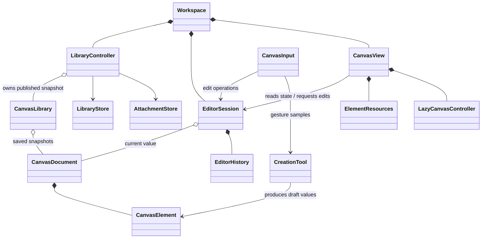

# Architecture

This document is Elseplane's architectural constitution: it defines target ownership and allowed dependencies for the rewrite. The document, geometry, library durability, editor session, rendering, and input boundaries are implemented; presentation consolidation remains a migration target. Follow the [refactor roadmap](REFACTOR_PLAN.md) to get there. The [interaction model](Interaction%20model.md) governs product behavior. Older notes do not override either document. Change the relevant document whenever an intentional design decision changes.

**Saved values describe the canvas. The editor owns changes. Views own rendering resources. Storage owns durability.**

## Structure and dependency direction

One Flutter application, organised by ownership. Create a file or folder when it has a responsibility; this tree does not require empty scaffolding.

```text
lib/
  main.dart                         # Initialise Flutter and start the app
  app/
    app.dart                        # Compose dependencies, theme, and root UI
    workspace.dart                  # Connect editor, library, settings lifetimes
    feature_flags.dart
  canvas/
    document/
      canvas_document.dart          # Immutable ordered document
      canvas_element.dart           # Sealed element values and saved enums
      document_codec.dart           # Encoding, decoding, boundary validation
    geometry/                       # Paths, bounds, hit tests, transforms
    editor/
      editor_session.dart           # Document writes and interaction state
      editor_history.dart           # Typed snapshots and operation grouping
      canvas_input.dart             # Pointer ownership and gesture transitions
      canvas_shortcuts.dart         # Focus-aware keyboard actions
      canvas_clipboard.dart         # Clipboard interpretation and edit workflow
      canvas_page.dart              # Compose canvas and controls
      canvas_view.dart              # Project document into infinite_lazy_grid
      element_resources.dart        # Resources retained by element identity
      tools/                        # Creation gestures and placement
      elements/                     # text/, code/, media/, shape/, pen/, arrow/
      widgets/                      # Shared canvas chrome and controls
      previews/                     # Canvas component previews
  library/
    canvas_library.dart             # File/folder values and hierarchy rules
    library_controller.dart         # Library operations and save queue
    library_store.dart              # Storage contract and implementation
    transfer/                       # Project/backup codecs and import staging
    widgets/                        # File picker and file tree
    previews/
  attachments/
    attachment_store.dart           # Byte-storage contract
    image_import.dart               # Validate images and create attachments
    attachment_store_web.dart       # Browser implementation
  settings/                         # Application preferences and settings UI
  theme/                            # Semantic theme, concrete styles, font resources
  ui/
    common/                         # App-wide Flutter primitives
    previews/                       # Previews of those primitives
test/                               # Mirror the owner of each behavior
```

| Owner | May depend on | Boundary |
| --- | --- | --- |
| `app` | All feature entry points | Constructs dependencies and connects lifetimes. |
| `document` | Value types and serialization support | No widgets, theme lookup, loading, storage, or browser APIs. |
| `geometry` | Document values and graphics/math primitives | Computes geometry without application state or I/O. |
| Editor logic | Document, geometry, narrow I/O contracts, Flutter input/notifier primitives | No widget construction or concrete storage implementations. |
| Editor presentation | Editor logic, Flutter, theme, shared UI, grid | Requests edits; never writes document fields. |
| `library` | Document and attachments | Never imports the editor; library widgets additionally use Flutter, theme, and shared UI. |
| `attachments` | Byte/image primitives and platform storage | Browser imports stay in the browser implementation. |
| `ui/common` | Flutter and theme | Never imports a feature. |
| `theme` | Flutter, font and highlighting dependencies | Never imports features or app composition. |

The document library keeps its sealed element values and private codec helpers in Dart parts alongside generated serialization. Geometry uses ordinary imports and has no widget, theme, storage, or browser dependencies. Published document collections are unmodifiable copies; unchanged immutable elements and stroke samples can be shared between snapshots.

`Offset`, `Size`, `Rect`, and `Color` are suitable value types. Saved enums belong to the document; background builders and syntax highlighting mappings belong to presentation. Font download availability does not determine document validity.

## Ownership and lifetime



Composition means lifetime ownership. Snapshot associations share immutable values and grant no mutation rights.

- **Document:** immutable elements, immutable collections, stable IDs, saved background, and back-to-front order. Keep one in-memory representation per concept; perform JSON and color-format conversion at boundaries. Validate external input and enforce invariants on edits.
- **EditorSession:** the sole writer of the open document. Own selected IDs, active ID, editing state, tool choice, drawing defaults, and history. Expose named operations such as move, resize, arrange, update content, and remove. Selection and activation are stored once. Geometry algorithms, gesture mechanics, rendering, and durability remain with their owners.
- **CanvasView:** owns the grid controller and element resources keyed by ID and type, outside lazily culled widgets. Controllers, focus nodes, scroll positions, image streams, and geometry caches are resources. Elements only get resource objects when they need them. Text and code scroll controllers retain offsets across detachment; culling does not retire resources. Menus, hover, and picker expansion stay local to presentation.
- **Restoration:** reconcile surviving IDs and types; update changed content without recreating unrelated controllers or restarting unchanged image loads. Removal invalidates pending work immediately; dispose resources after consumers detach. File switching and document replacement start a fresh editor lifetime.
- **LibraryController:** owns the immutable published library, pending document revisions, and one persistence queue. `LibraryStore` reads/writes snapshots without a second mutable library. Workspace passes editor snapshots to the library and flushes the outgoing file before replacing its editor. Workspace owns the open editor session and forwards its document-change notifications to the library. CanvasPage composes page chrome and dialogs; CanvasView retains the grid and element resources. Replacing a session creates fresh input, clipboard, and resource lifetimes while preserving the viewport.
- **Settings:** own application preferences independently of document history. Resolve defaults when creating elements; changing theme or surface style does not rewrite existing content.

## Operations and correctness

- **History:** retain 50 typed snapshots of document, tool choice, and touch-selection mode. JSON never participates in ordinary history capture or comparison. Explicit operation boundaries group drags, resizes, rotations, strokes, and option changes. Autosave timing is independent of history grouping.
- **Tool history and Auto remain:** tool-only undo does not save; a tool change cancels pending edits from the previous input context. Placement and its return to Select share an operation. Auto promotion belongs to the interaction that caused it; manual arrangement changes order and Auto settings together. No-ops preserve redo; new edits and explicit tool choices clear it. Focused editors retain local text undo.
- **Interaction state:** active owns controls, selected owns group operations, editing owns content input. Document restoration clears these states and cancels pending edits; tool-only restoration follows the interaction model. Rendering lift is temporary; saved order changes only through editor operations.
- **Input:** one owner arbitrates each pointer sequence. CanvasInput represents mutually exclusive gestures explicitly and supplies lifetime-bound element and control callbacks. CanvasShortcuts gives menus and focused editors priority; CanvasClipboard owns canvas clipboard interpretation and edit workflows. Creation tools produce values, never mount widgets or save documents. Two-finger takeover cancels drafts, ends already-applied edits as one operation, and blocks interrupted pointers until release. Menus and focused editors receive input before canvas commands.
- **Coordinates:** name spaces explicitly (`screenPosition`, `canvasPosition`, `localDelta`), convert at boundaries, and share transform calculations. The document is authoritative for persisted geometry and order; the grid owns measured layout and viewport state.
- **Async edits:** capture session and target lifetime tokens. Follow the [paste cancellation decision](adr/0001-cancel-unfinished-pastes.md): logical field changes, editing exit, tool changes, app dialogs, restoration, replacement, removal, and disposal invalidate affected edits. Browser focus loss, permission prompts, device selection, and ordinary edits within the same context do not. Navigation cancels unfinished work and flushes completed snapshots without waiting for clipboard reads or uploads. Image display loads track source identity separately. Canceled uploads attempt cleanup without modifying restored content.
- **Saving:** every queued write captures file identity, revision, and snapshot. Failed writes retain unsaved state; a late write cannot mark newer content saved. Structural library operations use the same queue. Failed loading must not silently overwrite unreadable saved data with an empty document.
- **Import/restore:** validate the complete candidate, confirm replacement, flush current edits, suspend conflicting writes, prepare every imported attachment at a fresh unused path, persist metadata, then publish state. Canvas import, library restore, and debug Demo creation share this staging path. Failure preserves existing live content; cleanup attempts only the new unpublished attachment paths. Successful replacement invalidates queued revisions from the outgoing document. Existing attachments remain available to saved documents and retained history.

## Extension and design rules

| Principle | Application |
| --- | --- |
| Single responsibility | One owner for each kind of state or policy and its lifecycle. |
| Open/closed | Extend actual variation points; explicit exhaustive dispatch is appropriate for the closed set of element types. |
| Substitutability | A shared contract promises only behavior every implementation supports. |
| Interface segregation | Supply the operations a consumer needs; represent optional capabilities explicitly. |
| Dependency inversion | Logic receives narrow I/O contracts; app composition selects implementations. |
| Reuse | Share rules whose consumers must change together. An abstraction must remove existing duplication, enforce an invariant, or isolate an external boundary. |
| Simplicity | Keep related small declarations together; remove obsolete paths, unused options, and speculative flexibility. |

- **Naming:** `TextElement` is saved data, `TextElementView` renders it, `TextEditorResources` retains Flutter resources, `PenTool` creates strokes, `EditorSession` owns one editing lifetime, `LibraryStore` persists, and `DocumentCodec` converts representations. Use descriptive `snake_case` filenames and one element vocabulary; avoid vague `manager`, `helpers`, and `utils` buckets.
- **Files:** use ordinary imports for independent components. Reserve `part` for generated code or a genuinely inseparable Dart library. Sealed variants can share one file. Keep feature widgets with their feature; put shared canvas widgets in `canvas/editor/widgets/` and app-wide primitives in `ui/common/`.
- **UI:** consume semantic `BTheme` values internally. Theme owns palettes, typography, syntax styles, and reusable geometry; components own their layout details. Equal numbers do not necessarily share meaning. Reusable UI needs production consumers and annotated previews; expose visual options only for concrete requirements. Use `scroll_animator` 0.3.0 with `ChromiumEaseInOut` for smooth pointer scrolling.
- **Dependencies:** keep spatial rendering, culling, navigation mechanics, and generic overlap calculations in the owned grid library. Expose non-mutating arrangement calculation there; commit its result through editor operations. Use the Markdown fork's styling API first; improve that fork when rendering mechanics require it. Isolate platform implementations and reuse installed dependencies.
- **Verification:** test behavior and failure boundaries, not token values. Mirror ownership in tests, check import boundaries, and verify web only at this stage. Keep the interaction model current; implementation shortcuts never silently redefine it.
