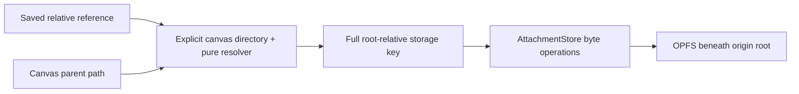

# Address attachments by full root-relative paths

Status: accepted (storage foundation only)

Date: 2026-11-10

Related accepted specification: [root-relative attachment paths](../specs/attachment-paths.md).
The [folder snapshot specification](../specs/folder-snapshots.md),
[design](../arch/folder-snapshots-design.md), and
[ADR 0005](0005-folder-based-snapshot-transfers.md) are also proposals, not
accepted contracts.

## Context

Before this decision, the [`AttachmentStore`](../../lib/attachments/attachment_store.dart)
accepted path strings, but the [web implementation](../../lib/attachments/attachment_store_web.dart)
accepted only root-level keys and used `attachmentFileName` to access the UUID
filename beneath one root `attachments` directory. Nested keys were rejected,
not silently flattened. Document references are relative to each canvas, so
different canvas folders can contain the same valid attachment path while a
flat store gives them one byte identity. The proposed folder snapshot tree
preserves canvas parent paths and sibling `attachments` folders. Its current
fresh-filename recommendation avoids some local collisions by changing image
names, but that conflicts with retaining literal image paths and does not
establish a path-aware storage foundation.

The accepted [document and media ADR 0002](0002-separate-documents-and-media.md)
keeps image bytes separate and references relative to the canvas. The accepted
[persistence contract](../arch/persistence.md) and
[asynchronous edit ADR 0001](0001-cancel-unfinished-pastes.md) require failure-
safe staging and cleanup limited to new, unpublished paths. Neither is changed
by this ADR.

## Decision

`AttachmentStore` uses the complete library-root-relative attachment key as its
byte identity, preserving its current `write`, `read`, `readIfExists`, and
`delete` operations. A root canvas keeps `attachments/<uuid>.<ext>`; a canvas in
`School` may resolve its saved relative reference to
`School/attachments/<uuid>.<ext>`. Equal leaf filenames in different folders
are distinct keys, and writes never substitute a new filename.

The store validates the complete path and traverses it beneath the OPFS origin
root. It remains a byte-only owner: it does not infer the current canvas,
import library or editor models, or rewrite saved JSON. A higher layer supplies
the containing-directory context explicitly when it adopts nested addressing
and uses the resulting full key consistently for reads, writes, and cleanup.
Existing callers continue using root-level keys, including callers for canvases
in nested explorer folders; this acceptance does not adopt directory context in
those callers.

Keep recognition of a canvas-relative `attachments/<uuid>.<ext>` reference
separate from validation of a full storage key. Preserve the existing UUID
version, extension set, image validation, and 10 MiB limit. Enforce the limit
before storage writes and before buffering storage reads, with an actual-length
check after the read. The store does not decode images.

Reject unsafe path structure before any I/O. In the browser, create required
parent directories only for writes; reads and deletes do not create them.
Missing `read` fails, `readIfExists` returns `null` only for genuine absence,
and `delete` removes only an exact leaf and tolerates absence. Write success
requires close; failure propagates after a best-effort writer abort. These are
per-operation rules, not a transaction or crash-atomicity promise.

The full specification is in
[attachment paths](../specs/attachment-paths.md). This ADR deliberately leaves
caller adoption and same-key import publication to their existing owners and
separate decisions.

## Alternatives

- Keep one flat global attachment directory and rename imported images: rejected
  because distinct canvas-relative paths can identify different files, and
  generated names discard the supplied leaf filename.
- Flatten or discard the canvas-directory prefix: rejected because it recreates
  collisions and loses the root-relative identity.
- Put full library paths into portable document JSON: rejected because saved
  image references remain relative to their canvas and portable documents must
  not depend on the local library root.
- Add transactions, generations, filename mappings, or a generic provider
  framework: rejected because path identity support does not require a storage
  redesign and these mechanisms would not be justified by this decision.

## Consequences

This acceptance establishes the byte-store addressing contract only. It does
not change the separation of document JSON and media bytes, canvas-relative
document references, file formats, image validation, or current import staging
and failure guarantees. Existing callers continue to use root-level keys,
including for canvases in nested explorer folders. Adopting nested keys in a
caller requires that owner to supply and capture the canvas-directory context.

Full paths solve namespace collisions while preserving literal filenames. They
do not make overwriting an already-published same-path attachment safe during a
multi-canvas restore. The folder-snapshot fresh-filename recommendation remains
a proposal; nested storage support alone does not establish a safe same-key
publication protocol. This ADR does not select a replacement import algorithm:
current staged fresh-path import and cleanup rules remain authoritative until
the snapshot proposals and import behavior are separately aligned and accepted.

Nested-key byte operations require no file moves, library-document rewrites,
OPFS clearing, or import changes. No compatibility layer or data reset is part
of this decision.

## Supersedes or superseded by

This ADR does not supersede an accepted document. It establishes storage-key
addressing; caller adoption and import-publication behavior remain follow-up
decisions for their respective owners.
