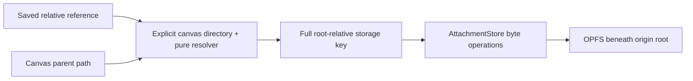

# Address attachments by full root-relative paths

Status: accepted (storage foundation only)

Date: 2026-11-10

Related accepted specification: [root-relative attachment paths](../specs/attachment-paths.md).
The accepted [folder-based canvas transfer specification](../specs/folder-based-canvas-transfers.md),
[design](../arch/folder-based-canvas-transfers-design.md), and
[ADR 0005](0005-folder-based-canvas-transfers.md) define transfer behavior and
caller adoption. Caller adoption is implemented; this ADR remains limited to
the byte-store foundation.

## Context

Before this decision, the [`AttachmentStore`](../../lib/attachments/attachment_store.dart)
accepted path strings, but the [web implementation](../../lib/attachments/attachment_store_web.dart)
accepted only root-level keys and used `attachmentFileName` to access the UUID
filename beneath one root `attachments` directory. Nested keys were rejected,
not silently flattened. Document references are relative to each canvas, so
different canvas folders can contain the same valid attachment path while a
flat store gives them one byte identity. The accepted folder transfer tree
preserves canvas parent paths and sibling `attachments` folders. Its import
algorithm is outside the scope of this storage decision.

The accepted [document and media ADR 0002](0002-separate-documents-and-media.md)
keeps image bytes separate and references relative to the canvas. The persistence
contract governs durable publication, and [asynchronous edit ADR 0001](0001-cancel-unfinished-pastes.md)
continues to govern pending edits. ADR 0005 supersedes the former transfer-specific
staging workflow without changing that asynchronous edit policy.

## Decision

`AttachmentStore` uses the complete library-root-relative attachment key as its
byte identity, preserving its current `write`, `read`, `readIfExists`, and
`delete` operations. A root canvas keeps `attachments/<uuid>.<ext>`; a canvas in
`School` may resolve its saved relative reference to
`School/attachments/<uuid>.<ext>`. Equal leaf filenames in different folders
are distinct keys, and writes never substitute a new filename.

The store validates the complete path and traverses it beneath the OPFS origin
root. It remains a byte-only owner: it does not infer the current canvas,
import library or editor models, or rewrite saved JSON. Higher layers supply
the containing-directory context explicitly and use the resulting full key
consistently for reads, writes, and cleanup. Parent-aware caller adoption is
defined by ADR 0005, not by this storage decision.

Keep recognition of a canvas-relative `attachments/<uuid>.<ext>` reference
separate from validation of a full storage key. Preserve the existing UUID
version, extension set, image validation, and 10 MiB limit. Enforce the limit
before storage writes and before buffering storage reads, with an actual-length
check after the read. The store does not decode images.

Reject unsafe path structure before any I/O. In the browser, create required
parent directories only for writes; reads and deletes do not create them.
Missing `read` fails, `readIfExists` returns `null` only for genuine absence,
and `delete` removes only an exact leaf and tolerates absence. Write success
requires close; failure propagates after a best-effort writer abort. These are
per-operation rules, not a transaction or crash-atomicity promise.

The full storage specification is in
[attachment paths](../specs/attachment-paths.md). ADR 0005 separately accepts
parent-aware caller behavior and same-key import publication; this ADR remains
limited to the byte-store contract.

## Alternatives

- Keep one flat global attachment directory and rename imported images: rejected
  because distinct canvas-relative paths can identify different files, and
  generated names discard the supplied leaf filename.
- Flatten or discard the canvas-directory prefix: rejected because it recreates
  collisions and loses the root-relative identity.
- Put full library paths into portable document JSON: rejected because saved
  image references remain relative to their canvas and portable documents must
  not depend on the local library root.
- Add transactions, generations, filename mappings, or a generic provider
  framework: rejected because path identity support does not require a storage
  redesign and these mechanisms would not be justified by this decision.

## Consequences

This acceptance establishes the byte-store addressing contract only. It does
not change the separation of document JSON and media bytes, canvas-relative
document references, or image validation. ADR 0005 later accepted nested-key
caller adoption and the import failure policy. At pre-implementation baseline
`1c4839a`, source callers still used root-level keys, including for canvases in
nested explorer folders. Caller adoption is now implemented; each owner supplies
and captures canvas-directory context as specified by ADR 0005.

Full paths solve namespace collisions while preserving literal filenames; they
do not provide multi-file transactions. ADR 0005 accepts best-effort import
writes at exact full paths, with partial byte effects possible on failure. At
the time ADR 0006 was accepted, import publication remained a separate decision;
this storage ADR does not itself define that policy.

Nested-key byte operations require no file moves, library-document rewrites,
OPFS clearing, or import changes. No compatibility layer or data reset is part
of this decision.

## Supersedes or superseded by

This ADR does not supersede an accepted document. ADR 0005 later accepts the
transfer behavior that adopts these keys in callers. The byte-store addressing
contract remains unchanged. Parent-aware caller implementation is covered by
ADR 0005 and is now present; this ADR remains storage-only history.
