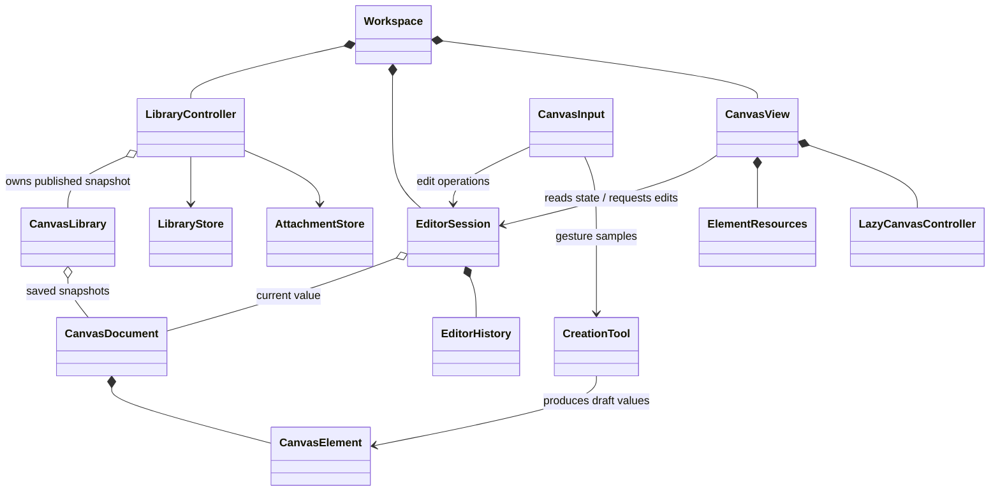

# Editor lifecycles

## Ownership and lifetime

Composition means lifetime ownership. Snapshot associations share immutable
values and grant no mutation rights.

## Editor and view owners

- **EditorSession:** sole writer of the open document. Own selected IDs, active
  ID, editing state, tool choice, drawing defaults, and history. Expose named
  operations such as move, resize, arrange, update content, and remove.
  Selection and activation are stored once. Geometry algorithms, gesture
  mechanics, rendering, and durability remain with their owners.
- **Document:** immutable elements and collections, stable IDs, saved
  background, and back-to-front order. Persisted changes go through editor
  operations.
- **CanvasView:** owns the grid controller and element resources keyed by ID and
  type, outside lazily culled widgets. Controllers, focus nodes, scroll
  positions, image streams, and geometry caches are resources. Elements receive
  resource objects only when needed. Text and code scroll controllers retain
  offsets across detachment; culling does not retire resources. Inline Markdown
  images load lazily and retain source-keyed reads and image streams with text
  resources; preview widgets only render those resources. Media loads exact
  local attachment references or external HTTPS image sources resolved at use
  time; raw saved strings remain unchanged. Unsupported or unusable external
  sources remain unresolved and are never requested or opened. Provider metadata
  and thumbnail requests start when visible and retain
  source-keyed runtime results across culling. Source changes, removal, and
  document replacement invalidate them; stale completions are ignored. Menus,
  hover, and picker expansion stay local to presentation.
- **CanvasPage:** composes page chrome and dialogs. CanvasView retains the grid
  and element resources. Replacing a session creates fresh input, clipboard,
  and resource lifetimes while preserving the viewport.
- **Creation tools:** produce element values or raw pen samples; they do not
  mount widgets or save documents. EditorSession commits document changes.

## Restoration and history

- Reconcile surviving IDs and types; update changed content without recreating
  unrelated controllers or restarting unchanged image loads. Removal
  invalidates pending work immediately; dispose resources after consumers
  detach. File switching and document replacement start a fresh editor
  lifetime.
- Retain 50 typed snapshots of document and tool choice. JSON does not
  participate in ordinary history capture or comparison. Explicit operation
  boundaries group drags, resizes, rotations, strokes, and option changes.
  Autosave timing is independent of history grouping.
- Tool-only undo does not save; a tool change cancels pending edits from the
  previous input context. Placement and its return to Select share an
  operation. Auto promotion belongs to the interaction that caused it; manual
  arrangement changes order and Auto settings together. No-ops preserve redo;
  new edits and explicit tool choices clear it. Focused editors retain local
  text undo.
- Active owns controls, selected owns group operations, and editing owns
  content input. Document restoration clears these states and cancels pending
  edits; tool-only restoration follows the [interaction model](../specs/interaction-model.md).
  Rendering lift is temporary; saved order changes only through editor
  operations.

## Input, coordinates, and asynchronous edits

- CanvasInput owns pointer arbitration and explicit gesture transitions;
  CanvasShortcuts gives menus and focused editors priority; CanvasClipboard
  owns canvas clipboard interpretation and edit workflows. Input supplies
  lifetime-bound element and control callbacks. Cancellation, tool changes,
  dialogs, restoration, replacement, and disposal cancel affected work, and
  held interrupted pointers cannot restart it.
- Direct Arrange captures the pre-pointer selection when the active object
  belongs to it. CanvasView owns the menu and grid queries; EditorSession
  commits group order and Auto changes together.
- The grid owns ordinary touch navigation through Flutter's gesture
  recognizer. It has no takeover or touch-ownership callback contract. Finger
  input must not independently start Plane's custom canvas edits while the
  grid handles touch navigation. Ordinary touch on native controls and editors
  remains best effort. Supported input behavior is defined in the
  [interaction model](../specs/interaction-model.md).
- Name coordinate spaces explicitly (`screenPosition`, `canvasPosition`,
  `localDelta`), convert at boundaries, and share transform calculations. The
  document is authoritative for persisted geometry and order; the grid owns
  measured layout and viewport state.
- Async edits capture session and target lifetime tokens and follow the
  [paste cancellation decision](../adr/0001-cancel-unfinished-pastes.md).
  Logical field changes, editing exit, tool changes, app dialogs, restoration,
  replacement, removal, and disposal invalidate affected edits. Media metadata
  and thumbnail completions also check source and document lifetime. Browser focus
  loss, permission prompts, device selection, and ordinary edits in the same
  context do not. Navigation cancels unfinished work and flushes completed
  snapshots without waiting for clipboard reads or uploads. Image display loads
  track source identity separately. Canceled uploads attempt cleanup without
  modifying restored content.

## Code wrapping constraint

Code blocks keep wrapping fixed off and scroll long lines horizontally.
`re_editor` 0.10.0 changes wrapped-line scroll position after a lazily culled
editor remounts, even when its scroll controller retains its offset; its public
API has no scroll snapshot/restore contract. Do not enable wrapping until that
restoration defect is fixed. The dependency remains unchanged.
