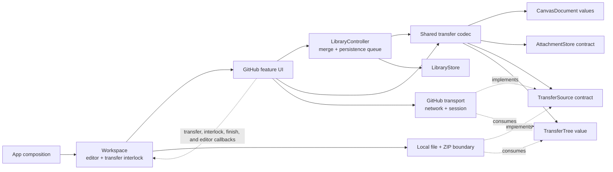
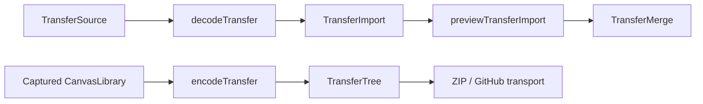

# Folder-based canvas transfer design

Status: accepted design; parent-aware caller adoption is implemented; final
integration and verification remain open.
Pre-implementation baseline: `1c4839a` (2026-11-11).

This design accompanies the accepted
[folder-based canvas transfer specification](../specs/folder-based-canvas-transfers.md) and
[ADR 0005](../adr/0005-folder-based-canvas-transfers.md). The accepted
[ownership](ownership.md), [persistence](persistence.md), [UI](ui.md), and
[interaction model](../specs/interaction-model.md) are aligned with this target.
Source-caller behavior below is historical evidence from the recorded baseline;
the active [plan](../plans/folder-based-canvas-transfers.md) tracks remaining
integration and verification.

## Pre-implementation evidence

| Area | Source behavior at baseline `1c4839a` | Evidence |
| --- | --- | --- |
| Canvas project | `document.json` plus root `attachments/...` in a single-canvas ZIP; export and import call `validateCanvasAttachment`, and import requires every referenced attachment. | Historical path: `lib/library/transfer/canvas_project.dart`; [`canvas_project_files.dart`](../../lib/library/transfer/canvas_project_files.dart) |
| Library archive | Wrapper JSON at `library/<encoded name>.json`, root-level attachments, and whole-library replacement on restore. | Historical path: `lib/library/transfer/canvas_library_archive.dart` |
| GitHub canvas | A separate `.canvas` document codec, stricter complete-attachment validation, and one-canvas import/commit workflow. | Historical path: `lib/library/transfer/canvas_remote_transfer.dart`; [`github_api.dart`](../../lib/github/github_api.dart), `github_workspace_panel.dart` at the recorded revision |
| GitHub tracking | Per-canvas confirmed baseline, attachment-name mapping, and pending-write guard live in library metadata. | [`github_metadata.dart`](../../lib/library/github_metadata.dart), [`canvas_library.dart`](../../lib/library/canvas_library.dart) |
| Attachment storage | ADR 0006 implements full root-relative keys, `resolveAttachmentPath`, and path validation. At this baseline, rendering, editing, transfer, and `_stage` callers still use root-level keys, including nested explorer canvases. | [`attachment_store.dart`](../../lib/attachments/attachment_store.dart), [ADR 0006](../adr/0006-path-aware-attachment-store.md), [accepted attachment path specification](../specs/attachment-paths.md) |
| Library staging and save | `LibraryController._stage` reserves fresh root-level UUID keys, writes them, persists metadata, and attempts to delete its attempted keys on failure. `LibraryStore.save` promises the prior whole-library snapshot remains on save failure. | [`library_controller.dart`](../../lib/library/library_controller.dart), [`library_store.dart`](../../lib/library/library_store.dart) |
| Library hierarchy changes | `rename` and `move` run through the controller queue and persist hierarchy metadata; neither copies image bytes. `CanvasLibrary.move` rejects cycles and exact sibling-name conflicts. | [`library_controller.dart`](../../lib/library/library_controller.dart), [`canvas_library.dart`](../../lib/library/canvas_library.dart) |
| Internal clipboard | `CanvasClipboard` version 3 encodes `format`, `version`, and `elements`; its decoder rejects unknown keys. The baseline payload has no source-directory context, and editor image paste writes a root-level key. | [`canvas_clipboard.dart`](../../lib/canvas/editor/canvas_clipboard.dart) |

These rows snapshot source behavior at pre-implementation baseline `1c4839a`,
not the accepted target or current implementation. Parent-aware caller adoption
and shared transfer integration are implemented. Current transfer sources
include the [shared codec](../../lib/library/transfer/canvas_transfer.dart),
[ZIP adapter](../../lib/library/transfer/canvas_transfer_zip.dart), and
[attachment discovery](../../lib/canvas/document/attachment_references.dart).

## Ownership and dependencies

Place the shared codec and its transfer types under
`lib/library/transfer/`. It owns path validation, tree discovery, document
decoding, image path and byte-size checks, archive integrity checks, and
conversion between captured library values and portable paths. It does not
decode image content. Its I/O dependencies are the `TransferSource` contract,
document values, and the `AttachmentStore` contract; it does not import concrete
ZIP, browser, or GitHub adapters or own networking. Concrete inputs implement
`TransferSource`, and transports consume the source and `TransferTree` value
contracts. The document layer gains no storage, editor, network, or browser
imports. The library does not import GitHub networking.

App composition in `Workspace` connects the GitHub feature and the local file
boundary. `Workspace` owns the editor lifetime and transfer interlock. The
feature calls Workspace through transfer-start/end, interaction-finishing, and
editor-replacement callbacks; it does not import the app or `Workspace`.
`LibraryController` remains the sole owner of published library state, pending
revisions, local attachment writes, and the one metadata persistence queue. It
uses the shared codec contracts for import and export. There is no second mutable
library, provider registry, or framework.

For hierarchy changes, `LibraryController` also owns copy planning,
the existing queue, and metadata publication. `CanvasClipboard` owns its local
payload context and element insertion; it does not import the library. Share
only byte-copy policy in a small helper in
`lib/attachments/attachment_store.dart` beside `AttachmentStore`, with explicit
full-key pairs and no document, library, editor, browser, or registry imports.
For example, an illustrative interface is:

```dart
Future<List<String>> copyAttachmentPaths(
  AttachmentStore store,
  Map<String, String> sourceToDestination,
);
```

The helper validates keys and sizes, reads and compares bytes, copies only when
the destination is absent, reuses equal bytes, and reports a differing
destination or I/O failure with its path through the existing operational
failure style. The list contains confirmed newly written destination paths.
This is not a transaction or rollback API. Keep attachment discovery with its
caller: library transfer code finds references for hierarchy changes, and the
clipboard handles references in its decoded elements. If a later implementation
needs to share pure discovery logic, place it below library ownership without
adding a new layer or dependency.



Solid arrows show imports or composition. Dashed arrows show an implementation
or use of a shared value contract, or a callback; the feature has no import edge
to `Workspace`. The local boundary uses the existing single-file picker and ZIP
adapter. ZIP and GitHub are the two tree transports; GitHub networking stays in
the GitHub feature boundary.

## Transfer types and codec boundary

These field-only declarations and signatures are illustrative, not generated or
compile-ready code. Use concrete types for this closed transfer contract, not a
provider registry or generic import/export framework:

```dart
enum TransferScope { currentCanvas, wholeLibrary }

final class TransferTree {
  final Map<String, Uint8List> files; // full root-relative file paths
  final Set<String> directories;     // root-relative, no trailing slash; root is implicit
}

enum TransferEntryKind { regularFile, directory, unsupported }

final class TransferEntry {
  final String path;
  final TransferEntryKind kind;
  final int? size;
}

abstract interface class TransferSource {
  Future<List<TransferEntry>> entries();
  Future<Uint8List> read(String path);
}

final class TransferImport {
  final Map<String, CanvasDocument> canvases; // keyed by document root path
  final Map<String, Uint8List> attachments;  // keyed by image root path; bytes are not image-decoded
  final Set<String> directories; // explorer folders, excluding attachment/metadata directories
  final List<TransferIssue> skippedCanvases;
}

final class TransferIssue {
  final String path;
  final String reason; // sanitized; never includes document contents or raw parser details
}

Future<TransferTree> encodeTransfer(
  CanvasLibrary captured,
  AttachmentStore attachments,
  TransferScope scope,
);

Future<TransferImport> decodeTransfer(TransferSource source);

final class TransferImportResult {
  final List<TransferIssue> skippedCanvases;
  final List<String> writtenImagePaths; // writer close completed
  final bool metadataSaved;
  final TransferFailure? failure;
}

enum TransferFailureStage { preparation, imageWrite, publication }

final class TransferFailure {
  final String? path;
  final String reason; // sanitized
  final TransferFailureStage stage;
}
```

The transfer coordinator and `LibraryController.importTransfer` use this one
report for operational outcomes. The controller returns it with confirmed writes
and an optional failure, including when an apply operation fails. Codec, adapter,
and preview operations may raise their existing validation, I/O, or network
errors; the coordinator catches expected operational failures and converts them
to the same report, retaining skipped-canvas issues when known. Do not add a
second exception-wrapper protocol or broadly catch programmer defects as invalid
input. Prompt cancellation happens before apply. The coordinator may return the
same four-field report with the candidate's skipped issues, no writes, false
`metadataSaved`, and no failure; the user interface knows the choice, so the
report needs no outcome or cancellation field.

`TransferFailure.path` is optional. For `imageWrite`, it is the actual attempted
image key and may have effects; it is not a confirmed write. Preparation failures
may identify an invalid or conflicting input path. Publication failures cover a
change-revision mismatch after writes or a metadata-save failure. Only
`writtenImagePaths` contains confirmed writes. Do not store attempted or
not-attempted path lists: derive later eligible paths from the candidate's
deterministic ordered keys. Imported canvas and folder summaries come from the
candidate only when `metadataSaved` is true. The user interface derives a
no-changes state from candidate changes and confirmed writes, not from a success
outcome in the report.

Maps, sets, and report lists are unmodifiable copies; byte arrays are copied and
treated as immutable. `encodeTransfer` uses `captured.currentId` for the current-canvas
scope and never rereads selection or library state after an await.
`decodeTransfer` scans one source root. It reports malformed documents through
`skippedCanvases` and never creates document values for them. Attachment
discovery derives missing references from valid documents; no duplicate
missing-reference list is stored. `importTransfer` returns a
`TransferImportResult`, including partial write details on failure, rather than
`void`. Use fixed, sanitized issue reasons such as `Invalid JSON` or
`Unsupported canvas schema`; never include document contents or raw parser
messages.



This shows value flow, not adapter imports: sources feed decoding, the library
controller previews and merges decoded candidates, and captured library values
encode to a tree for the selected transport.

Tree paths include each canvas's full parent path. A reference such as
`attachments/<uuid>.png` in `Projects/Map.canvas.json` resolves to
`Projects/attachments/<uuid>.png`. The saved reference remains relative. The
shared codec validates it with `isCanvasAttachmentReference`, resolves it with
`resolveAttachmentPath` using the captured canvas parent path, and uses the same
full key for storage and cache identity. No transfer flow rebases a reference or
allocates another filename.

Reuse `canvasAttachmentPaths`, `isCanvasAttachmentReference`,
`resolveAttachmentPath`, `validateAttachmentPath`,
`AttachmentStore.readIfExists`, the `AttachmentStore` byte contract, and the
strict `CanvasDocument` decoder. Do not reuse `validateCanvasAttachment` for
transfer I/O: it decodes image bytes. Do not add a custom parser or image model.
Export omits genuinely absent bytes but retains references; storage read errors
fail export. Available bytes, including corrupt image content, are copied
unchanged after path and byte-limit checks. Upload validation remains unchanged
outside transfers.

Before any import write, validate all source entry paths and kinds, exact
duplicate paths, file/directory prefixes, local hierarchy conflicts, and finite
byte budgets. Paths differing only by case remain distinct. ZIP input must pass
declared and actual size checks, CRCs, and bounded inflation. Read or network
failures are not document parse errors and must fail preparation rather than
becoming skipped canvases. Decode every supported canvas before writes. Skip
only invalid UTF-8, JSON, or document schema, recording a
`TransferIssue(path, sanitizedReason)`; an unknown schema
version is also skipped. Do not load invalid document state or offer overwrite
for a skipped document.

Validate recognized image paths and sizes, and verify archive integrity, without
decoding or sniffing image content. The codec may read image entries that will
not be stored. The controller writes available bytes only when a valid imported
canvas references them, once per full source path, at that exact resolved key.
Unreferenced images and images referenced only by skipped canvases do not mutate
OPFS. Missing bytes preserve the reference and never delete destination bytes:
an existing file at that full path remains resolvable, while an absent one is
missing. Same-parent references share one byte identity, cross-folder references
do not, and an import may replace shared bytes even if the source is corrupt.
No filename map or automatic image forking is part of the accepted transfer.

## Tree adapters and path rules

`TransferTree` is prepared output. ZIP input/output wraps it: validate the
central directory and declared sizes before bounded inflation, then verify
actual sizes and CRCs. ZIP is not a separate document format. `TransferSource`
is lazy input; the ZIP adapter reads archive entries and GitHub blobs are fetched
by immutable SHA only when needed instead of buffering the repository. ZIP and
GitHub inputs implement the same source contract. The existing
`CanvasProjectFiles` boundary opens one `.canvas.json` or ZIP file and saves
local ZIP exports; the ZIP adapter exposes archive entries through
`TransferSource`.

The codec applies the same path rules to every adapter. The source root is
implicit; entry paths are relative and literal. Reject absolute paths, empty,
`.` or `..` segments, backslashes, controls, exact duplicate paths,
file/directory prefix conflicts, symbolic links, and unsupported Git objects.
Do not URL-decode, normalize Unicode, trim names, or repair a conflicting path.
A path's case is significant: `School/Map.canvas.json` and
`school/Map.canvas.json` are different entries. Case-insensitive filesystems
may not represent both when a ZIP is extracted there; extraction can fail or
collapse case-distinct paths. The design does not add an alternate export naming
mechanism.
A canvas filename loses exactly one final `.canvas.json` suffix; an empty name
after stripping is invalid. A file name collision with the synthetic suffix,
or a file/folder prefix collision, is structural and fails with its path.

Sibling local names follow `CanvasLibrary.nameError` case-sensitive matching;
only an exact sibling spelling is reused or rejected as a duplicate.
The serialized canvas filename adds `.canvas.json` to the full canvas name;
this can collide with an ordinary folder or file name even when the source
library names differ. For example, `Foo.canvas.json` as a folder conflicts with
the serialized path of a canvas named `Foo`. Such a collision is reported,
never silently suffixed.
Reserve folder names `attachments` and `.git` literally and case-sensitively.
Reject those names when creating, renaming, or moving an explorer folder, and
reject an input tree that would create either as an explorer folder. Report an
export collision with its path; do not escape or rename it. Case variants such
as `Attachments` remain valid. These restrictions apply to folder segments, not
canvas title text: a canvas may be named `attachments` or `.git` if its
serialized file path does not collide.

Unrelated regular files are ignored, including repository `README` and
`.gitignore`. Exclude normal `.git` metadata from ZIP and GitHub input discovery;
it is not an error and never becomes an explorer folder. ZIP entry path, kind,
and size checks still apply before ignoring metadata payloads. The reserved
`attachments` namespace contains image paths, not explorer folders.
Recognized image paths and sizes are checked even when no document references
them; image contents are not decoded. Only available bytes referenced by valid
documents are written into OPFS; unreferenced files and files referenced only by
skipped documents do not create or change local attachments.
`TransferImport.directories` contains only explorer folders;
attachment-storage and Git-metadata directories never become explorer entries.
A canvas file inside the reserved attachment namespace is a format error, not a
canvas under an explorer folder named `attachments`. A serialized canvas
file/folder collision fails with the offending path, never with automatic
escaping or renaming.
Empty explorer directories survive in ZIP transfers. GitHub cannot store them;
do not invent `.gitkeep` or other synthetic files.

## Preflight and best-effort local merge

`LibraryController` owns two concrete operations:

```dart
Future<TransferMerge> previewTransferImport(TransferImport candidate);

Future<TransferImportResult> importTransfer(
  TransferMerge merge, {
  required Set<String> confirmedOverwritePaths,
});

final class TransferMerge {
  final TransferImport candidate;
  final int expectedChangeRevision;
  final Set<String> overwritePaths; // candidate paths that need confirmation
}
```

Codec preparation validates all source paths, kinds, exact duplicate and
prefix conflicts, finite byte budgets, and ZIP integrity before any import
write. It reads data separately from document parsing so source read, network,
archive, size, and path failures fail preparation rather than becoming skipped
canvases. These errors remain ordinary validation, I/O, or network errors at the
codec and adapter boundaries. The transfer coordinator catches expected
operational errors and returns a `TransferImportResult` with a preparation-stage
failure; it does not add a custom thrown wrapper or broadly turn programming
defects into bad input. Every supported document is decoded before writes.
Invalid UTF-8, JSON, or document schema skips that document with a
`TransferIssue(path, sanitizedReason)`; it never enters the candidate library or
gets an overwrite prompt. Transfer image entries receive path, integrity, and
byte-size checks, not content decoding.

`LibraryController.changeRevision` is one monotonically increasing in-memory
counter used to validate a transfer preview. Increment it for every accepted
pending-document edit and every published library mutation, including structural
name or path changes, destination changes, current selection changes, and
completed metadata publications such as a flush. A queued pending edit that
drains and changes captured state also invalidates the preview. Do not persist
the counter or reuse the existing document-edit `_revision` or `documentToken` for this
purpose; those do not cover every library change. Existing pending-revision
tracking for autosave durability and cleanup remains in place and is not
replaced by this counter. Asynchronous paste or upload work that later produces
an accepted document edit advances the counter too.

Preview is read-only and captures `expectedChangeRevision` after prior edits
have been flushed. It computes full-path canvas collisions and local hierarchy
conflicts. A file/folder or path-prefix conflict fails preview with the
conflicting paths before confirmation. Existing valid canvas collisions are
returned together in `TransferMerge.overwritePaths`. If the set is nonempty, show
one dialog listing every colliding full path, with **Overwrite and import** and
**Cancel**. Its warning says shared images may also change in other canvases.
Do not ask per canvas or ask separately about images. With no collisions, do not
show a dialog. Cancel aborts with zero import writes. Apply requires the exact
confirmed path set, with no missing or unexpected path. At
queue entry, compare `expectedChangeRevision` with the current counter before
the first image write; compare it again immediately before metadata save. A
mismatch before writes returns a preparation-stage failure with zero import
writes. A mismatch after writes returns a publication-stage failure and leaves
the image changes in place; it does not trigger cleanup or recalculation of
overwrite choices. This counter is a preview-validity check, not a lock that
freezes changes while the metadata save is awaited. Preserve existing pending
revision durability and cleanup rules for replaced IDs; do not add a post-save
concurrency protocol.

The transfer sequence is:

```mermaid
sequenceDiagram
  participant W as Workspace
  participant B as Local file picker and ZIP adapter
  participant S as Transfer source and codec
  participant U as UI confirmation
  participant L as LibraryController
  participant A as AttachmentStore
  participant P as LibraryStore
  W->>W: Synchronously finish interaction and acquire transfer interlock
  W->>B: Open picker for `.canvas.json` or ZIP
  alt Picker canceled
    B-->>W: cancel; no source read or import writes
  else File selected
    B-->>W: selected file
    W->>L: Flush completed edits; capture immutable library and current ID
    W->>S: read and validate complete source
    S-->>W: immutable TransferImport
    W->>L: previewTransferImport(candidate)
    L-->>W: collisions + expected change revision
    W->>U: if collisions, show one list and confirm/cancel; otherwise skip
    alt User cancels the dialog
      W-->>W: no apply; zero import writes; retain skipped issues
    else User confirms or no dialog was needed
      W->>L: importTransfer(preview, confirmed overwrite paths)
      L->>L: enter queue; compare expected change revision
      L->>L: build additive metadata with literal attachment references
      L->>A: write referenced bytes to exact full paths in sorted order
      alt first image write fails
        L-->>W: report confirmed writes + imageWrite failure; possible effects remain
      else all image writes succeed
        L->>L: compare expected change revision before metadata save
        alt late change-revision mismatch
          L-->>W: publication failure; image writes remain; metadata not saved
        else still current
          L->>P: save merged metadata once
          alt metadata save fails
            P-->>L: failure; previous library remains published
            L-->>W: publication failure; image writes remain
          else saved
            P-->>L: saved
            L->>L: publish immutable state
            L-->>W: result; notify through lifetime guards
          end
        end
      end
      W->>W: refresh confirmed writes and, only for imageWrite failure, its failed key
    end
  end
  W->>W: release transfer interlock in finally
```

Within that queue operation, write available referenced bytes to their exact
resolved root keys in deterministic path order. The first operational write
failure stops the sequence. Its `TransferFailure.path` is the actual attempted
image key and may have effects; later eligible keys are derived from the
candidate order rather than stored in another report list. Do not remove, roll
back, or clean up changed paths, and do not save metadata after an image-write
failure. `AttachmentStore` continues to own per-file close/abort behavior. A
metadata-save failure or a late change-revision mismatch after image writes
leaves those byte changes in place while the previously published library
remains unchanged. No local multi-file atomicity or all-or-nothing rollback is
promised.

`TransferImportResult` contains only skipped-canvas issues, confirmed
`writtenImagePaths`, `metadataSaved`, and an optional `TransferFailure` with
`path`, sanitized `reason`, and `stage`. A failure at `imageWrite` identifies an
attempted key that may have effects but is not confirmed written. A preparation
failure can identify an invalid or conflicting input path; a publication
failure covers a late change-revision mismatch or metadata-save failure. The
coordinator returns the same report for operational preparation failures and
pre-apply outcomes; cancellation is already known to the user interface and
does not add an outcome enum. `metadataSaved` is true only after the store save
completes. Derive no changes from the candidate and confirmed writes, not as a
success outcome. Show imported canvas or folder summaries from the candidate
only when `metadataSaved` is true. An empty-folder addition is a metadata change
and can be saved by itself.

Keep local extras, the saved GitHub destination, and retained history
attachments. Portable transfers supply no local IDs or GitHub metadata.
Overwritten canvases retain their file IDs; new canvases and folders get new IDs,
and matching parent folders are reused. Keep the current file ID and do not
select an imported canvas. Discard pending revisions only for replaced canvases
after durable metadata save. After success, Workspace rebuilds only the overwritten active
document's `EditorSession`, clearing its history and tools. An unchanged editor
is not replaced, and image-only changes never clear its history.

Workspace invalidates loaded media and Markdown image resources by full key
through existing composition callbacks. Refresh `writtenImagePaths` after
confirmed writes and include `failure.path` only when `failure.stage` is
`imageWrite`, since that attempted key may have effects. Do not infer affected
keys from preparation or publication failures. Use full keys as cache identity
and refresh Flutter image-cache identity when needed; do not add a global event
bus or cache manager. Missing or broken cached entries are retried after
invalidation. Keep an unchanged editor and its history. Pending uploads and
pastes retain their captured key and lifetime; the transfer interlock does not
cancel work already in flight. Publish metadata and notify only after the single
successful library save through existing lifetime guards. No dialogs run inside
the persistence queue.

## Hierarchy changes and clipboard context

`LibraryController` plans attachment key changes from the old and proposed file
hierarchies. A same-parent canvas rename leaves the parent path unchanged and
copies no bytes. Moving a canvas, or moving or renaming a folder, resolves every
affected canvas's references against its destination parent. Keep the relative
document references and UUID filenames unchanged. Deduplicate identical
source-to-destination pairs and retain source bytes; other canvases, history,
and clipboard payloads may still need them.

Validate all keys and the existing 10 MiB byte limit before writing. If source
bytes are missing, keep the reference unchanged and do not delete destination
bytes; pre-existing bytes at the resulting full key may still resolve it.
Propagate source I/O errors. Copy corrupt but available bytes unchanged. For an
available source, read the destination: copy when absent, reuse without writing
when byte-identical, and stop with the conflicting path when different. Compare
bytes directly, not by hash. Find every known destination conflict before the
first write. A later write failure may leave new byte files, but do not publish
the hierarchy change until every required copy succeeds. Save hierarchy
metadata through the existing library queue only after the copies. A copy or
metadata-save failure keeps the published hierarchy and active editor intact;
newly copied bytes may remain. Do not add rollback machinery or delete existing
paths.

For internal clipboard JSON, add the required validated `sourceDirectory`, the
source canvas's root-relative parent path (`''` at the root), and advance the
payload version. `CanvasClipboard` owns this local context. The decoder accepts
the new version only; do not add a legacy branch. The payload still contains
elements only, not image bytes, and `sourceDirectory` never enters portable
`CanvasDocument` JSON. Copy captures its source parent. Paste captures its
destination parent before awaiting clipboard input, then resolves full keys
from decoded elements before awaiting copies. Keep the existing captured
destination and session-lifetime guards. Same-parent
paste shares the existing paths; cross-folder paste copies referenced images
with the same byte comparison and conflict policy. Keep external URLs unchanged.
After all required copies succeed, insert elements with existing geometry,
fresh IDs, selection, and undo behavior. Cut still removes its captured targets
only after a successful clipboard write and while the source session is live.
Do not wait on pending asynchronous work under a new policy; this does not add
cross-device clipboard support or embed images.

Workspace continues to own editor context and lifetimes. After a durable move
changes the active canvas path, refresh its current parent context without
replacing an otherwise unchanged editor or clearing history. An asynchronous
operation already using the old path remains bound to its captured full key and
cannot write into the new context. Reuse existing full-key cache invalidation
for copied bytes, including an attempted key that may have changed on failure;
do not add a new event bus, barrier, focus cancellation, or cache abstraction.
Keep the accepted autosave, transfer-interlock, preview-revision, and
asynchronous-lifetime rules unchanged.

## GitHub transport

The GitHub feature uses the mediator's existing OAuth flow for expiring GitHub
App user access tokens; it does not use installation tokens or require a `repo`
scope. It keeps account/repository identity checks, default-branch selection,
and rate-limit/error handling. A single searchable setup picker saves one
explicit `GitHubDestination` for both Import and Commit; transfers only display
and use that saved choice. GitHub's installation flow
controls the granted repositories, and the picker only chooses the current
destination. Installation IDs and access tokens are in-memory operation state,
not library metadata. Import uses the latest default branch and whole
repository; there is no separate import URL or independently selected
destination. Use one discovery operation and
two transfer operations:

```dart
final class GitHubInstallation {
  final int id;
  final int accountId;
  final String accountLogin;
  final Uri htmlUrl; // validated GitHub installation-management URL
  final String contentsPermission; // read or write
}

final class GitHubRepository {
  final int installationId;
  final int id;
  final String owner;
  final String name;
  final String visibility;
  final String defaultBranch;
  final Map<String, bool> permissions;
  final bool archived;
  final bool disabled;
}

Future<({
  List<GitHubInstallation> installations,
  List<GitHubRepository> repositories,
})> discoverRepositories();

Future<TransferSource> readRepository(
  GitHubDestination destination, {
  required int installationId,
});

Future<GitHubCommitResult> commitTransfer(
  GitHubDestination destination,
  TransferTree tree, {
  required int installationId,
  required String message,
});

final class GitHubCommitResult {
  final String? commitSha;
  final String url;
}
```

`discoverRepositories` returns the accessible installations and their
repositories together. Use one access token for the operation, paginate
`GET /user/installations` and each
`GET /user/installations/{installation_id}/repositories` with `per_page=100`,
and build every next-page request on the fixed GitHub API origin. Keep pagination
helpers private; never follow an arbitrary response URL with credentials. Validate
page envelopes and fields, use provider pagination metadata, deduplicate
repositories by ID, and sort by full name. Publish only a complete fresh result;
a failed page or the 60-second overall deadline leaves the previous selectable
state intact and offers explicit retry. Keep the existing 15-second
per-request timeout and finite response bounds. Do not add a cache or persist
installation IDs.

`readRepository` independently verifies the saved account and repository IDs
and freshly checks membership only in the supplied installation, using that
operation's token. The installation ID is required lookup context, not proof of
access. After checking membership, capture that operation's current
default-branch head, read one bounded recursive Git tree, and reject a truncated
tree. Its source keeps immutable path-to-blob-SHA metadata. Reads use those SHAs
and enforce declared sizes before allocation and actual sizes after decoding.
The shared codec discovers all `.canvas.json` files and recognized
`attachments/<uuid>.<ext>` image paths in the whole repository; non-format
regular files are ignored. No archive endpoint bypasses path or byte limits.
Import reads only the latest default-branch head; no historical commit import
or revision-link import is supported.

Resolve a saved choice against current discovery after reload; do not guess its
installation. Before each transfer, retain the existing same-account and
repository-ID checks, verify membership in only the selected installation, and
reject a changed default branch until the user refreshes and explicitly confirms
the updated selection.
Verify the selected default-branch head on selection and immediately before
transfer. If it is missing, use a bounded branch query to distinguish a truly
empty repository from a default-branch inconsistency; never infer emptiness from
repository size or generic HTTP errors. Empty repositories fail with the
specified README-and-refresh message and are never initialized.

Each `commitTransfer` independently verifies the saved account and repository
and freshly checks membership in the supplied installation, then captures a
fresh default-branch head and bounded recursive tree at that checkpoint's
operation time. After confirmation, the [Sync workflow](../specs/github-sync-ux.md) records the captured version locally. Before
uploading blobs, use the fresh tree metadata to reject an
output blob path occupied by a tree, symlink, submodule, or other unsupported
Git object, and reject any required directory ancestor occupied by a
non-directory. Report the conflicting path and stop before uploads or branch
update. Existing regular blobs at exact output paths are overwritten blindly,
including shared image paths; this is structural format preservation, not
content comparison or conflict resolution. These checks prevent replacing an
`attachments` file/tree or path prefix that contains unrelated files.

The remote publication sequence remains one tree on the freshly captured head,
one commit, and one force-disabled branch-reference update. The reference update
remains the publication boundary. Local best-effort byte writes do not weaken
this GitHub commit behavior and do not introduce remote cleanup or automatic
retry.

After structural validation, create blobs, one tree with `base_tree` set to the
freshly captured tree, one commit whose parent is the fresh head, then update
only the selected default-branch reference with force disabled. Do not fetch or
compare old contents, delete paths, remap remote attachment names, or retry a
race. Validate the existing explicit message rule: a nonempty lowercase
Conventional Commit subject of at most 72 characters. If a branch update outcome
is uncertain, show that it may have succeeded and its link. Do not retry
automatically; an explicit later submission can create a duplicate history
commit.

```mermaid
sequenceDiagram
  participant F as GitHub feature
  participant W as Workspace
  participant G as GitHub transport
  participant H as GitHub API
  participant C as Shared transfer codec
  participant L as LibraryController
  participant U as Confirmation UI
  alt User connects or refreshes repositories
    F->>G: discoverRepositories()
    G->>H: paginate installations and their repositories
    H-->>G: complete installation/repository pages
    G-->>F: installations + repositories record
  else User imports repository
    F->>W: finish interaction; acquire interlock; flush completed edits
    W-->>F: ready for import; interlock held
    F->>G: readRepository(destination, installationId: selectedId)
    G->>H: verify identity and selected-installation membership; capture head + tree
    H-->>G: import head + tree entries
    G-->>F: immutable TransferSource keyed by blob SHA
    F->>C: decodeTransfer(source)
    C-->>F: whole-repository TransferImport
    F->>L: preview transfer
    F->>U: if collisions, show one full-path list; otherwise skip dialog
    U-->>F: confirm once or cancel; no dialog when there are no collisions
    alt User cancels
      F-->>F: no apply; zero import writes
    else Confirmed or no dialog needed
      F->>L: apply exact confirmed path set through additive merge
    end
  else User checkpoints current canvas
    F->>W: finish interaction; acquire interlock and block canvas input; flush and capture canvas
    W-->>F: immutable current-canvas snapshot
    F->>C: encodeTransfer(captured canvas)
    C-->>F: TransferTree
    F->>W: resume canvas input; keep transfer interlock
    F->>G: commitTransfer(destination, tree, installationId: selectedId, message: message)
    G->>H: verify identity and selected-installation membership; capture head + tree
    H-->>G: checkpoint head + bounded tree entries
    G->>G: reject structural output-path conflicts before blob uploads
    G->>H: create blobs, tree on fresh head, commit, PATCH ref force=false
    H-->>G: commit URL/SHA or failure
    G-->>F: result; no automatic retry
    opt Confirmed commit
      F->>L: save captured baseline for the original canvas
    end
  end
  F->>W: release transfer interlock in finally
```

The branches are mutually exclusive user actions. Import does not checkpoint
after merging, and a later checkpoint never reuses the import head or tree.

Keep the mediator's cookie-enabled browser client separate from the GitHub
client. Access tokens stay in memory. Preserve the current identity checks,
sanitized errors, rate-limit behavior, 15-second request timeout, bounded
32 MiB metadata JSON responses, size-derived base64 blob-response bounds, and
100 MiB GitHub blob limit. A prepared tree and a
decoded candidate remain within the 140 MiB total transfer budget; images
remain capped at 10 MiB. ZIP compressed and expanded totals retain their
existing 140 MiB limits. Enforce metadata size before allocating, then check
actual bytes. These budgets do not imply streaming or lower peak memory use.

## Platform boundary and settled product rules

The existing [`CanvasProjectFiles`](../../lib/library/transfer/canvas_project_files.dart)
boundary uses the installed `file_selector` to open one file and save output; on
web, save downloads the file. Use it for standalone `.canvas.json` and ZIP
input. The document decoder reads a standalone `.canvas.json` as a root canvas;
the ZIP adapter decodes a full tree and implements `TransferSource`. Local
exports encode the tree as ZIP before saving through the same boundary. GitHub
remains the other `TransferSource` transport.

Standalone `.canvas.json` input imports at the root; ZIP carries a full tree.
The GitHub setup picker saves the single destination used by both import and
commit; transfers do not prompt for or change it. Import reads the latest default
branch and whole repository. Folder segments `attachments` and `.git` are reserved
case-sensitively, and serialized file/folder collisions fail with the offending
path. These accepted product rules are defined in the transfer specification and
aligned interaction and persistence contracts.

## Caller adoption and remaining integration gates

Parent-aware key adoption is implemented. ADR 0006 remains the byte-store
foundation only; ADR 0005 accepts explicit parent context and its use by callers.
The [active plan](../plans/folder-based-canvas-transfers.md) retains final
integration, automated checks, and required reviews.

`LibraryController` and library values derive each canvas parent from its file
hierarchy. `Workspace` owns the active editor's parent context and passes the
captured string to media and text-resource loading, clipboard edits, and uploads.
The shared resolver turns a relative reference into a full key. Each async
operation captures that key before awaiting and keeps it through completion and
cleanup. Full keys identify retained media and Flutter image-cache entries.
Refresh the active context after a durable path change; an operation already
using the old context remains bound to its old key and cannot retarget the new
folder. Use existing composition, callbacks, and lifetime guards; do not add a
context manager, provider, store wrapper, editor/library dependency, new
barrier, or cancel-on-focus behavior. Do not replace an unchanged editor or
clear its history on rename.

The MVP uses only the new nested layout. It has no old-layout fallback,
dual-layout branch, migration, persisted mode, detection code, or automatic
reset. Existing root-canvas keys such as `attachments/<uuid>.<ext>` remain valid
at the same root path; do not add a parent prefix or silently lose their bytes.
Before testing the new layout locally, the user will manually clear the app's
browser data, including existing canvases and images. No preservation or
conversion task is required for that local testing. This does not authorize
automatic deletion by the app; migration remains outside this MVP.

The selected move and clipboard policies above are implemented. Preserve the
existing transfer interlock, preview `changeRevision`, autosave, pending-edit,
and asynchronous lifetime rules. Do not add a new wait-for-pending-work policy
or redesign the transfer barrier.

## Reuse, replace, and remove

| Action | Existing behavior or owner | Proposed result |
| --- | --- | --- |
| Reuse | Attachment discovery, `isCanvasAttachmentReference`, `resolveAttachmentPath`, `validateAttachmentPath`, `AttachmentStore`, and the library save queue | Keep path resolution in the shared codec and direct byte writes plus metadata ownership in `LibraryController`; do not use image decoding as transfer validation. |
| Reuse | Workspace transfer interlock, editor lifetime callbacks, OAuth/session, GitHub identity checks, and saved repository destination | Keep their current owners; do not move app composition into the feature. |
| Replace | Separate canvas-project, library-archive, and GitHub document codecs | Use one transfer codec and a thin ZIP adapter around `TransferTree`. |
| Replace | `addGitHubCanvas` and destructive settings restore/import flows | Use one provider-neutral additive import with exact-path, best-effort local image writes and one metadata save after all image writes succeed. |
| Replace | Bundled demo ZIP layout and its tests/fixtures | Move them to the transfer tree and shared codec; do not retain an old decoder only for the demo asset. |
| Replace | `GitHubCanvasTracking` and its recovery state | The [Sync workflow](../specs/github-sync-ux.md) records one local baseline per canvas. |

Ignoring or dropping optional tracking records must not delete browser library
documents or the saved repository destination. Existing transfer-file backward
compatibility is not required at this development stage. Local canvas IDs remain
nonportable, and the canvas document schema needs no version bump.
