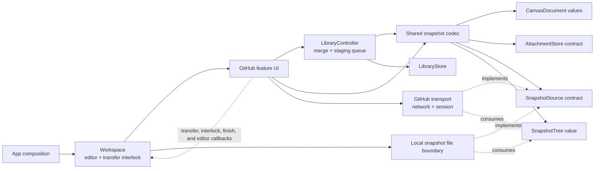
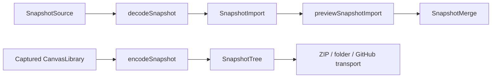

# Folder snapshot transfer design

Status: proposed. This target design accompanies the proposed
[folder snapshot specification](../specs/folder-snapshots.md) and
[ADR 0005](../adr/0005-folder-based-snapshot-transfers.md).
The accepted [ownership](ownership.md), [persistence](persistence.md),
[UI](ui.md), and [interaction model](../specs/interaction-model.md) remain
authoritative until the proposal is accepted and those contracts are aligned.

## Current evidence

| Area | Current source behavior | Evidence |
| --- | --- | --- |
| Canvas project | `document.json` plus root `attachments/...` in a single-canvas ZIP; replacement import requires every referenced attachment. | [`canvas_project.dart`](../../lib/library/transfer/canvas_project.dart), [`canvas_project_files.dart`](../../lib/library/transfer/canvas_project_files.dart) |
| Library archive | Wrapper JSON at `library/<encoded name>.json`, root-level attachments, and whole-library replacement on restore. | [`canvas_library_archive.dart`](../../lib/library/transfer/canvas_library_archive.dart) |
| GitHub canvas | A separate `.canvas` document codec, stricter complete-attachment validation, and one-canvas import/commit workflow. | [`canvas_remote_transfer.dart`](../../lib/library/transfer/canvas_remote_transfer.dart), [`github_api.dart`](../../lib/github/github_api.dart), [`github_workspace_panel.dart`](../../lib/github/github_workspace_panel.dart) |
| GitHub tracking | Per-canvas confirmed baseline, attachment-name mapping, and pending-write guard live in library metadata. | [`github_metadata.dart`](../../lib/library/github_metadata.dart), [`canvas_library.dart`](../../lib/library/canvas_library.dart) |

## Ownership and dependencies

Place the shared codec and its snapshot types under
`lib/library/transfer/`. It owns path validation, tree discovery, document and
image validation, and conversion between captured library values and portable
paths. Its I/O dependencies are the `SnapshotSource` contract, document values,
and the `AttachmentStore` contract; it does not import concrete ZIP, browser, or
GitHub adapters or own networking. Concrete inputs implement `SnapshotSource`,
and transports consume the source and `SnapshotTree` value contracts. The
document layer gains no storage, editor, network, or browser imports. The library
does not import GitHub networking; web imports stay in the isolated browser
adapter.

App composition in `Workspace` connects the GitHub feature and the local file
boundary. `Workspace` owns the editor lifetime and transfer interlock. The
feature calls Workspace through transfer-start/end, interaction-finishing, and
editor-replacement callbacks; it does not import the app or `Workspace`.
`LibraryController` remains the sole owner of published library state, pending
revisions, attachment staging, and the one metadata persistence queue. It uses
the shared codec contracts for import and export. There is no second mutable
library, provider registry, or framework.



Solid arrows show imports or composition. Dashed arrows show an implementation
or use of a shared value contract, or a callback; the feature has no import edge
to `Workspace`. The local boundary contains the ZIP adapter and the isolated web
folder adapter. GitHub networking stays in the GitHub feature boundary. Web
imports stay in the isolated browser adapter.

## Snapshot types and codec boundary

These field-only declarations and signatures are illustrative, not generated or
compile-ready code. Use concrete types for this closed transfer contract, not a
provider registry or generic import/export framework:

```dart
enum SnapshotScope { currentCanvas, wholeLibrary }

final class SnapshotTree {
  final Map<String, Uint8List> files; // full root-relative file paths
  final Set<String> directories;     // root-relative, no trailing slash; root is implicit
}

enum SnapshotEntryKind { regularFile, directory, unsupported }

final class SnapshotEntry {
  final String path;
  final SnapshotEntryKind kind;
  final int? size;
}

abstract interface class SnapshotSource {
  Future<List<SnapshotEntry>> entries();
  Future<Uint8List> read(String path);
}

final class SnapshotImport {
  final Map<String, CanvasDocument> canvases; // keyed by document root path
  final Map<String, Uint8List> attachments;  // keyed by image root path
  final Set<String> directories; // explorer folders, excluding attachment/metadata directories
}

Future<SnapshotTree> encodeSnapshot(
  CanvasLibrary captured,
  AttachmentStore attachments,
  SnapshotScope scope,
);

Future<SnapshotImport> decodeSnapshot(SnapshotSource source);
```

Maps and sets are unmodifiable copies; byte arrays are copied and treated as immutable.
`encodeSnapshot` uses
`captured.currentId` for the current-canvas scope and never rereads selection or
library state after an await. `decodeSnapshot` scans one source root. Attachment
discovery derives missing references from decoded documents; no duplicate
missing-reference list is stored.



This shows value flow, not adapter imports: sources feed decoding, the library
controller previews and merges decoded candidates, and captured library values
encode to a tree for the selected transport.

Tree paths include each canvas's full parent path. A reference such as
`attachments/<uuid>.png` in `Projects/Map.canvas.json` resolves to
`Projects/attachments/<uuid>.png`. The path stays relative in saved document
content until local staging rebases it. A source image at a distinct directory
is a distinct image, even if its UUID and bytes match another path.

Reuse `canvasAttachmentPaths`, `rebaseCanvasDocumentAttachments`,
`AttachmentStore.readIfExists`, `validateCanvasAttachment`, and the strict
`CanvasDocument` decoder for discovery, rewriting, storage, and validation. Do
not add a custom parser or image model. Export omits absent images but retains
references; only confirmed not-found counts as absent. Other storage errors and
corrupt existing bytes fail export.

For import, build one operation-local map from source-root image paths to fresh
local attachment paths. Reserve a fresh path for every referenced image,
including missing references, so a missing source cannot bind to an unrelated
existing file in the browser's private attachment store (OPFS) with the same
UUID. Stage available bytes once per source
path; rebase each document reference to its reserved local path. Shared source
paths are staged once. Distinct source image paths remain distinct. Canvas and
explorer-folder paths are preserved; attachment filenames may change. Exports
rebuild sibling attachment directories from each canvas's preserved parent path.
No attachment-name mapping is persisted. Local import preserves semantic document
content, including missingness; external media URL strings remain unchanged.

## Tree adapters and path rules

`SnapshotTree` is prepared output. ZIP input/output wraps it: validate the
central directory and declared sizes before bounded inflation, then verify
actual sizes and CRCs. ZIP is not a separate document format. `SnapshotSource`
is lazy input; GitHub blobs are fetched by immutable SHA only when needed
instead of buffering the repository. The browser folder adapter recursively
enumerates directory handles, includes empty directories, and captures
immutable `File` values for read payloads. ZIP and GitHub inputs implement the
same source contract.

The codec applies the same path rules to every adapter. The source root is
implicit; entry paths are relative and literal. Reject absolute paths, empty,
`.` or `..` segments, backslashes, controls, duplicate or case-ambiguous paths,
file/directory prefix conflicts, symbolic links, and unsupported Git objects.
Do not URL-decode, normalize Unicode, trim names, or repair a conflicting path.
A canvas filename loses exactly one final `.canvas.json` suffix; an empty name
after stripping is invalid. A file name collision with the synthetic suffix,
or a file/folder prefix collision, is structural and fails with its path.

Sibling local names follow `CanvasLibrary.nameError` case-insensitive matching.
The serialized canvas filename adds `.canvas.json` to the full canvas name;
this can collide with an ordinary folder or file name even when the source
library names differ. For example, `Foo.canvas.json` as a folder conflicts with
the serialized path of a canvas named `Foo`. Such a collision is reported,
never silently suffixed.
Reserve `attachments` for image paths and `.git` for Git metadata at every tree
level. Real explorer folders with either name therefore make export fail with
their paths rather than disappear on reimport. These are product-facing
restrictions for review, not accepted contracts.

Unrelated regular files are ignored, including repository `README` and
`.gitignore`. The codec excludes `.git` metadata from discovery for every input;
the web directory adapter avoids walking that directory at all. ZIP entry
path, kind, and size checks still apply before ignoring metadata payloads.
Recognized image paths are validated even when no
document references them; a corrupt supplied image fails the full import. Only
referenced images are staged into OPFS; unreferenced files do not create local
orphan attachments. `SnapshotImport.directories` contains only explorer folders;
attachment-storage and Git-metadata directories never become explorer entries.
A canvas file inside the reserved attachment namespace is a format error, not a
canvas under an explorer folder named `attachments`.
Empty explorer directories survive folder and ZIP snapshots. GitHub
cannot store them; do not invent `.gitkeep` or other synthetic files.

## Preflight and atomic local merge

`LibraryController` owns two concrete operations:

```dart
Future<SnapshotMerge> previewSnapshotImport(SnapshotImport candidate);

Future<void> importSnapshot(
  SnapshotMerge merge, {
  required Set<String> overwritePaths,
});

final class SnapshotMerge {
  final SnapshotImport candidate;
  final Object expectedLibraryToken;
  final Map<String, int> expectedPendingRevisions;
  final Set<String> overwritePaths;
}
```

Preview is read-only. It captures an immutable identity for the complete
published library and the pending-document revision map, then computes all
full-path canvas collisions. The token is not `documentToken`, which does not
cover every library change. A file/folder or path-prefix collision fails
preview with the conflicting paths. Existing canvas collisions are returned as
`overwritePaths` for confirmation; the caller gathers every answer outside the
persistence queue. Apply requires the exact set of paths confirmed Yes; a
missing or unexpected path aborts. At queue entry, and again after awaited
attachment staging immediately before metadata save, compare both captured
values with current state. If either changed, abort rather than silently
recalculating which local canvases the user's answers overwrite.

The transfer sequence is:

```mermaid
sequenceDiagram
  participant W as Workspace
  participant B as Browser folder adapter
  participant S as Snapshot source and codec
  participant U as UI prompts
  participant L as LibraryController
  participant A as AttachmentStore
  participant P as LibraryStore
  W->>W: Synchronously finish interaction and acquire transfer interlock
  W->>B: Invoke showDirectoryPicker() in the same user gesture
  B-->>W: Selection accepted; adapter retains handle for this operation only
  W->>L: Flush completed edits; capture immutable library and current ID
  W->>S: read and validate complete source
  S-->>W: immutable SnapshotImport
  W->>L: previewSnapshotImport(candidate)
  L-->>W: collisions + expected library and pending revisions
  W->>U: ask all overwrite questions
  U-->>W: all Yes, or any No
  alt any No
    W-->>W: abort with no import writes
  else all Yes
    W->>L: importSnapshot(preview, overwrite paths)
    L->>L: enter queue; revalidate library identity and pending revisions
    L->>A: reserve fresh paths and stage available bytes
    L->>L: rebase documents; build additive library snapshot
    L->>L: revalidate after staging, immediately before metadata save
    alt candidate identity or pending revisions changed
      L->>A: remove only unpublished staged bytes
      L-->>W: abort without publishing
    else still current
      L->>P: one metadata save
      P-->>L: saved
      L->>L: publish immutable state and notify through lifetime guards
      L-->>W: imported file identity
    end
  end
```

Within that same queue operation, reserve all fresh local paths, write each
available image, rebase documents, and save metadata once before publishing the
new library state. On failure or a late identity change, remove only newly
staged, unpublished paths; never overwrite or delete bytes reachable from the
old library. Keep local extras, existing attachments, and retained history
attachments. Overwritten canvases retain their file IDs and lose only their
pending saved revision. New canvases and folders get new IDs; matching parent
folders are reused. Keep the current file ID; do not select an imported canvas.
After durability, Workspace rebuilds only the overwritten active file's
`EditorSession`, clearing its history and tools. Otherwise it leaves the live
editor alone. Do not cancel pending paste or image work before an actual
document replacement.

The atomicity promise is published local state and one library metadata save,
not a physically atomic multi-file OPFS transaction. Cleanup is limited to
unpublished staged paths. Do not show dialogs while queued writes are in
progress. Publish and notify after successful durability through the existing
lifetime guards; do not redesign notification ownership.

## GitHub transport

The GitHub feature keeps OAuth, account/repository identity checks, default
branch selection, and rate-limit/error handling. Replace content-baseline
tracking with two transport operations:

```dart
Future<SnapshotSource> readRepository(GitHubDestination destination);

Future<GitHubCommitResult> commitSnapshot(
  GitHubDestination destination,
  SnapshotTree tree, {
  required String message,
});

final class GitHubCommitResult {
  final String? commitSha;
  final String url;
}
```

`readRepository` independently verifies the saved account and repository IDs,
captures that operation's default-branch head, reads one bounded recursive Git
tree, and rejects a truncated tree. Its source keeps immutable path-to-blob-SHA
metadata. Reads use those SHAs and enforce declared sizes before allocation and
actual sizes after decoding. The shared codec discovers all `.canvas.json`
files and valid `attachments/<uuid>.<ext>` images in the whole repository;
non-format regular files are ignored. No archive endpoint bypasses path or byte
limits. Restore means this repository import and shared merge. It reads only
the latest default-branch head; no historical commit picker or revision-link
restore is supported.

Each `commitSnapshot` independently verifies the saved account and repository,
then captures a fresh default-branch head and bounded recursive tree at that
checkpoint's operation time. It does not reuse an import snapshot or track a
baseline. Before uploading blobs, use the fresh tree metadata to reject an
output blob path occupied by a tree, symlink, submodule, or other unsupported
Git object, and reject any required directory ancestor occupied by a
non-directory. Report the conflicting path and stop before uploads or branch
update. Existing regular blobs at exact output paths are overwritten blindly,
including shared image paths; this is structural format preservation, not
content comparison or conflict resolution. These checks prevent replacing an
`attachments` file/tree or path prefix that contains unrelated files.

After structural validation, create blobs, one tree with `base_tree` set to the
freshly captured tree, one commit whose parent is the fresh head, then update
only the selected default-branch reference with force disabled. Do not fetch or
compare old contents, delete paths, remap remote attachment names, or retry a
race. Validate the existing explicit message rule: a nonempty lowercase
Conventional Commit subject of at most 72 characters. If a branch update outcome
is uncertain, show that it may have succeeded and its link. Do not retry
automatically; an explicit later submission can create a duplicate history
commit.

```mermaid
sequenceDiagram
  participant F as GitHub feature
  participant W as Workspace
  participant G as GitHub transport
  participant H as GitHub API
  participant C as Shared snapshot codec
  participant L as LibraryController
  alt User imports repository
    F->>W: finish interaction; acquire interlock; flush completed edits
    W-->>F: ready for import; interlock held
    F->>G: readRepository(destination); verify account and repository
    G->>H: capture default-branch head and bounded recursive tree
    H-->>G: import head + tree entries
    G-->>F: immutable SnapshotSource keyed by blob SHA
    F->>C: decodeSnapshot(source)
    C-->>F: whole-repository SnapshotImport
    F->>L: preview; gather all overwrite answers outside queue
    F->>L: apply through shared additive merge
  else User checkpoints current canvas
    F->>W: finish interaction; acquire interlock; flush and capture canvas
    W-->>F: immutable current-canvas snapshot
    F->>C: encodeSnapshot(captured canvas)
    C-->>F: SnapshotTree
    F->>G: commitSnapshot(destination, tree, message)
    G->>H: independently verify account/repository; capture fresh head + tree
    H-->>G: checkpoint head + bounded tree entries
    G->>G: reject structural output-path conflicts before blob uploads
    G->>H: create blobs, tree on fresh head, commit, PATCH ref force=false
    H-->>G: commit URL/SHA or failure
    G-->>F: result; no tracking write or automatic retry
  end
  F->>W: release transfer interlock in finally
```

The branches are mutually exclusive user actions. Import does not checkpoint
after merging, and a later checkpoint never reuses the import head or tree.

Keep the mediator's cookie-enabled browser client separate from the GitHub
client. Access tokens stay in memory. Preserve the current identity checks,
sanitized errors, rate-limit behavior, 15-second request timeout, bounded
32 MiB metadata JSON responses, size-derived base64 blob-response bounds, and
100 MiB GitHub blob limit. A prepared tree and a
decoded candidate remain within the 140 MiB total snapshot budget; images
remain capped at 10 MiB. ZIP compressed and expanded totals retain their
existing 140 MiB limits. Enforce metadata size before allocating, then check
actual bytes. These budgets do not imply streaming or lower peak memory use.

## Platform boundary and review points

The current [`CanvasProjectFiles`](../../lib/library/transfer/canvas_project_files.dart)
boundary opens one file and saves by download on web; it does not provide
hierarchical folder reads or writes. The proposed narrow
`lib/library/transfer/snapshot_files.dart` boundary keeps the existing single
`.canvas.json`/ZIP file picker and adds folder read and write operations. The
web implementation stays isolated in the already installed `package:web`
adapter, `snapshot_files_web.dart`; this proposal does not add a dependency.

For direct folder reads and writes, feature-detect `showDirectoryPicker()` for
both operations. Do not substitute a `webkitdirectory`/`webkitRelativePath`
file-only picker: it cannot represent empty directories, so it is not a complete
snapshot source. If directory pickers are unavailable, disable direct folder
actions and leave ZIP as an explicit, broadly supported choice rather than a
silent fallback. `showDirectoryPicker()` has limited browser availability,
requires a secure context and permission, and depends on a user gesture; these
support limits are product review points. See MDN for
[`showDirectoryPicker()`](https://developer.mozilla.org/en-US/docs/Web/API/Window/showDirectoryPicker)
and [`webkitRelativePath`](https://developer.mozilla.org/en-US/docs/Web/API/File/webkitRelativePath).

The browser gesture sequence is part of this proposed behavior:

- On folder input, an explicit user action synchronously finishes the active
  interaction and acquires the transfer interlock, then invokes
  `showDirectoryPicker()` immediately, before any awaited flush or other work
  that could lose user activation. After selection, flush completed edits,
  capture the immutable library and current file ID, recursively enumerate the
  selected directory including empty folders, and capture immutable `File`
  objects for payload reads. Read and validate the whole candidate before any
   library writes. If flushing fails, do not import or write into the selected
   directory; keep unsaved local edits available for retry.
- For folder output, finish the interaction, flush, capture, and prepare the
  complete `SnapshotTree` first. Then show a visible, enabled **Save folder**
  button. Its fresh user gesture invokes `showDirectoryPicker()` immediately
  and passes the ready tree to `saveSnapshotFolder(tree)`; do not await work
  before invoking the picker. After selection, confirm the directory is empty
  before writing any files. A nonempty destination is refused, never cleaned or
  merged. Browser writes are not atomic; report paths written if a later write
  fails.
- Keep a selected directory handle for that one operation only. Do not persist
  it, link it to the library, or watch it.

These additional product recommendations need review before acceptance:

1. Confirm direct folder support and its secure-context and permission limits on
   supported browsers before promising availability. ZIP remains the explicit
   alternative when folder pickers are unavailable; it is never a silent
   substitute for a folder choice.
2. A single `.canvas.json` imports at the root; a selected folder or ZIP carries
   a full tree. Do not offer a lossy multi-file input as a folder snapshot.
3. Latest-default-branch restore is settled for this proposal. The remaining URL
    recommendation is to accept only a repository root URL
    (`https://github.com/owner/repo[.git]`). Tree/blob
   subset links should direct the user to use the root URL. This import need not
   change the saved checkpoint destination; the existing signed-in session is
   required for public and private repositories. Do not fetch arbitrary HTTP
   links.
4. The reserved `attachments` and `.git` names and serialized suffix collisions can block
   some otherwise valid local names. Confirm that reporting these paths, rather
   than encoding or renaming them, is acceptable.
5. Local staging currently proposes fresh attachment paths and rebases local
   references. No persistent mapping preserves attachment filenames across
   round trips. Canvas and explorer-folder paths stay intact. The fresh-filename
   recommendation is under review pending the proposed
   [root-relative attachment paths](../specs/attachment-paths.md) and failure-safe
   import integration; it is not accepted behavior. External media URL strings
   remain unchanged.

## Reuse, replace, and remove

| Action | Existing behavior or owner | Proposed result |
| --- | --- | --- |
| Reuse | Attachment discovery and rebasing helpers, image validators, `AttachmentStore`, staging cleanup, and the library save queue | Keep these in the shared codec and `LibraryController` staging path. |
| Reuse | Workspace transfer interlock, editor lifetime callbacks, OAuth/session, GitHub identity checks, and saved repository destination | Keep their current owners; do not move app composition into the feature. |
| Replace | Separate canvas-project, library-archive, and GitHub document codecs | Use one snapshot codec and a thin ZIP adapter around `SnapshotTree`. |
| Replace | `addGitHubCanvas` and destructive settings restore/import flows | Use one provider-neutral atomic multi-canvas merge and additive local import. |
| Replace | Bundled demo ZIP layout and its tests/fixtures | Move them to the snapshot tree and shared codec; do not retain an old decoder only for the demo asset. |
| Remove | `GitHubCanvasTracking`, per-canvas baseline and pending guards, content comparison, remote attachment remapping, and recovery/status flows | Keep no remote baseline or automatic recovery state. |

Ignoring or dropping optional tracking records must not delete browser library
documents or the saved repository destination. Existing transfer-file backward
compatibility is not required at this development stage. Local canvas IDs remain
nonportable, and the canvas document schema needs no version bump.
