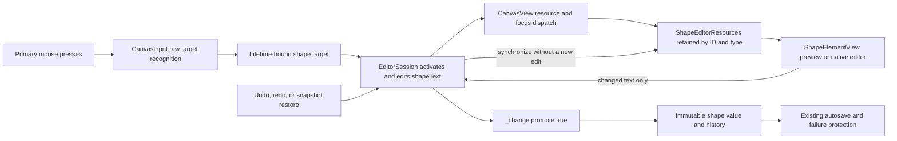

# Shape text editing

Status: complete. Implemented and verified on 2026-11-09, with the limitations
recorded below.

Integration aligned this feature with the accepted asynchronous-edit decision:
logical context changes do not cancel pending clipboard or device-image work;
session and target lifetime safety remains. After updating to main `4837c3d`,
analysis, the full Chrome suite (651 passed, four existing skips), and the web
build passed. The earlier feature checks below remain historical evidence.

## Goal and scope

Allow a shape to keep and edit a plain-text label inside its existing fixed
geometry. Preserve current shape activation, selection, movement, resize,
stacking, clipboard, history, and save behavior except where editing requires the
explicit changes below. Support all six saved shape kinds: rectangle, rounded
rectangle, ellipse, diamond, triangle, and hexagon.

This plan records the approved implementation design. It does not replace the
accepted [interaction model](../specs/interaction-model.md),
[editor lifecycle contract](../arch/editor-lifecycles.md), or
[ownership rules](../arch/ownership.md). Update those authorities before
changing behavior; until then they remain authoritative.

## Non-goals

- Rich text, per-label font or color controls, or separately bound text objects.
- Automatic shape growth or shrinkage, automatic font shrinking, saved-text
  truncation, or ellipsis.
- Changes to existing rotation behavior, touch editing support, new dependencies,
  document schema version bumps, or a new canvas clipboard format.

## Design decisions

### Saved text and editing

- Add `ShapeElementData.text`, a `String` defaulting to `''`. Keep the label in
  the shape value; do not create a second text element or a separate style
  model. Do not bump the document schema version or add dependencies.
- Update the model constructors, `copyWith`, generated JSON codec, equality,
  hash code, and strict decoding. Decoding an absent `text` field yields the
  empty string; a present field of the wrong type fails. Preserve existing
  structural validation.
- Add `EditorField.shapeText` and shape-text validation to
  `EditorSession.setShapeText`; apply changes through `_change(promote: true)`.
  The session remains the only writer of saved document data.
- A `ShapeEditorResources` instance extends `ElementResources` and owns the
  shape's `TextEditingController`, `FocusNode`, and retained scroll position.
  It sends changes to the session only when the text changes. Undo/redo and
  restored snapshots synchronize the controller from saved data without
  creating a new edit.
- `CanvasView` owns shape resources by element identity outside lazily culled
  widgets. Culling preserves the controller and scroll position. Removal
  invalidates the lifetime immediately; dispose the focus and text controllers
  after consumers detach. Document replacement starts a new resource lifetime.
- `ShapeElementView` layers the existing shape painter, a centered plain label
  preview, a transparent native multiline editor while editing, and existing
  controls. The preview and editor use the same bundled canvas body typography.
  The label uses the saved `strokeColor`; selection tint changes the shape
  outline but not the label color.

### Geometry and fixed-size layout

- Add pure `shapeTextBounds(ShapeKind, Size, double strokeWidth)` geometry next
  to `shapePath` in `lib/canvas/geometry/shape_geometry.dart`. Return a
  conservative centered inscribed rectangle for each kind. At minimum size or
  when stroke width consumes the available interior, clamp to finite,
  nonnegative bounds.
- Keep shape geometry fixed. Wrap text within the returned bounds and center it
  vertically when it fits. If preview text overflows vertically, clip it from
  the top-aligned content; do not truncate saved text or add an ellipsis. The
  editor scrolls and keeps the caret visible. It never auto-grows or shrinks the
  shape or font.
- Scrolling inside the editor must not pan the canvas, including when the editor
  reaches a scroll boundary or has no scrollable overflow.

### Input, focus, and clipboard

- Preserve immediate single-click routing. In Select, primary-mouse double-click
  on a shape enters or re-enters text editing; place the caret at the end on
  entry. A double-click inside an already focused editor keeps native word
  selection.
- Extend `CanvasInput`'s existing raw quick-text double-click recognition to
  distinguish an empty-canvas target from a shape ID and lifetime. Keep its
  current thresholds and immediate single-click behavior. Both presses must
  resolve to the same live shape target; reject cross-target pairs. Controls
  invalidate recognition. Dragging, navigation, interruption, tool changes,
  and document changes cancel it. Do not add `GestureDetector.onDoubleTap`,
  delay single-click activation, or change `infinite_lazy_grid`.
- Route successful recognition through the lifetime-bound target's
  `activate(edit: true)` path. A following tap must not end and restart the
  editing session. `CanvasView` extends resource dispatch, focus lookup, editor
  field mapping, editing detection, focused-editor hit testing, and
  `_focusElement`. Request focus after mount only after checking the current
  context and target lifetime.
- Enter ends editing unless an IME composition is active; Shift+Enter inserts a
  newline. Escape and click-away preserve text and follow normal deactivation
  and target routing. Using a transform control ends text editing but leaves
  the shape active.
- Native selection, cut, copy, paste, delete, and local undo retain priority
  while the shape editor is focused. Pasting plain text inserts text into the
  label, including URL-looking text; it must not invoke media URL handling or
  an attachment workflow. Canvas shape copy and paste use the existing element
  serializer and preserve the label. Async clipboard and device-image edits
  follow the accepted [asynchronous edit decision](../adr/0001-cancel-unfinished-pastes.md).

### History and durability

- Session updates save as the user types. Keep the label as one logical field
  history group; close that group on editing exit or another document
  operation, not temporary browser focus loss. Opening or closing an unchanged
  editor adds no content history entry. Automatic stack promotion may add its
  existing separate order change. Undo restores text and clears editing as
  required by document restoration behavior.
- Use existing save failure protections. Do not discard entered text or weaken
  retry behavior when a save fails.

## Ownership and interfaces

| Responsibility | Existing or new path | Interface and boundary |
| --- | --- | --- |
| Saved value and strict serialization | `lib/canvas/document/canvas_element.dart` (existing); `lib/canvas/document/canvas_document.g.dart` (generated) | `ShapeElementData` owns the label. Keep codec output, equality, hash, constructors, copying, and strict decoding consistent. |
| Session editing and history | `lib/canvas/editor/editor_session.dart` (existing) | Add `EditorField.shapeText` and `setShapeText`; validate the target and commit through `_change(promote: true)`. |
| Shape text interior geometry | `lib/canvas/geometry/shape_geometry.dart` (existing) | Add pure `shapeTextBounds` beside `shapePath`; geometry has no presentation or I/O dependency. |
| Retained shape editor state | `lib/canvas/editor/elements/shape/shape_editor_resources.dart` (new); `lib/canvas/editor/element_resources.dart` (existing) | `ShapeEditorResources extends ElementResources`; owns controller, focus, scroll retention, session synchronization, and resource disposal while following the shared resource lifetime. |
| Shape label rendering and native editing | `lib/canvas/editor/elements/shape/shape_element_view.dart` (existing) | Compose the existing painter and controls with preview/editor content; request saved changes through session-backed resources. |
| Resource, focus, and target dispatch | `lib/canvas/editor/canvas_view.dart` (existing); `lib/canvas/editor/canvas_input.dart` (existing) | CanvasView retains and reconciles resources and routes focus. CanvasInput owns raw double-click recognition, cancellation, and lifetime-bound activation. |
| Canvas shortcut and clipboard integration | `lib/canvas/editor/canvas_shortcuts.dart` and `lib/canvas/editor/canvas_clipboard.dart` (existing) | Preserve focused native editing priority and use current element serialization. Change these only if a concrete integration gap is found; do not add a shape-specific clipboard format. |
| Element ownership guidance | `lib/canvas/editor/elements/AGENTS.md` (existing) | Replace the statement that shapes are resource-free with their retained-resource ownership and lifecycle. |
| Accepted behavior and lifecycle | `docs/specs/interaction-model.md` and `docs/arch/editor-lifecycles.md` (existing) | Document the accepted shape editing interaction and resource/history rules before behavior implementation. |
| Document and session tests | `test/canvas/document/canvas_document_test.dart` and `test/canvas/editor/editor_session_test.dart` (existing) | Verify strict/default decoding, Unicode roundtrip, equality/hash/copying, validation, and session/context/history behavior. |
| Geometry tests | `test/canvas/geometry/shape_geometry_test.dart` (new if no existing geometry owner applies) | Cover all six kinds, center/inset behavior, minimum sizes, and finite nonnegative bounds under excess stroke. |
| Input, history, shortcut, and clipboard tests | `test/canvas/editor/canvas_input_test.dart`, `test/canvas/editor/canvas_history_test.dart`, `test/canvas/editor/canvas_shortcuts_test.dart`, and `test/canvas/editor/canvas_clipboard_test.dart` (existing) | Verify double-click timing and target identity, edit grouping, focused native shortcut priority, native-vs-canvas paste, URL text, and shape copy/transfer. |
| Resource and shape presentation tests | `test/canvas/editor/element_resources_test.dart` and `test/canvas/editor/elements/shape/shape_element_test.dart` (existing); `test/canvas/editor/elements/shape/shape_editor_resources_test.dart` (new only if needed) | Verify culling retention, restoration, stale focus rejection, removal/disposal, rendering, overflow, and scroll behavior. |

Generated output must follow the repository's normal generator workflow. If
that workflow is unavailable or requires a tooling workaround, stop rather
than editing around it.

## Architecture flow



## Interaction table

| Input or state change | Required result |
| --- | --- |
| Single click on a shape | Keep existing immediate activation and target routing; do not wait for a possible second click. |
| Select-tool primary mouse double-click on a shape | If both presses resolve to the same live target, activate and enter text editing with the caret at the end. |
| Double-click inside an already focused shape editor | Preserve native word selection. |
| Double-click crosses from empty canvas, another shape, or a control | Do not enter shape editing; reject or cancel the pending pair. |
| Tap after text editing has begun | Preserve editing; do not end and restart it. |
| Enter / Shift+Enter | Finish editing / insert a newline, except Enter during active IME composition remains with the IME. |
| Escape or click elsewhere | Preserve text and follow the existing normal deactivation and target behavior. |
| Move or resize through a control | End text editing and keep the shape active, following existing control behavior. |
| Focused editor selection, clipboard, delete, or local undo | Native editor action takes priority; pasted URL-like content remains plain label text. |
| Editor scroll, including at either boundary | Scroll the label when possible; never pan the canvas from the editor scroll. |
| Drag, navigation, interruption, tool change, or document change during recognition | Cancel the pending double-click; an interrupted press cannot restart it. |
| Undo/redo or restored document snapshot | Restore saved label data, clear editing, and retain resources for surviving same-ID/same-type elements. |

## Fixed-size layout policy

| Condition | Preview | Editor |
| --- | --- | --- |
| Text fits inside `shapeTextBounds` | Wrap to the available width and center vertically. | Use the same typography and bounds; keep native caret and selection visible. |
| Text exceeds available height | Clip the top-aligned content within the shape; retain the complete saved string and show no ellipsis. | Keep the shape size fixed and scroll to the caret. |
| Shape is at minimum size or stroke consumes its interior | Use finite, nonnegative conservative bounds; no invalid layout dimensions. | Keep editing enabled within the clamped bounds without growing the shape or shrinking the font. |

The six `ShapeKind` values use explicit exhaustive geometry. Actual bundled body
font metrics and resulting line heights are execution measurements, not choices
to resolve by changing the fixed-size policy.

## Failure and lifetime handling

- A missing serialized `text` is the only legacy default: decode it as empty.
  Reject malformed present values under existing strict decoding. Do not add a
  schema migration or permissive fallback.
- Validate that session edits target a live `ShapeElementData` and the
  `shapeText` field. Stale target callbacks and delayed focus requests must not
  edit removed elements or a replaced session.
- Keep resources through lazy culling. On removal, invalidate the element
  lifetime before disposing controllers after the widget detaches. On
  restoration, synchronize from the restored model and do not submit that
  synchronization as user input.
- Temporary browser focus loss does not close the logical field history group.
  Explicit editing exit, another field or operation, tool changes, replacement,
  and removal follow the existing history boundaries. Async clipboard and
  device-image work is not canceled by logical context changes; session and
  target lifetime safety follows the accepted asynchronous-edit decision.
- Keep text if autosave fails and use the existing retry/error path. Clipboard
  operations use existing failure handling; a failed write must not cause a
  destructive cut.
- Keep ordinary touch editing best effort; do not introduce a touch-only
  editing path or interfere with grid-owned touch navigation.

## Phased checklist

Implementation items below are checked against the current source. Checks that
require final suite results, manual browser work, or independent review remain
open.

### 1. Update accepted contracts first

- [x] Extend `docs/specs/interaction-model.md` with shape text activation,
  editing, keyboard/IME, native clipboard, and fixed-size overflow behavior.
- [x] Extend `docs/arch/editor-lifecycles.md` with shape resources, retained
  focus/controller/scroll state, restoration, disposal, and history grouping.
- [x] Update `lib/canvas/editor/elements/AGENTS.md` so shape editor resources
  follow the shared resource lifetime.
- [x] Confirm the contracts match the design without introducing a schema,
  style, input, or ownership alternative.

### 2. Add saved text, session editing, and geometry

- [x] Add `ShapeElementData.text` with the empty-string constructor default;
  update copying, generated codec output, equality/hash, and strict decoding
  without changing the document version.
- [x] Add `EditorField.shapeText` and `EditorSession.setShapeText` with live
  target/field validation and `_change(promote: true)`.
- [x] Add `shapeTextBounds` for all six kinds, clamping at minimum size and
  excessive stroke width.
- [x] Add model, session/history, and geometry tests for missing/malformed
  fields, Unicode roundtrip, equality/hash/copying, field validation, and
  geometry bounds.

### 3. Add retained resources and shape presentation

- [x] Add `ShapeEditorResources` with text controller, focus node, retained
  scroll state, session update callback, and restoration synchronization.
- [x] Extend CanvasView resource creation/reconciliation and focus dispatch;
  keep resources through culling and invalidate on removal or session change.
- [x] Add the label preview and transparent multiline editor to
  `ShapeElementView`, retaining the existing painter, hit target, and controls.
- [x] Add focused tests for shape-label preview/editing and retained resources
  across culling; add geometry coverage for all six kinds and bounded results.
- [x] Check that the shape editor opens and reopens, an actual URL pasted from
  the browser clipboard remains label text, multiline input uses physical
  Shift+Enter and Enter finishes editing, overflowing preview text clips at the
  top, the editor scrolls without changing shape geometry, and saved labels
  survive reload. The browser CLI's modifier emulation required explicit
  physical key events for the multiline check.
- [x] Cover native word selection in automated tests.
- [x] Add a 143% zoom regression for fitting editor text placement, overflow
  caret visibility, and returning to short text. Confirm corrected centering
  separately in the built app.

### 4. Integrate input, native editing, history, and clipboard

- [x] Extend raw quick-text recognition to explicit empty or live shape targets;
  preserve thresholds and immediate single-click behavior, and reject
  cross-target or interrupted click pairs.
- [x] Route the recognized shape to lifetime-bound `activate(edit: true)` and
  focus after mount only when context and target lifetime still match.
- [x] Add field mapping, focused-editor detection/hit testing, and shortcut
  dispatch for `shapeText`; preserve native word selection, IME behavior,
  Shift+Enter, clipboard, delete, and local undo priority.
- [x] Add coverage for plain-text URL paste and shape label serialization through
  the current element serializer, without media URL or attachment handling.
- [x] Add coverage for shape-label history grouping and unchanged edits.
- [x] Implement field history grouping so unchanged open/close adds no content
  entry, edits group until logical exit or another operation, and undo restores
  the label and exits editing; shape edits retain existing Auto promotion.
- [x] Implement control, click-away, and Escape behavior so controls end editing
  while keeping the shape active and text is preserved on exit.
- [x] Verify click-away and Escape in the built app; verify option and transform
  controls in focused Chrome widget tests.

### 5. Verify, reconcile, and retire the plan

- [x] Run focused model/session/geometry tests (42 passed).
- [x] Run focused transfer tests (36 passed).
- [x] Run focused UI/input/resource browser suites (passed) and six VM
  architecture tests (passed).
- [x] Inspect focused coverage and add review regressions for minimum-size
  shape editing and a collapsed text field.
- [x] Run `flutter analyze` (no issues, 2026-11-09).
- [x] Run the full Chrome suite (665 tests passed, four existing appearance-flag skips,
  2026-11-09) with
  `CHROME_EXECUTABLE=/usr/bin/chromium flutter test --platform chrome`.
- [x] Run `flutter build web` before the alignment correction (passed with
  existing wasm dry-run `dart:html` warnings).
- [x] Run `flutter build web` after the alignment correction (passed).
- [x] Verify fitting-text alignment, focus, caret visibility, and overflow
  scrolling through the browser checks and focused regressions above.
- [x] Complete correctness and reduced-principles reviews. Both found the same
  minimum-size editing defect; remove redundant geometry padding, retain the
  editor when its bounds collapse, and verify the correction with focused tests.
- [x] Run final geometry and shape Chrome tests (19 passed), analysis, and a web
  build after the production review correction.
- [x] Check documentation links and `git diff --check`.
- [x] Archive this plan after final checks and reviews are complete and
  lasting rules are captured in their accepted contracts.

The feature verification above predates the integration alignment; the
post-integration checks are recorded at the top of this plan.

## Verification commands

Run focused tests with the repository's web browser command, substituting the
focused test paths listed above:

```sh
CHROME_EXECUTABLE=/usr/bin/chromium flutter test --platform chrome <focused-test-files>
flutter analyze
flutter build web
```

The full Chrome suite passed 665 tests with four existing appearance-flag skips
after the alignment correction and before the minimum-size review correction.
The final geometry and shape suites passed 19 tests, including text entry and
autosave for all six minimum-size shapes. Analysis and the web build also
passed after the production correction. The build retains existing Wasm
dry-run warnings for dependency uses of `dart:html`. Six VM architecture tests
passed. No second review pass was run; the correction was inspected and checked
with focused tests.

## Accepted limitations and deferred work

- A stress test using a saved stroke width of 1000 exposed an existing shape
  options slider assertion: the document permits positive widths but the slider
  supports at most 5. This unrelated options issue is not changed here. The
  collapsed-field regression isolates the element view; it does not claim the
  full options panel supports extreme saved widths. Validation was not weakened.
- Real browser checks covered creation, reopening, multiline input, native URL
  paste, overflow, scrolling, Escape, click-away, and persistence through reload.
  The final minimum-size correction was checked in Chrome widget tests rather
  than another manual browser run. The full suite was not repeated after that
  correction.
