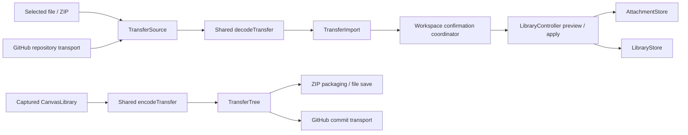

# Implement folder-based canvas transfers

Status: active; contract alignment is complete and implementation adoption is incomplete.

## Goal and authority

Replace the three transfer formats with one root-relative tree, transported by
ZIP or GitHub. Adopt canvas-parent attachment keys throughout editing and
rendering, not only inside the transfer codec. Finish with one additive import
workflow and no remote content-tracking state.

Read the accepted [specification](../specs/folder-based-canvas-transfers.md),
[design](../arch/folder-based-canvas-transfers-design.md), and
[ADR 0005](../adr/0005-folder-based-canvas-transfers.md) with the aligned
[interaction model](../specs/interaction-model.md),
[ownership](../arch/ownership.md), [persistence](../arch/persistence.md), and
[editor lifecycles](../arch/editor-lifecycles.md). The [attachment path
specification](../specs/attachment-paths.md) remains the byte-store contract.
These documents define the accepted target; source callers have not adopted it
at baseline revision `1c4839a`. This plan tracks that implementation work and
does not change contract authority.

The product choices are settled. Before local acceptance testing, the user will
manually clear this app's browser data, including existing canvases and images.
Do not clear it programmatically or clear unrelated origins. No migration,
old-format decoder, dual layout, or automatic reset belongs in this work.

## Scope and fixed decisions

- Direct versioned `<name>.canvas.json` documents and sibling
  `attachments/<uuid>.<ext>` images; preserve literal, case-sensitive paths.
  Document references and external media URLs do not change.
- Local import accepts a standalone `.canvas.json` or ZIP. ZIP import covers
  its complete tree. Exports offer current canvas or whole library as ZIP.
  Keep `canvas.elseplane.zip` and `library.elseplane.zip` download names and
  `application/zip`; change their contents, not their names.
- One GitHub repository selection serves Import and Commit. Import reads the
  whole repository at its latest default-branch head. Commit publishes only the
  captured current canvas. Each action captures its own fresh remote head.
- Imports keep local extras and current selection. Exact-path document
  overwrites retain local IDs. One confirmation lists all colliding valid
  canvases, warns about shared images, and offers **Overwrite and import** or
  **Cancel**. No collisions means no dialog. Cancel means zero import writes.
- Import writes referenced available images at their exact full keys, even if
  their bytes are corrupt. Stop on the first failed image write; do not save
  merged metadata. Earlier byte changes remain. Save merged metadata once after
  successful image writes. Metadata failure leaves previous documents published,
  but does not restore images.
- Missing source images retain references and existing destination bytes.
  Skip malformed UTF-8, JSON, or schema documents with sanitized reasons.
  Unsafe paths, structural conflicts, read failures, budget failures, and bad
  archives fail preparation instead of becoming skipped documents.
- Keep the existing save queue, autosave revision tracking, and asynchronous
  edit lifetimes. Add only the design's in-memory preview `changeRevision`.
  No wait-for-pending-work barrier or cancellation on focus/history changes.
- Canvas rename within its parent copies nothing. Canvas moves and folder
  moves/renames copy referenced images to remapped parent paths, retaining the
  source files and relative references. Missing destination: copy; equal bytes:
  reuse; differing bytes: fail with the path. Preflight conflicts before writes.
  Publish hierarchy only after copies and metadata save succeed.
- Internal clipboard version advances from 3 to 4 with required validated
  `sourceDirectory` (`''` at root). Same-parent paste shares images;
  cross-parent paste uses the move copy rules. No embedded image bundle or
  legacy clipboard decoder.
- Reserve literal folder segments `attachments` and `.git`, not case variants
  or canvas title text. Reject structural and serialized-suffix collisions;
  never repair names. Normal `.git` metadata is excluded from input discovery.
- GitHub overwrites regular output blobs without content comparisons. Preserve
  unrelated files, old canvas paths, unused images, normal history, and one
  force-disabled branch update. Remove baseline/pending tracking and recovery
  UI. Report uncertain writes without automatic retry or a new local guard.

Do not add dependencies, persistence formats, provider frameworks, cache
services, background synchronization, remote cleanup, streaming promises, or
entry-count/depth limits. The latter remain in the backlog. Upload image-content
validation remains intact; the relaxed byte-preservation rule is for transfers
and the specified move/paste copies.

## Source baseline and component boundaries

Pre-implementation baseline inspected at `1c4839a` on 2026-11-11. Recheck
symbols and callers before execution; line numbers and previous test counts are
not acceptance evidence.

| Component | Current evidence | Target responsibility |
| --- | --- | --- |
| `lib/library/transfer/canvas_project.dart` | Canvas ZIP codec, attachment discovery, reference rebasing, bounded ZIP inflation and CRC checks | Extract reusable discovery and ZIP safety; replace the document codec and remove transfer rebasing. |
| `canvas_library_archive.dart`, `canvas_remote_transfer.dart` in that directory | Independent library ZIP and GitHub codecs | Delete once their callers and safety tests use the shared format. |
| `canvas_project_files.dart` | `open()` returns bytes only; `save()` uses the installed file selector | Retain this boundary; return selected filename plus bytes so standalone input has a real canvas name. |
| `lib/library/canvas_library.dart` | Immutable hierarchy, exact sibling matching, optional destination and per-canvas tracking | Derive parent paths; enforce safe names and serialized-path conflicts; retain destination, remove tracking. |
| `lib/library/library_controller.dart` | `_pending`, `_durableRevisions`, `_queue`, `_change`, `_stage`; separate replacement operations | Own preview, additive merge, exact-key image writes, move copies, and publication through the existing queue. |
| `lib/app/workspace.dart` | Owns editor token/lifetime, transfer interlock, settings transfers; replaces editor after imports | Own context propagation and one shared import coordinator; replace only an overwritten active document after durable success. |
| `lib/canvas/editor/` | Canvas paste, Markdown image insertion, device image upload, media/Markdown reads use root keys | Capture parent context and full keys; retain editor/resource state when paths or shared bytes change. |
| `lib/github/github_api.dart` | Bounded HTTP, identity checks, recursive trees, blob fetches, tracked commits and name remapping | Keep transport/security code; expose tree input and atomic untracked tree commits. |
| `github_workspace_panel.dart`, `github_panel.dart` | Remote canvas chooser, tracking/status/conflict dialogs and orchestration | Keep session/repository/message/link UI; import the repository through the common coordinator. |
| `lib/library/debug/demo_canvas.dart`, `assets/demo/canvas.elseplane.zip` | Old-format bundled archive; debug creation uses `_stage` | Repackage and decode with the shared format while preserving debug-only, uniquely named Demo creation. |
| `lib/settings/settings_dialog.dart`, picker widgets, previews and test fakes | Separate canvas import and destructive library restore callbacks | One Import action and two export scopes; update every consumer rather than keep aliases. |

All paths in the table are repository-relative. Follow the nested element
guidance in `lib/canvas/editor/elements/AGENTS.md` when touching its descendants.

Keep these dependency directions:



This is data flow, not an import diagram. The local ZIP adapter and GitHub
adapter both feed the same decoder. Neither owns a second canvas decoder.
GitHub owns networking; Workspace supplies callbacks without the feature
importing the app. The library never imports editor or GitHub networking code.

## Interface decisions for execution

Use the design's `TransferTree`, `TransferSource`, `TransferImport`,
`TransferMerge`, `TransferImportResult`, and staged `TransferFailure` unchanged
in meaning. Keep related declarations together in
`lib/library/transfer/canvas_transfer.dart`; put ZIP-specific code in
`canvas_transfer_zip.dart`. These are concrete files for two actual transports,
not a plugin system. Collections are immutable copies and owned byte arrays
cannot be mutated through input aliases.

Keep `CanvasProjectFiles` and its injection points rather than rename the file
boundary across the app. Change `open()` to return a nullable named record
containing `String name` and `Uint8List bytes`. The platform implementation gets
the name from the selected `XFile`; update all implementers and fakes in the
same slice. Check `XFile.length()` against the input budget before reading and
check actual bytes afterward. Accept only `.canvas.json` and ZIP inputs.
Standalone input strips one final suffix, validates its basename, and exposes
one root file through the same source/decoder path; it cannot read adjacent
images. Do not invent a default canvas name or use ZIP entry names to guess a
wrapper directory.

Extract the existing pure attachment discovery into
`lib/canvas/document/attachment_references.dart`, accepting
`Iterable<CanvasElementData>` so both documents and clipboard selections can
use it. Preserve the existing media-source handling and Markdown parser
semantics. It performs no byte I/O, image decoding, reference rewriting, or
editor imports. Keep transfer validation separate from discovery. Expose a
small directory validator beside the existing attachment resolver if needed
for clipboard context and shared path validation; reuse the existing grammar,
not a second permissive parser.

Share byte copying beside `AttachmentStore`, receiving explicit full-key pairs.
Read and validate sources/destinations before the first write, compare bytes
directly, deduplicate pairs, and do not delete source files. Return confirmed
new writes. A narrow before-write callback lets callers retain the attempted
destination keys for invalidation if a write fails; the attempted sequence is
the successful prefix plus the failed key, not a new public result protocol.
Conflicts are ordinary path-bearing validation failures, not another exception
hierarchy. Do not catch I/O failures as missing files. This copy helper is not
used to implement import's intentional shared-byte overwrite policy.

Workspace supplies parent-directory strings through `CanvasPage` and
`CanvasView` using a `canvasDirectory` parameter, then to clipboard and retained
text/media resources. Update context
in place after a durable hierarchy path change. Each async operation snapshots
its string/key before its first await, including before file/clipboard reads;
never read mutable context later to choose a write or cleanup destination.
Context changes invalidate only local-image loads; they must not reset history,
controllers, scroll, tool state, or unrelated provider metadata.

Use one Workspace-owned import coordinator, passed to GitHub as a callback
accepting `TransferSource`. It prepares, previews, confirms, applies, refreshes
affected keys, and presents the result for both local and GitHub inputs.
The action initiator owns interaction finishing and interlock acquisition;
release in its `finally`. Do not reacquire that interlock or enqueue a public
queued operation from inside another queued operation. Keep dialogs outside
the persistence queue. Preserve preparation errors from repository acquisition
as sanitized failures rather than mislabeling them as invalid canvases.

Expose image invalidation using the existing Workspace → CanvasPage →
CanvasView composition path. Add an `onAttachmentInvalidatorChanged` callback
that registers the view's `void Function(Set<String>)` invalidator with Workspace
and unregisters it on detach; Workspace retains no resource objects. Give
`LibraryController` an `onAttachmentPathsChanged` callback for move-copy effects,
and route clipboard-copy effects directly to the view's same invalidator.
These callbacks carry keys only and do not change dependencies. No global
dispatcher is needed. Identify local loads by resolved full key;
detach stale streams and ignore stale completions. Evict affected old Flutter
image providers when required, then retry missing/failed entries. Callers
invalidate confirmed writes plus the failed attempted image key, including
after metadata publication failure. An unchanged document keeps its session.

For GitHub, retain `GitHubDestination` only. Independently verify account and
repository identities for each action, and verify that the saved branch is still
the repository's default branch. If it changed, stop and require the existing
repository chooser again rather than write an obsolete branch or silently
rewrite the saved destination. Build lazy input reads from captured blob SHAs.
For commits, validate every output path and required ancestor against the fresh
tree before uploading any blob. Use `base_tree`, one parent commit, and
`force: false`; never submit deletion entries. An uncertain result retains its
commit link but no tracking object or automatic retry.

## Implementation sequence and ownership

Complete each slice with its focused tests before integrating the next
dependent slice. These are ownership boundaries, not permission to ship a
partially converted application. Keep intermediate changes off a release until
all callers use the new model and obsolete paths are removed.

### 0. Align contracts and capture the baseline

- [x] Record the starting tree: clean at `1c4839a`. Proposal documents were
  tracked; the three old-path deletions and obsolete GitHub-plan deletion were
  already committed. There were no working-tree edits or untracked proposal
  files to preserve.
- [x] Accept ADR 0005 and the transfer specification; align the interaction,
  persistence, ownership, and editor-lifecycle contracts. Mark only ADR 0002's
  transfer/import portions superseded, preserving document/media separation and
  validation rationale. Preserve ADR 0001's asynchronous policy and ADR 0006's
  storage-only history, record that caller adoption is not implemented, update
  the documentation map, and label the design baseline.
- [x] Run and record baseline analyzer and focused Chrome tests for library,
  transfers, workspace handoff, clipboard, text/media resources, and GitHub.
  Record existing failures/skips; do not weaken tests to erase them.

Baseline checks at `1c4839a`: `flutter analyze` clean; focused Chrome run
passed 336 tests; full Chrome suite passed 740 tests. Both runs skipped the
same four appearance-feature-flag tests. `flutter build web` passed with the
existing `isolate_contactor` WebAssembly dry-run warnings. Logs are held in
`/tmp/opencode/folder-transfers/` for this execution; these are baseline results,
not verification of the implementation.

Exit: no authority conflict authorizes fresh-name staging and direct overwrites
at the same time. Preserve atomic metadata save and unchanged upload validation.

### 1. Establish shared paths, discovery, types, and byte copying

Own `attachment_store.dart`, the new pure discovery file, transfer value/path
code, `canvas_library.dart`, and their direct tests. Update discovery callers
together; do not leave an editor-to-library import as a temporary solution.

- [x] Derive parent directories and serialized paths from library values.
  Validate safe segments, exact sibling identity, reserved folder names, and
  canvas-suffix/file-directory collisions on create, rename, move, and export.
  Do not trim or normalize imported names through local inline-edit handling.
- [x] Add the immutable transfer values and common literal tree validation.
  Model explicit and implied directories without accepting duplicate files or
  treating ordinary parent directory entries as prefix conflicts.
- [x] Add non-overwriting copy policy with preflight and attempted-key feedback.
  Cover absence, equality, difference, read errors, corrupt bytes, bounds,
  partial write failure, and source retention.

Exit: no browser, editor, or networking dependency enters shared value code;
case-distinct paths and root-parent behavior remain correct.

Slice 1 checks: analyzer, focused Chrome coverage for attachments/discovery,
library paths, transfer values, existing codecs/controller/GitHub/handoffs,
architecture boundaries, diff checks, and web build passed. One grouped Chrome
startup timed out; the affected controller tests passed separately and in the
final focused batch. Full-suite verification remains due after integration.

### 2. Build the shared codec and ZIP/file adapters

Own `lib/library/transfer/`, file-boundary fakes, and transfer tests. Keep old
entry points only while converting actual callers; no compatibility decoder.

- [x] Implement encode/decode with direct document JSON and full-parent paths.
  Capture current selection/library before awaits. Deduplicate images by full
  key. Use `readIfExists`; missing is allowed, other read failures propagate.
- [x] Separate source reading/integrity/size checks from the narrow document
  parser catch. Skip only malformed or unsupported documents. Use fixed reasons
  without raw JSON, credentials, or parser details.
- [x] Implement ZIP input/output using the installed `archive` package. Retain
  central/local header consistency, supported compression, encryption/link
  rejection, duplicate/path checks, bounded inflation, actual size, and CRC
  validation from the existing project decoder. Apply entry safety and budgets
  even to ignored ZIP files; do not eagerly expand unchecked data.
- [x] Keep 140 MiB compressed ZIP input/output and total expanded transfer
  bounds, 10 MiB images, and GitHub's separate 100 MiB blob ceiling. Count a
  shared path once, not once per referencing canvas. Validate declared bounds
  before allocating and actual bytes afterward. No image decode in transfers.
- [x] Preserve empty ZIP folders; exclude attachment and `.git` metadata
  directories from explorer entries. Ignore unrelated regular files only after
  applicable validation. Reject a canvas inside the attachment namespace.
- [x] Extend the file boundary to retain the input filename and use one-entry
  sources for standalone documents. Keep local output ZIP-only.

Exit: the same test tree produces the same candidate through ZIP and an
in-memory `TransferSource`. Test multiple canvases, all-skipped input, empty
folders, missing/corrupt/shared images, case and Unicode names, nested full-root
exports, no wrapper stripping, malformed archives, and limits.

Slice 2 checks: 15 new codec/ZIP Chrome tests and 92 relevant existing tests
passed; analyzer, web build, and diff checks passed. Filename-aware fakes and
intermediate old-reader unwrapping are updated. Interactive picker-open and
post-integration full-suite verification remain due.

### 3. Implement library preview, apply, and hierarchy copies

Own `library_controller.dart`, hierarchy changes not completed in slice 1, and
controller tests. Keep the existing queue and pending-save bookkeeping.

- [x] Increment `changeRevision` on accepted pending edits and every published
  library mutation. Keep it separate from autosave `_revision`, durable revision
  tracking, and `documentToken`. Preview is read-only after flush.
- [x] Compute full-path collisions and additive metadata, retaining IDs,
  current selection, local extras, and destination. Allocate IDs only for new
  entries. Reject structural conflicts before confirmation or bytes.
- [x] Apply only the exact confirmed collision set. At queue entry reject a
  stale preview before image writes; pending edits drained by `_change` must
  also invalidate it. Recheck before metadata save. Do not add a post-save
  concurrency protocol or delete autosave revision guards.
- [x] Write eligible images in sorted full-key order and stop at the first
  operational failure. Return the four-field result on preparation, image-write,
  or publication failure. Only completed closes enter `writtenImagePaths`.
  Never route this through `_stage`, rebase references, or clean overwritten
  paths. Save merged metadata once, then publish and retire replaced revisions
  using existing durability rules.
- [x] Use old/new hierarchies to plan copies for affected descendant canvases.
  Same-parent canvas rename and reorder need no image copies. Preflight byte
  conflicts, copy, save metadata, then publish; source bytes remain on success
  and failure. Notify image invalidation even when copies precede a failed save.
- [x] Change the editor replacement token only for the active document's
  successful replacement, not every import or path change. Preserve load/save
  failure behavior and queue recovery after a rejected operation.

Exit: deferred-future tests cover cancellation, missing/unexpected confirmation,
stale preview at entry and after writes, a failed writer close, failed metadata
save, queued autosave overlap, and edits accepted while a save is awaited.
Assert exact writes, unchanged published documents on failure, and no rollback.

Slice 3 integration checks: 51 controller, GitHub tree-transport, and codec
Chrome tests passed after correcting a new fixture below the existing media
schema minimum. The parser-boundary correction also passed. Analyzer reported
temporary old/new GitHub result transition lints; remove those with tracking
APIs in slice 6 before final verification. No contract or dependency change.

### 4. Adopt editor context, clipboard copies, and image refresh

Own `canvas_page.dart`, `canvas_view.dart`, `canvas_clipboard.dart`, affected
text/media resource/editor files, and their tests. Workspace wiring belongs to
slice 5; use the context/invalidation parameters defined above.

- [x] Thread the captured parent string to media reads, Markdown reads, canvas
  image paste, Markdown image paste, and device-image upload. Keep relative
  references in elements, but full keys for reads/writes/cleanup/cache identity.
  Capture context before clipboard reads, pickers, and image decoding, not only
  before the final store write.
- [x] Refresh context without recreating the session or retained controllers.
  Discard stale load completions and keep old async writes/cleanup on old keys.
  Do not cancel accepted edits because focus, selection, tools, or history changed.
- [x] Implement clipboard version 4 with source-directory validation; discover
  selected-element references using the shared pure discovery. Copy bytes before
  inserting cross-parent elements. Recheck session/target lifetimes after
  awaits; preserve captured paste location, fresh IDs, selection, undo, and Cut
  ordering. Failed copies insert nothing and never remove source bytes.
- [x] Add full-key invalidation for media and Markdown retained loads, including
  failed/missing entries and Flutter image-cache refresh. Do not reset unrelated
  external loads or history. Keep uploads' existing format/content validation
  and cleanup limited to their own newly allocated unpublished full keys.

Exit: tests distinguish the same UUID in two folders; deferred uploads/pastes
cannot retarget after a move; existing session-end/target-removal tests still
pass. Shared overwrite refresh works without reopening, including failed
publication, failed close, broken-image replacement, culling, and stale reads.

Slice 4 checks: 169 focused Chrome tests passed across clipboard/history,
element resources, text, and media; web build and diff checks passed. Analyzer
has only the five temporary GitHub API transition infos awaiting slice 6.
Workspace context/invalidation wiring is the next slice.

### 5. Integrate one local/GitHub import coordinator and settings

Own `workspace.dart`, `settings_dialog.dart`, their callbacks/previews, and app
integration tests. Integrate editor APIs from slice 4 and controller APIs from
slice 3. Update `lib/app/app.dart` only where changed injections require it.

- [x] Replace destructive canvas import/library restore actions with one
  Import action and Export current canvas / Export library. Collapse callbacks
  through CanvasPage and Settings; remove aliases for old restore behavior.
  Reuse existing dialog surfaces, busy handling, and file save boundary.
- [x] Finish active interaction, acquire the existing interlock, open local
  input, flush completed edits, prepare/preview, confirm once, and apply.
  GitHub passes a prepared source through the same coordinator while holding
  its interlock. Do not wait for pending clipboard/uploads. Release on cancel,
  errors, success, or disposal through existing lifetime guards.
- [x] Present skipped paths and sanitized failures; show imported counts only
  after `metadataSaved`. State explicitly when images changed without saved
  documents. Keep cancellation distinct in the UI without extending the result
  model. No-collision imports must not produce an overwrite dialog.
- [x] Refresh affected full keys on every apply outcome. Rebuild only a durably
  overwritten active document, otherwise retain session/history/viewport.
  Refresh active parent context after moves even while the picker remains open;
  `_showLibrary` currently replaces only on a changed selected file ID.

Exit: app tests prove local and GitHub candidate handling uses the same prompt,
merge, report, and refresh path; extras/current selection survive; failed
flushes and failed imports preserve the appropriate published editor state.

Slice 5 local integration checks: app and settings Chrome suites, web build,
and diff checks passed. The shared Workspace source coordinator is ready;
GitHub callback adoption and joint-path proof are tracked in slice 6. Analyzer
still reports only the five temporary GitHub transition infos.

### 6. Replace GitHub transport and remove tracking workflows

Own `github_api.dart`, GitHub feature/controller/panel changes, GitHub tests, and
`test/app/github_workspace_test.dart`. Remove persisted tracking fields from
`canvas_library.dart`/`github_metadata.dart` only after controller and UI callers
are converted; coordinate those shared files with slice 3, not concurrent edits.

- [x] Implement `readRepository(destination)` as a lazy `TransferSource` over
  one immutable head/tree. Validate truncated trees, sizes, paths, duplicates,
  and unsupported Git objects. Read supported content by blob SHA; never fetch
  ignored regular-file contents or buffer the whole repository as an archive.
- [x] Implement `commitTransfer(destination, tree, message)`: independent
  identity/default-branch verification, fresh head/tree, structural preflight,
  blobs, one tree/commit, one force-disabled reference update. No existing blob
  content fetch, attachment renaming, old-path deletion, or no-change shortcut.
- [x] Preserve separate mediator/GitHub clients, in-memory tokens, scope checks,
  sanitized errors, rate-limit handling, 15-second timeout, 32 MiB metadata
  response bound, and size-derived base64 blob-response bounds. Keep message
  validation: nonempty lowercase Conventional Commit subject, at most 72 chars.
- [x] Replace remote canvas browsing/open/name-conflict flows with Import from
  the selected repository. Remove Check remote status, pending-write UI,
  before-reference local tracking saves, baseline comparisons, recovery,
  `noChanges`, tracking result fields, and remote attachment-name maps.
- [x] Preserve repository selection, OAuth restoration/logout retry, identity
  mismatch feedback, commit message confirmation, and result links. An uncertain
  branch update says it may have succeeded; a later explicit submission is
  allowed and can create a duplicate history commit.
- [x] Keep the library snapshot version and saved destination. Stop decoding
  and emitting obsolete optional per-canvas tracking fields; do not write a
  migration or discard library documents because removed fields are present.

Exit: mocked HTTP tests assert request order, fresh heads for independent
actions, no blob uploads before structural preflight, no baseline-content GETs,
no deletion entries/local tracking writes, `base_tree`, one parent, and
`force: false`. Cover shared blob overwrite, unrelated files, moved paths left
behind, malformed/oversized responses, default-branch changes, branch races,
protected branches, and uncertain updates without retries.

Slice 6 checks: analyzer clean; default and GitHub-enabled web builds passed;
GitHub Chrome suite (29), GitHub Workspace suite (11), and library suite (126)
passed. The old tracking workflows and temporary result accessors are removed.
Authenticated acceptance and full post-integration verification remain due.

### 7. Convert the demo and delete superseded paths

This is an integration slice after all production consumers have switched.

- [x] Repackage `assets/demo/canvas.elseplane.zip` into the new tree, preserving
  its document/image content. Load it through the shared decoder on demand.
  Preserve debug-only action/loading, Demo numbering, opening the newly created
  root canvas, and one durable metadata publication. Reuse exact-key byte-write
  primitives, not nested calls to public queued import. Unique Demo naming is
  local demo creation, not transfer collision repair or image rebasing.
- [x] Remove `_stage`, old project/archive/remote codecs, reference rebasing,
  tracking helpers, and obsolete dialog APIs when no live caller remains.
  Remove only tests for intentionally removed behavior; port their security,
  boundary, and failure coverage to the new owners.
- [x] Update fixtures, test stores/file fakes, shared test helpers, preview
  constructors, settings/widget tests, and documentation source links. Inspect
  `test/canvas/test_helpers.dart` and every `CanvasProjectFiles` implementation.
  Keep the asset declaration unless the path actually changes.
- [x] Scan `lib/`, `test/`, and active docs for old `.canvas` paths,
  `document.json`/`library/` transfer assumptions, staging/rebasing, restore,
  baseline/pending state, and root-only reads. Classify legitimate unrelated
  matches instead of deleting by text search.

Exit: one format, one import path, no old-format fallback, no dead compatibility
wrappers, no production caller left using a relative reference as a nested key.

Slice 7 checks: focused library (85), attachment (40), architecture (3), and
demo asset (1) tests passed; analyzer, web build, and diff checks passed. Lead
compared the repackaged demo to `HEAD`: document and image bytes are identical.

Initial final checks: analyzer clean, full Chrome suite passed 734 tests with
the same four appearance-feature-flag skips, and default/GitHub-enabled web
builds passed (existing WebAssembly dry-run warnings only). A final export-label
clarification passed all seven Settings tests. Isolated-browser smoke verified
nested creation, durable reload, current ZIP download naming and full-parent ZIP
contents, Settings actions, and unauthenticated GitHub visibility. Native-picker
round trips and the broader manual reset/authenticated acceptance remain open;
the isolated profile did not clear or modify the user's browser data.

## Execution guidance and parallel boundaries

Keep ownership, interfaces, control flow, and failure behavior above fixed in
implementation handoffs. Distinguish **Decided by lead**, **Worker discretion**
(local naming, private decomposition, focused fixtures), and **Escalate**
(ownership/interface/dependency/persistence changes or failed assumptions).
Supply bounded paths, applicable contracts, tests, and expected reports rather
than hand off the entire feature as an unresolved architecture task.

The sequence is the default. After shared contracts in slices 1–2 stabilize,
GitHub API transport work can run alongside controller work if it avoids
`canvas_library.dart`, `github_metadata.dart`, and shared test artifacts. After
slice 3, editor internals and GitHub internals can proceed independently against
the agreed Workspace callback contract. Do not run overlapping writes to
Workspace, shared fakes, or controller metadata files. Integrate those serially.
Use isolated worktrees only when writes or build state actually overlap.

Do not replace a failed approved assumption with a fallback. Stop, report the
evidence and affected slice, and obtain approval before investigating a different
architecture or authorizing new dependencies/tooling. Do not expand this work
into grid, Markdown rendering mechanics, OAuth backend, or platform bootstrap
changes. A contract violation or concrete data-loss/security defect is not an
optional cleanup item; verify the real flow and correct it within approved scope.

## Verification and completion

Focused Chrome tests belong beside each owner. Use existing deferred-future
stores and mock HTTP clients to force write ordering and failures rather than
timing sleeps. Test behavior and failure boundaries, not private field counts,
theme constants, or exact previous suite totals.

Run during integration and again after corrections where relevant:

```sh
flutter analyze
CHROME_EXECUTABLE=/usr/bin/chromium flutter test --platform chrome test/attachments
CHROME_EXECUTABLE=/usr/bin/chromium flutter test --platform chrome test/library
CHROME_EXECUTABLE=/usr/bin/chromium flutter test --platform chrome test/app
CHROME_EXECUTABLE=/usr/bin/chromium flutter test --platform chrome test/github
CHROME_EXECUTABLE=/usr/bin/chromium flutter test --platform chrome test/canvas/editor
flutter build web
```

Run the full Chrome suite once before committing feature/fix work. Also build
with the configured GitHub feature enabled; the default build alone does not
exercise production configuration:

```sh
CHROME_EXECUTABLE=/usr/bin/chromium flutter test --platform chrome
flutter build web --dart-define=GITHUB_MEDIATOR_URL=https://backend.elseplane.ruiny.de
```

- [ ] Browser acceptance after the manual local-data reset: nested canvas
  creation; media/Markdown upload and reload; folder rename/move; cross-folder
  paste; current/library ZIP round trips; one batch overwrite/cancel; malformed
  canvas skip; missing/corrupt image handling; shared-image refresh without
  history loss; reload after durable success. Verify buttons/keyboard/dialog
  priority and busy-state release, not only test-injected methods.
- [ ] Authenticated GitHub acceptance, when credentials and suitable repositories
  are available: OAuth return/logout, public and private repository import and
  commit, multi-canvas import, shared-image overwrite, unrelated-file retention,
  moved canvas leaving the old remote path, rejected/uncertain branch updates.
  Never log credentials or mutate a repository without permission. Report any
  unavailable live check explicitly; mocked HTTP and unauthenticated smoke
  checks do not establish authenticated acceptance.
- [ ] After implementation and initial checks, capture the complete task scope
  and diff once, including relevant untracked additions, deletes, renames, and
  binary asset changes. Run one fresh independent correctness/contract review
  and one fresh reduced-principles review in parallel, both read-only, with the
  same scope/contracts/check evidence. Wait for both results. Failed reviews are
  incomplete, not clean. Identify stale results if the reviewed scope changes.
- [ ] Verify findings against the connected flow. Fix reproducible failures and
  concrete security/data-loss risks; record rejected/deferred advice with the
  reason. Use focused checks and direct diff inspection after corrections,
  not repeated full review rounds. Re-review only a materially changed security
  or data-loss boundary with the relevant lens.
- [ ] Inspect final integration, full task diff, binary asset contents, status,
  links, and accepted contract consistency. Record checks, skips, limitations,
  review outcomes, and the final assessment. Stage/commit/push only when
  requested; commit subjects use lowercase Conventional Commits, 4–6 words.
- [ ] Mark this plan complete only after implementation and verification,
  preserve remaining live-verification gaps in the backlog, and retire the plan
  to the archive with map/link updates. Do not call mocked coverage live proof.

Measurements to collect during execution are actual test/build results, suite
skips, response/budget boundary behavior, browser acceptance, and net code
removal. None is a reason to reopen the settled product rules or promise a
specific line-count saving in advance.
