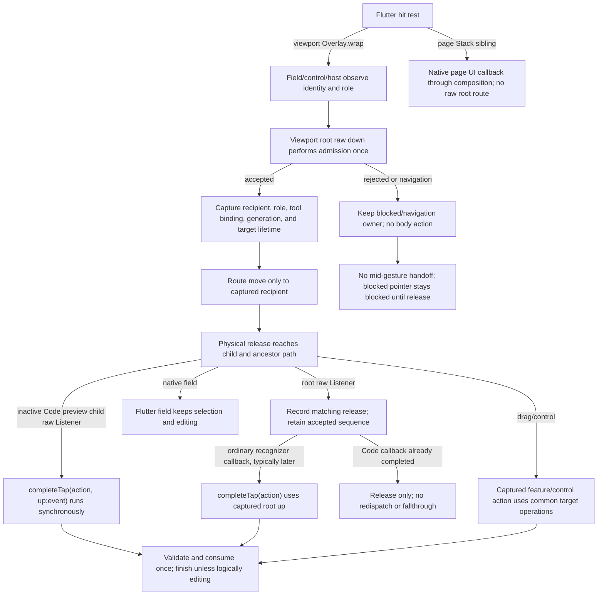

# Canvas input delegation migration

Status: draft

Date: 2026-11-09

This plan implements the proposal in [ADR 0004](../adr/0004-delegate-canvas-input-behavior.md).
The ADR and this plan link to each other. This draft does not authorize
implementation. The accepted [ownership contract](../arch/ownership.md),
[editor lifecycle contract](../arch/editor-lifecycles.md), and
[interaction model](../specs/interaction-model.md) remain authoritative until
the ADR is accepted and implementation is separately authorized.

## Goal and scope

Separate shared pointer arbitration from per-feature interaction behavior without
changing user-visible behavior, saved document values, history ownership,
clipboard or upload workflows, touch support, or the grid contract. Keep
`CanvasInput` as the one arbitration owner and `CanvasInputTarget` as the cached
per-element binding for shared accepted operations. Move shape label recognition
to shape resources, arrow body gestures to the arrow view, empty-canvas selection
and quick text to `SelectTool`, and erase sampling to `EraserTool`. Route every
`CanvasTool` through one exhaustive `ToolInput` binding.

The migration includes constructor and caller updates, focused browser tests,
architecture tests, and later ownership-document updates. It does not include
changes to document models, codecs, generated serialization, history snapshot
types, app bootstrap, platform code, `infinite_lazy_grid`, Flutter, or
dependencies.

## Authority, baseline, and limits

The implementation baseline is `main` at `4837c3d` plus the completed shape
label feature present in the checkout at the start of implementation. Before
changing source, record the complete dirty status and diff for that feature and
keep it intact as part of the baseline. Do not claim existing test or build
results as evidence for this future design. Record the actual test outcomes,
durations, and source/test line counts at execution time; these are observations,
not a line-count target or a promise of savings.

The accepted behavior contract already defines immediate shape activation,
shape-label double-click, empty-canvas quick text, native text selection, media
link opening, selection and movement, tool placement, and cancellation. This
plan does not redefine those behaviors. If execution finds a conflict between
source and the accepted contracts, report it instead of silently changing the
contract or implementation target.

### Source evidence to preserve

- `CanvasTool` is the closed eight-value enum in
  `lib/canvas/editor/editor_history.dart`: `select`, `text`, `code`, `media`,
  `shape`, `pen`, `arrow`, and `eraser`.
- `CanvasInput` in `lib/canvas/editor/canvas_input.dart` currently owns
  arbitration, creation tool instances, placement dispatch, eraser hit testing,
  empty and shape quick-tap recognition, marquee state, and an arrow body-drag
  gesture. It repeats selected-tool checks during pointer move and release.
- `CanvasInputTarget` already captures an element lifetime and input generation.
  `CanvasView` caches these bindings in `_targets` by ID. Keep the same cached
  identity; do not add a second registry or handler hierarchy.
- `CanvasView._attachSession` installs the grid controller's raw pointer
  callbacks. `_CanvasElementHost`, controls, and native fields also receive
  pointer events. The installed `infinite_lazy_grid` source at commit
  `82c3b07481c9e811590183437563d07cecb3e7d0` places raw `Listener` callbacks
  around `RawGestureDetector` and children in `lib/core/render.dart` lines
  110-124. Flutter's `RenderProxyBoxWithHitTestBehavior.hitTest` visits children
  before adding itself (`rendering/proxy_box.dart` lines 183-189), and
  `GestureBinding.dispatchEvent` walks the hit-test path (`gestures/binding.dart`
  line 506). This supports the current inner-control/host/root route; it does
  not establish every later recognizer callback order. The source-confirmed
  exception is `CodeElementView._handlePreviewPointerUp` (lines 116-134), which
  invokes `widget.onEdit()` synchronously in the inactive preview's child
  `Listener` (`_previewInteraction`, lines 154-163), before ancestor/root raw up.
  T0 verifies this delivery and the ordinary recognizer path in tests; do not
  patch the grid or Flutter.
- Hit testing remains geometry-aware. `ArrowElementView` uses the foreground
  `_ArrowPainter.hitTest`; its ignored `SizedBox` child is not an ignored arrow
  target. Preserve path hit testing, including dashed gaps. Do not replace it
  with global rectangular hit routing. Arrow point handles remain a separate
  overlay.
- `CanvasInputTarget.attached`, `current`, target lifetime, and pointer
  generation guard stale callbacks. Preserve them. The media `afterActivate` /
  `fromPointer` gates and source-keyed media load guards remain separate. Do not
  add asynchronous edit tokens or alter the accepted
  [asynchronous edit decision](../adr/0001-cancel-unfinished-pastes.md).
- Root `CanvasInput.pointerUp` alone does not complete an object action. Ordinary
  recognizer callbacks typically follow root up, but the inactive Code preview's
  child raw listener calls its edit action synchronously before ancestor/root up.
  An admitted action may therefore complete before or after root up; keep the
  sequence until accepted completion and finalize exactly once unless the session
  is logically editing.

The viewport root route applies only inside `CanvasView._buildCanvasViewport`'s
`Overlay.wrap`, built in the grid's `viewportBuilder`: viewport body, native
fields, and viewport controls participate in its raw listener path;
`CanvasView._buildControlsPortal` uses the nearest local Overlay there.
`CanvasPage` supplies `widget.chromeBuilder`; `CanvasView` inserts its output as
a sibling of `LazyCanvas` in `CanvasView`'s `Stack`, outside that grid listener.
Page options, toolbar, and menus stay native UI controls and
do not claim raw pointer sequences; their existing callbacks send generic
end-edit/control/reset notifications through composition and the current cached
target, with normal UI gating. Do not add a global listener or grid callback for
page chrome.

## Target design

### Ownership before and after

| Concern | Current owner and source | Proposed owner and source | Must remain true |
| --- | --- | --- | --- |
| Device/button admission, enabled state, held pointers, blocked pointers, navigation precedence, and current pointer recipient | `CanvasInput` in `canvas_input.dart` | `CanvasInput` in `canvas_input.dart` | One accepted route per pointer; no mid-gesture recipient handoff. |
| Cross-element selection, activation, Auto promotion, group movement, transforms, stale callback checks, and operation grouping | `CanvasInput` plus `CanvasInputTarget` | `CanvasInput` plus the same cached `CanvasInputTarget` | Session remains the sole owner of active, selected, editing, and history state. |
| Element hit identity and event role | `_CanvasElementHost`, controls, native fields, and `CanvasInputTarget.pointerDown` in `canvas_view.dart` / `canvas_input.dart` | Same child-host-root path, with explicit body/native-field/control role registration and root dispatch | Inner field/control role wins; repeated registration for one pointer is idempotent. |
| Shape label tap-pair recognition and candidate reset | `_QuickTextTap`, `_resolveQuickTextTarget`, and `_focusElement` in input/view | `ShapeEditorResources.acceptBodyTap` and the mounted `ShapeElementView` | First tap activates immediately; a valid second click edits; native focused-field selection stays native. |
| Empty-canvas marquee and quick transparent text | `_MarqueeGesture` and `_QuickTextTap` in input | `SelectTool` in `tools/select_tool.dart` | Existing empty-only double-click rules, selection toggle, slop, cancellation, and quick-text placement remain unchanged. |
| Eraser hit-test/remove sample stream | `_EraserGesture` and `_erase` in input | `EraserTool` in `tools/eraser_tool.dart` | Existing hit-test geometry, operation finish, and no-rollback-on-cancel behavior remain. |
| Arrow body click and drag | `_ArrowDragGesture` in input | `ArrowElementView` body recognizers plus common target methods | Raw screen deltas, first-threshold movement, group movement, activation, and path hit testing remain. |
| Text, code, and media feature activation/editing and end-editing | `_focusElement`, `_clearElementEditing`, and element callbacks split across view/page | Existing feature views/resources with narrow callbacks from `CanvasView` composition | No new editor-resource hierarchy or direct document writes from views. |
| Tool-specific input dispatch and placement | Repeated `session.tool` branches and `onPlace` switch-back in input/view | One exhaustive `CanvasTool -> ToolInput` lookup definition; three explicit placement bindings | Down captures the sequence binding; idle hover/exit looks up the current tool's optional handler, while an active Pen exit uses its captured binding. Placement terminalizes and consumes its original sequence. |
| Viewport input contract | `CanvasInputViewport` declared in `canvas_input.dart`, implemented by `CanvasView` | Unchanged interface in `canvas_input_viewport.dart` | No imports from tools to `CanvasInput` or `CanvasView`; no compatibility re-export. |
| Tool and feature resources | `CanvasInput` owns pen/arrow/shape tools; `CanvasView` owns retained resources | Same owners; add Select and Eraser tool instances to input ownership | Draft sampling remains tool-owned; session remains the document writer. |

### Event roles and routing

The three roles describe the hit surface, not the saved element type:

| Role | Registration and handling |
| --- | --- |
| `body` | Element host registers the target identity. The root may admit a body tap or drag only after normal device, button, tool, modifier, navigation, and pointer checks. Inactive Code source/title preview is `body`, even where its read-only surface uses `CodeEditor`; its raw preview listener owns activation/drag and cancels transient `re_editor` selection. |
| `nativeField` | A viewport field's Flutter recognizers and text selection keep the pointer. Canvas input observes the sequence only for shared activation/Auto, menu, and interruption rules; it never turns the field press into a body tap. Active editable Code source/title is `nativeField`; caret, selection, IME, and native interaction remain untouched. Role follows interaction state and surface, not widget class. Page chrome fields remain outside the grid root route. |
| `control` | A viewport control registers the target before root dispatch. Once the root accepts `CONTROL DOWN`, it calls `onControlPress` before any body-eligible action; the control's own recognizer retains the gesture, and the body beneath it cannot act. Page chrome controls remain outside the root route. |

Register this role at the existing viewport Markdown editor, code source/title
surfaces (as `body` while inactive previewing and `nativeField` while actively
editable), media URL field, shape label field, and viewport controls. Do not
classify every `CodeEditor` widget as a native field. The
registration is observation only: do not wrap a native field in an absorbing or
competing gesture layer. Page options, toolbar, and menus are not root-registered;
their existing UI callbacks issue generic notifications through composition and
the current cached target under normal UI gating.

For viewport pointer down, the hit-path hosts register the hit identity and role;
the root raw listener accepts or rejects and routes the pointer once. Preserve
this route and make repeated host/root observations idempotent. Capture the recipient,
role, current tool binding, pointer, modifier state, Space state, and target
lifetime at down. Moves, up, and cancel go only to that captured recipient; do
not reselect by current tool or pointer location. A non-Select creation tool
continues to receive its root sequence when the pointer is over an existing
object. Space, middle-button, secondary-button, and Select right-click/pan rules
retain their current precedence, including the 4-logical-pixel right-click
threshold.



Ordinary recognizer-based body callbacks typically complete after root up; the
custom inactive Code preview listener is the known exception and invokes its
action synchronously on child raw up before ancestor/root raw up. T0 must verify
both actual delivery paths rather than infer their order. T1 handles either
completion order: early Code completion consumes the sequence before root-up
bookkeeping, while an ordinary recognizer completion uses the root-captured up.
If either path cannot preserve exactly-once completion, stop before changing
sequencing.

| Sequence | Down | Move | Raw up | Cancel or recognizer completion |
| --- | --- | --- | --- | --- |
| Accepted object body, ordinary recognizer | Host registers body identity; root admits once and captures target, role, tool, pointer, and generation. | Route only to that target; common movement begins only after its accepted drag threshold. | Record the physical release and retain the accepted sequence. | The later accepted recognizer calls `completeTap(action)` using the captured root up; finish once unless logically editing. |
| Inactive Code source/title preview | Host registers the body role, including the read-only `CodeEditor` surface. | The child raw preview listener preserves existing activation/drag behavior and cancels transient `re_editor` selection on drag. | The child listener calls `onEdit(event)` synchronously before ancestor/root raw up. | `CanvasView` calls `completeTap(action, up: event)`; it validates and consumes the physical release once. A later root up only releases bookkeeping, with no duplicate action or Select fallthrough. |
| Active editable Code source/title | Register as native field, regardless of the underlying `CodeEditor` widget type. | Flutter retains caret, selection, drag, and IME behavior. | Release pointer bookkeeping without a body action. | Native editor interaction remains native; never call body `completeTap`. |
| Viewport control | Control registers before host/root; root admits `CONTROL DOWN`, captures control role, and synchronously calls `onControlPress` before any body-eligible action. | Control recognizer owns its movement; the body target cannot receive a tap or drag. | Release pointer bookkeeping without body action. | Run the control's accepted completion; do not defer `onControlPress` until up/completion. |
| Page option, toolbar, or menu control | Outside the grid root route; existing UI callback runs with normal UI gating and uses composition/current cached target for generic end-edit/control/reset notification. | Native UI recognizer owns its movement; it does not claim a raw canvas sequence. | No grid raw-pointer bookkeeping. | Run the existing UI action and any generic notification; do not add a root listener or grid callback. |
| Native field | Field registers native-field role; input observes the target but leaves Flutter field dispatch intact. | Flutter handles caret, selection, drag, and IME traffic; input does not synthesize a body action. Feature candidates are invalidated through `onInterrupt` without canceling or rerouting the pointer. | Input releases pointer bookkeeping; Flutter recognizer remains owner. | Native field completion stays native. Only the existing shared activation/Auto/menu rules may observe it; never call body `completeTap`. |
| Empty Select canvas | Viewport root captures Select binding with down samples and modifier/selection state; viewport hit test confirms no target. | Before slop, retain click candidate; beyond slop, Select owns marquee and updates session selection. | Complete the empty click pair only after valid up ordering and a second empty hit test. | Valid second click creates transparent text at its down position; cancel restores the pre-marquee selection and invalidates the pair. |
| Non-Select over an object | Root captures the selected tool binding even if an object host is hit; no object-body action. | Route only to that tool binding; do not choose from the current tool again. | A terminal placement discards later moves and consumes matching release without an up callback, Select action, or object action; a nonterminal tool receives its captured up. | Tool cancellation is local; no object tap or mid-gesture handoff. |
| Navigation | Space/middle/secondary precedence is resolved before custom editing; Select secondary input starts current pan/menu arbitration. | Grid pan receives its existing screen-space events and threshold. | Finish pan/fling or open the right-click menu only under existing distance rules. | Cancellation does not fling or hand the pointer to an edit recipient. |

### Binding and callback contracts

Keep `CanvasInputTarget` a concrete per-ID binding, created and cached by
`CanvasView._target`. It continues to expose the common operations `activate`,
`interact`, `move`, `transform`, and `finish`, plus role-aware down registration.
Its target lifetime and pointer-generation checks remain authoritative.

Add one completed body-tap entry point with this intent and signature:

```dart
void completeTap(
  void Function(PointerDownEvent down, PointerUpEvent up) action, {
  PointerUpEvent? up,
});
```

Ordinary `GestureDetector.onTap` callers omit `up` and use the router's already
captured root up. The inactive Code preview instead exposes `onEdit` as
`ValueChanged<PointerUpEvent>`; `CanvasView` wires it to
`target.completeTap(action, up: event)`, forwarding the actual child raw-up event.
`completeTap` validates a supplied event against the admitted pointer, down,
target, and generation, then records that physical release idempotently; it never
fabricates an event. It rejects a stale target, a different or absent current
sequence, modified or Space input, a control or native-field role, a drag, a
canceled sequence, a non-Select tool, or a navigation sequence. It invokes the
supplied feature action synchronously in the original trusted Flutter callback
and at most once, then owns the one operation finish if the session is not
logically editing. If child completion precedes root up, the eventual root up
only releases bookkeeping and cannot dispatch again or fall through. If root up
precedes recognizer completion, retain the sequence until the accepted callback.
If feature policy needs common activation, the action uses the same target's
ordinary `activate` path. While `completeTap` is invoking that action, `activate`
performs activation and Auto promotion but leaves finalization to `completeTap`;
outside that scope, `activate` keeps its existing completion behavior. This
makes `completeTap` the only finalizer for its captured sequence. Root raw up
alone does not activate or open an object.

Keep `activate({afterActivate, fromPointer})` for activation and non-pointer
keyboard/semantics actions. Remove its `edit` argument and remove
`onFocusElement` from input. The existing media accepted-pointer guard remains
in force for pointer-owned actions; semantic and keyboard activation still obey
the current media behavior. `interact`, movement, transforms, and finish remain
common accepted operations.

Configure only these optional feature callbacks in `CanvasView` composition:

| Callback | Owner and lifetime | When it runs |
| --- | --- | --- |
| `onInterrupt` | Feature resource/action bound to the cached target; invoked by the existing `CanvasView` target cache | Global input interruption, native-field observation, target detach, document replacement/restoration, or disposal invalidates ephemeral feature recognition. A native-field notification does not cancel or reroute its pointer. It must not dispose a retained controller or cancel unrelated asynchronous edits. |
| `onControlPress` | Feature action bound to the cached target | A control down invalidates local tap candidates even if the same object stays active. It may end that feature's editing when the accepted interaction model says so. |
| `onEndEditing({bool commitDraft})` | Existing feature resource/view action bound to the target | Shared deactivation, Escape, tool change, or history operation asks the current feature to end editing. Preserve the distinction between normal draft commit and `commitDraft: false` for undo/redo or restore paths. |

`CanvasView` snapshots the existing `_targets` before fan-out so synchronous
session notifications cannot invalidate iteration. It invokes `onInterrupt`
synchronously before advancing/invalidation of the cached `CanvasInputTarget`
gesture generation or refreshing that cache. The hook only resets ephemeral
feature candidates: it does not focus, write session/document state, or schedule
asynchronous cancellation. This ordering ensures a target's `attached` check
does not skip its reset after generation invalidation. Target removal/disposal
also resets its candidate through the resource-local detach path, even if the
target has already become invalid; do not add a second registry. Element controls
call their bound target directly. A viewport native-field registration notifies
the existing cache to clear ephemeral candidates while Flutter keeps the field
pointer; it does not interrupt the captured native sequence. Page-level option
controls remain outside root routing and signal generic control/end-edit/reset
notifications through the existing input-to-view composition callback, which
resolves the current cached target under normal UI gating.
`CanvasView._clearElementEditing`
becomes generic feature-end callbacks plus session/focus bookkeeping. The closed
view switch for layout, resources, and feature callback composition may remain;
it must not decide click-to-edit policy.

### Tool binding contract

Add `lib/canvas/editor/tools/tool_input.dart` with a minimal immutable callback
record/class named `ToolInput`:

```dart
final class ToolInput {
  const ToolInput({
    required this.down,
    this.move,
    this.up,
    this.cancel,
    this.hover,
    this.exit,
  });

  final void Function(PointerDownEvent) down;
  final void Function(PointerMoveEvent)? move;
  final void Function(PointerUpEvent)? up;
  final void Function()? cancel;
  final void Function(PointerHoverEvent)? hover;
  final void Function(PointerExitEvent)? exit;
}
```

Use raw Flutter events, not a normalized all-purpose sample type. Keep one
exhaustive `CanvasTool`-to-`ToolInput` lookup definition for all eight values; it
may be invoked for separate events, but do not add a switch per event. At an
accepted down, capture its binding and route that sequence's move/up/cancel only
through it. Hover and exit have no preceding down: while idle, look up the
current tool's optional callback and do not fabricate a captured sequence or
down. If Pen owns an active captured sequence, its exit goes to that captured
Pen binding and commits the stroke; it terminalizes that sequence, discards
later moves, and consumes the matching up without reviving or recommitting it.
Optional callbacks are absent when a mode does not support them. Do not add a
plugin map, dependency injection framework, new base class per tool, dummy
placement tool, preview interface, or model factory.

The router validates raw cancel against the original accepted pointer, then calls
the same zero-argument `cancel` hook exactly once for raw cancel or global
interruption. The callback is
`void Function()?` (`VoidCallback?`); do not synthesize a `PointerCancelEvent`.
Existing adapters remain `pen.cancel()`, `arrow.cancel()`, and `shape.cancel()`.
Select cancellation restores the selection captured at marquee down and resets
its click state; Eraser cancellation finalizes already accepted deletions without
rollback. Cancellation does not carry clipboard tokens or cancel asynchronous
edits. A terminal route remains consumed through matching up/cancel; raw cancel
still invokes its captured hook once as above, but cannot repeat output or route
to a new recipient.

One-shot outputs terminalize the captured route before invoking their existing
callbacks. Text/Code/Media placement terminalizes before calling the existing
view factory; Shape and Arrow output adapters terminalize before insert or
automatic-Select callbacks. This includes an Arrow primary release that finishes
while the secondary button is still held and may be observed on move. A terminal
route retains consumed ownership through its matching up/cancel: discard later
moves and consume release without delivering a Select up or starting marquee,
selection, or object action. No up callback is required for a completed
placement. Output/exit completes raw sampling, so matching release cannot finish
it twice. A factory/callback failure keeps its existing error propagation and
must not fall through to another recipient. Implement this as private router
sequence state or a common output-adapter notification, not a generation token,
`ToolResult` framework, inferred current-tool diff, or public compatibility API.
This terminal disposition is not a new recipient. A real explicit tool change or
interruption still cancels an active nonterminal draft once and blocks its held
pointer; automatic Select return caused by output does neither.

`CanvasInput` continues to construct and dispose the existing `PenTool`,
`ArrowTool`, and `ShapeTool`, and adds owned `SelectTool` and `EraserTool`
instances. Keep the current `input.pen`, `input.arrow`, and `input.shape`
accessors used by tool options and shortcuts. Pen continues to receive raw screen
events and pressure. Shape, arrow, and placement bindings perform the same
viewport conversion at the same feature boundary as today.

| `CanvasTool` | Binding and owned behavior | Required routing and regression coverage |
| --- | --- | --- |
| `select` | `SelectTool` owns empty-canvas marquee and quick text; `CanvasInputTarget` owns object arbitration. | Capture modifier/selection at down; empty quick text requires two empty primary-mouse clicks; object/control press cancels it; cancel restores selection and resets click state. Test `canvas_input_test.dart`, `canvas_selection_test.dart`, and new `select_tool_test.dart`. |
| `text` | Explicit placement callback to `CanvasView._addTextBlock`. | Mark the captured route terminal before invoking the factory; insert once, return to Select, and consume matching release without an up callback or Select action. Test `text_element_test.dart` and `canvas_input_test.dart`. |
| `code` | Explicit placement callback to `CanvasView._addCodeBlock`. | Preserve defaults, position, grouping, automatic Select return, and terminal ownership through matching release; no placement up callback is required. Test `code_interaction_test.dart` and `canvas_input_test.dart`. |
| `media` | Explicit placement callback to `CanvasView._addMedia`. | Preserve defaults, source handling, grouping, automatic Select return, and terminal ownership through matching release; no placement up callback is required. Test `media_element_test.dart` and `canvas_input_test.dart`. |
| `shape` | Existing `ShapeTool` owns sampled draft/options and emits the shape value. | Preserve viewport conversion, minimum size 32, output/defaults, cancel discard, and return behavior; terminalize before insertion/automatic-Select callback. Test `shape_tool_test.dart` and shape element tests. |
| `pen` | Existing `PenTool` owns raw screen samples, pressure, and stroke draft. | Preserve captured defaults and persistent Pen mode. Idle hover/exit uses the current Pen binding; an active captured Pen exit commits once, and its matching up is consumed. Raw/global cancellation calls `pen.cancel()` once and discards. Test `pen_tool_test.dart` and pen element tests. |
| `arrow` | Existing `ArrowTool` owns sampled draft, geometry defaults, and secondary-button handle pinning. | Preserve conversion, minimum length, secondary pinning, and cancel discard; terminalize before output callback, including primary-release completion while secondary remains held. Test `arrow_tool_test.dart` and arrow element tests. |
| `eraser` | New `EraserTool` owns viewport hit-test/remove sampling. | Preserve per-sample geometry hit testing, operation finish, no rollback on cancel, and persistent Eraser mode; `eraser.cancel()` finalizes accepted deletions. Test existing `canvas_eraser_test.dart` and new `eraser_tool_test.dart`. |

Text, code, and media each get a direct placement binding to the current
`CanvasView` factory (`_addTextBlock`, `_addCodeBlock`, `_addMedia`). The router
marks the captured route terminal before invoking each factory. Remove the
`onPlace` callback that switches back on the later `session.tool`. Keep each
factory's constructor defaults, theme resolution, UUID, session insertion, and
return-to-Select operation in its current view/session owner. Terminal ownership
consumes the original sequence through matching up/cancel; it discards later
moves and cannot activate Select, start marquee, or perform an object action.
Placement does not need an up callback. Preserve factory error propagation and
never fall through to a different recipient. Shape/Arrow output adapters follow
the same terminal-before-callback rule. Arrow's primary release may finish while
secondary remains held, including completion on a move event. A Pen exit commit
also completes sampling; matching release is consumed without a second finish.

### Select, eraser, and viewport ownership

`SelectTool` in `tools/select_tool.dart` owns empty-canvas marquee state and the
empty-canvas double-click-to-transparent-text policy. It receives the session,
the narrow viewport contract, captured modifier state, existing pan slop, and
narrow end-editing/quick-text callbacks. It does not know about widgets or grid
implementation. `CanvasInput` exposes the existing marquee value through a
read-only getter for the overlay. Marquee cancellation restores the selection
captured at down; selection changes remain session operations, and text creation
remains the view/session callback.

`EraserTool` in `tools/eraser_tool.dart` owns the existing hit-test/remove sample
stream and operation finish. It receives the session and narrow viewport
hit-test contract; it does not own data storage, theme, or widgets. Cancel does
not restore already erased objects, and the eraser remains selected until a
different tool is chosen.

Move the existing `CanvasInputViewport` interface, unchanged in methods and
semantics, to `lib/canvas/editor/canvas_input_viewport.dart`. Import it from
input, tools, view, and tests. Do not re-export it from `canvas_input.dart`; use
grep to update every actual caller and test.

### Shape tap-pair and resource lifecycle

Shape recognition lives in `ShapeEditorResources`, not `CanvasInput` or
`SelectTool`. Add `acceptBodyTap(down, up)` and call it only from an admitted
Select body tap after immediate common activation and Auto promotion. The first
accepted click activates immediately and then stores a candidate containing the
raw down/up samples and the current document identity after activation/promotion.
A second eligible click on the same still-attached shape enters or requests
label editing. Do not use `GestureDetector.onDoubleTap`, a delayed single tap, a
wall-clock timer, a saved-data snapshot, or a mirrored active/editing flag.

Add `lib/canvas/editor/tap_pair.dart` for only the shared timing/distance
predicate, used by exactly the empty-Select and shape recognizers. Keep separate
owners and state for those two policies. Match the existing primary-mouse
`kDoubleTapTimeout`, `kDoubleTapMinTime`, `kDoubleTapSlop`, completed-up ordering,
and existing drag-slop rejection. The native drag recognizer keeps its current
slop. The helper does not own timers, feature policy, target identity, or click
state.

The shape resource clears its candidate when it loses active state, sees a
different document identity/restoration, or is detached. The mounted shape view
also clears it when culled/unmounted; retained text controller, focus node, and
scroll controller stay alive in `CanvasView`. Logical editing/content/focus
nodes remain their existing resources. Any deferred post-frame focus request
belongs to the mounted feature widget `State`, which captures its expected
resource, field, and target and validates `mounted`, that the same resource
remains attached, that the expected target is still active, and that the desired
field is still editing before requesting focus. A stale frame cannot
reopen or refocus the editor. Text may keep its immediate
`FocusNode.requestFocus` on logical field entry where baseline ordering allows;
`TextMarkdownEditor` is already stateful and `TextElementView` is stateless, so
do not force a new root view state or controller hierarchy. Code uses
`CodeElementViewState`, Media its existing view/panel state, and Shape its
existing state for deferred requests. Store the first candidate only after
activation/promotion so the promotion itself does not invalidate it; unrelated
later document edits still clear it. This removes `_sameElements` and
`_promotingForActivation` workarounds.

A native-field-role down anywhere on the canvas clears pending feature tap
candidates through the existing cache before Flutter handles the field gesture.
It does not call `completeTap`, turn the field into a control, or interrupt native
selection. A shape field's own press also clears its resource candidate locally.

Focused shape-field double-click remains Flutter native word selection. Enter
finishes unless an IME composition is active; Shift+Enter inserts a newline.
Control presses finish shape editing while leaving the shape active. Keep the
current plain text, geometry, style, scrolling, paste, history, and selection
rules.

### Feature behavior ownership

| Feature | Existing source and current behavior | Proposed local owner and callback use | Required behavior and tests |
| --- | --- | --- | --- |
| Text | `TextElementView`, `TextMarkdownPreview`, `TextMarkdownEditor`, and `TextEditorResources`; input currently uses `_focusElement(edit: true)` and view callbacks. | Preview/native editor owns edit, focus, and interaction effects. `CanvasView` binds generic activation/interact/move and feature end-edit callback. | Preview activates and edits; Markdown link interaction keeps its behavior and Auto promotion; focused native selection remains native. Resize stays editing; options, move, and rotate end editing as accepted. Test `text_element_test.dart` and `canvas_history_test.dart`. |
| Code | `CodeElementView` custom preview pointer tracking, title/source surfaces, and `CodeEditorResources`. | Inactive source/title preview is a `body` role (including a read-only `CodeEditor`); its existing child raw listener owns activation/drag and cancels transient `re_editor` selection. Active editable source/title is a `nativeField` role; Flutter owns caret, selection, IME, and native interaction. Code view/resource owns the state-dependent role and feature policy; generic target provides common operations. | Preserve both roles by interaction state, not widget class. A child raw-up callback completes synchronously before root raw-up; an ordinary recognizer completion may follow root up. Test both timelines, duplicate supplied/root release, stale callback after cancel, exactly-once action/no Select fallback, inactive drag cleanup, and untouched active native editing. Also test rotation, controls, wrapping/scroll boundaries, and history. Update every direct `CodeElementView` constructor caller atomically. |
| Media | `MediaElementView`, `_MediaBody`, `_MediaUrlPanel`, and `MediaResources`; `CanvasView` currently supplies `target.activate(afterActivate, fromPointer)`. | Shared `_MediaBody` remains the body interaction surface; existing media view/resource owns inactive activation, active open, unresolved URL focus, and image behavior. | Inactive link tap activates only; active admitted body tap opens once; images never open; unresolved links are not launched. Keep native link keyboard/semantics Open, raw resolved URL, launch errors, and source-keyed guards. Preserve `afterActivate`/`fromPointer`. Test media element/link/card/request and clipboard tests. |
| Shape | `ShapeElementView`, `ShapeEditorResources`, `_QuickTextTap.shapeTarget`, and `_focusElement`. | Shape view captures accepted body tap; `ShapeEditorResources.acceptBodyTap` owns its candidate; common target performs immediate activation/Auto promotion. | First click activates immediately, eligible second same-live-shape click edits; A-B-A, controls, modifiers, drags, fields, culling, restoration, and document change reject stale recognition. Test shape element, input, resources, and history. |
| Pen stroke | `PenElementView` GestureDetector and `PenResources`; target `interact` promotes Auto without active/editing state. | Pen view owns body tap/pan recognizers; common target still handles Auto promotion and selected-group movement. | A tap never makes a stroke active; direct primary drag and selected-group drag remain; modifier click only changes selection; creation tool remains enabled. Test pen element, input, and selection. |
| Arrow | `ArrowElementView` path painter and separate `ArrowEditor` point overlay; `_ArrowDragGesture` is in input. | Arrow view owns body tap/pan and transient body-drag state; common target owns activation/group movement/history. | Path-level hit test still includes dashed gaps; selected group movement and Auto promotion remain; arrow point handles stay separate; secondary button held during drawing still pins handles without changing pointer owner. Test arrow element/tool and input. |

Do not build a central control-action-by-element-type matrix. Keep existing
feature-specific differences explicit in callbacks: text resize stays editing
while text options/move/rotate end it; code controls stay editable; shape
controls end shape editing while leaving it active; media URL draft commits on
normal end but is not committed during undo/redo or restoration. `CanvasView` may
retain its focus-node-to-`EditorField` lookup for shortcut routing and its closed
resource/layout switch. Neither becomes a click/edit policy owner.

### Transient-state reset and lifetime matrix

Global input arbitration and local feature recognition are separate. A global
interrupt cancels a captured nonterminal pointer sequence once, blocks its held
pointer until release, resets empty-Select and feature-local tap candidates
through the existing target cache, and never rolls back accepted document edits.
A route already terminalized by output/exit remains consumed through matching
release without repeating output or handing off. Local control or target events
can invalidate one feature candidate without taking over the pointer. Native
field focus and pending asynchronous operations are not pointer-candidate state.

| Event or condition | Global pointer sequence | Empty Select candidate | Shape candidate | Native field / async work |
| --- | --- | --- | --- | --- |
| Active shape A -> B -> A | Each accepted tap completes normally; no old pointer is reused. | Reset by target/control routing as today. | Clear when A loses active state; returning to A starts fresh. | Retained controllers survive if their target survives; no synthetic focus. |
| Control press on still-active shape | Captured as `control`; body action rejected. | Invalidate before normal control handling. | `onControlPress` clears candidate and ends shape editing as specified, while active stays A. | Control callback does not alter unrelated focus or async work. |
| Modifier changes or Space/navigation begins | Preserve existing admission/precedence; interruption blocks held pointer until release. | Clear candidate. | `onInterrupt` clears candidate even if shape remains active. | Native text field keeps Flutter selection. |
| Tool changes, modal/page blocking, session replacement, or navigation interruption | Cancel a nonterminal sequence once and prevent mid-gesture handoff; terminal output stays consumed through release. | Clear. | Clear through cached target hooks. | Do not add clipboard/image cancellation; a replaced session remains protected by existing lifetime rules. |
| Any later document edit between taps, including an unrelated edit or later Auto promotion | Accepted current sequence completes under common history rules. | Pending pair is invalidated on the changed document snapshot. | Candidate is assigned after first activation/promotion; any later document identity change clears it. | Async clipboard/upload work continues under ADR 0001; only its resulting document edit can invalidate recognition. |
| Undo/redo or document restoration | End operation with existing `commitDraft: false` behavior and invalidate stale generation. | Clear. | Clear, including when ID/type survives. | Preserve resource controllers and history rules; do not commit a media draft during restore. |
| Drag beyond native/common slop | Captured body drag owns the sequence; no tap callback. | Clear pair. | Clear pair; no label editing. | Code preview drag still cancels its transient native text selection. |
| Control receives down | Control callback only; no body tap. | Clear before normal control handling. | Clear through `onControlPress`; control policy may end shape editing while keeping it active. | Control behavior remains feature-local. |
| Native field receives down | Keep the captured native-field route; no body tap or pointer handoff. | Clear through the native-field notification. | Clear through the `onInterrupt` notification and local field listener; native field double-click remains word selection. | Flutter retains caret, selection, keyboard, and IME traffic. |
| Target detach, deletion, or reinsertion | Target lifetime/generation rejects stale callback. | Clear pending pair. | Clear candidate; a reinserted ID has a new lifetime and cannot complete it. | Existing resource detach/disposal order remains. |
| Widget culling/unmount while resource is retained | No active pointer recognizer can complete into a new mount. | Select tool remains input-owned and is not tied to one widget. | Shape view clears click candidate; resource controllers/focus/scroll state remain retained. | Do not dispose resource or end logical editing only because of culling. |
| View/session disposal | Input generation invalidates callbacks. | Clear. | Clear candidate only. | Retained resources follow existing detach/dispose lifetime; no new async edit token. |
| Blocked pointer released | Keep blocked status until original release; never hand over mid-gesture. | Pair cannot complete. | Pair cannot complete. | Unrelated accepted async operations follow ADR 0001. |

## Files and callers in scope

The paths below are migration scope, not permission to edit them before ADR
acceptance. At T0, grep all actual constructor and symbol callers again; update
actual callers atomically with each interface change. Do not add compatibility
aliases or leave old and new behavior active at once.

| Area | Existing files likely changed | Planned new/deleted files and callsites |
| --- | --- | --- |
| Router and composition | `lib/canvas/editor/canvas_input.dart`, `canvas_view.dart`, `canvas_page.dart`, `editor_history.dart` only if a real caller requires it | Add `lib/canvas/editor/canvas_input_viewport.dart`; add `lib/canvas/editor/tools/tool_input.dart`, `select_tool.dart`, `eraser_tool.dart`, and `lib/canvas/editor/tap_pair.dart`. Do not change enum values or history snapshots. |
| Feature views/resources | `elements/{text,code,media,shape,pen,arrow}/*_view.dart` and existing resource files where that feature has one | Keep files in their current feature directories. T3 converts `ArrowElementView` from `StatelessWidget` to `StatefulWidget` solely for local drag position in its `State`; do not add an arrow controller/resource or separate state hierarchy. Preserve `MediaLinkCard` as presentation-only and `_MediaBody` as the shared media interaction surface. |
| View callers and previews | `CanvasView._buildElement`, resource composition, page option listeners, and any preview passing changed callbacks | Keep feature callback wiring in composition; update all existing direct constructor calls. Do not invent new preview types. |
| Existing editor tests | `test/canvas/editor/canvas_input_test.dart`, `canvas_navigation_test.dart`, `canvas_eraser_test.dart`, `canvas_selection_test.dart`, `canvas_history_test.dart`, `canvas_arrange_test.dart`, `canvas_clipboard_test.dart`, `editor_session_test.dart`, `element_resources_test.dart`, `canvas_shortcuts_test.dart`, and `canvas_document_batch_test.dart` as behavior requires | Keep router-wide tests with editor owner; move no test merely to match the new file layout. |
| Existing tool tests | `test/canvas/editor/tools/pen_tool_test.dart`, `arrow_tool_test.dart`, `shape_tool_test.dart` | Add `test/canvas/editor/tools/select_tool_test.dart`, `eraser_tool_test.dart`, and `tool_input_test.dart`; add `test/canvas/editor/tap_pair_test.dart`. |
| Existing feature tests | `test/canvas/editor/elements/text/text_element_test.dart`; `code/code_element_test.dart`, `code_interaction_test.dart`, `code_language_picker_test.dart`; `media/media_element_test.dart`, `media_link_card_test.dart`, `media_link_preview_test.dart`, `media_link_request_test.dart`; `shape/shape_element_test.dart`; `pen/pen_element_test.dart`; `arrow/arrow_element_test.dart` | Update constructor helpers/callers in these actual files. `CodeElementView` is constructed directly in `code_element_test.dart`; `MediaElementView` in `media_element_test.dart`; `ShapeElementView` in `shape_element_test.dart`. No direct `TextElementView`, `PenElementView`, or `ArrowElementView` test constructor was found at baseline; those behaviors are covered through canvas tests. `TextMarkdownPreview` also has a direct preview test in `text_element_test.dart`. Re-run the caller search before changing signatures. |
| Widget and architecture checks | `test/canvas/editor/widgets/tool_options_test.dart`, `canvas_toolbar_test.dart`, `element_controls_test.dart`; `test/architecture/document_boundaries_test.dart`, `editor_boundaries_test.dart`, `library_boundaries_test.dart` | Update boundaries only for the approved ownership move. Do not weaken architecture assertions. |
| Accepted documentation at implementation time | `docs/arch/README.md`, `docs/arch/ownership.md`, `docs/arch/editor-lifecycles.md`, `lib/canvas/editor/elements/AGENTS.md`, `lib/canvas/editor/tools/AGENTS.md`; `docs/specs/interaction-model.md` only for ownership-neutral clarification if needed | Update ownership/lifecycle guidance only after behavior tests prove the migration. Do not rewrite accepted behavior to fit a failing implementation. The proposal link in `docs/README.md` does not make this plan authoritative. |

No migration task changes `docs/README.md` beyond the current labeled proposal
link unless the final document lifecycle requires a map correction. This plan
does not authorize a commit, staging, or push.

## Ordered implementation tasks

Only work after ADR 0004 is accepted and implementation is explicitly authorized.
At each task, preserve the accepted contracts and use one integration owner for
shared `canvas_input.dart`, `canvas_view.dart`, and `canvas_page.dart` changes.
Feature-local view/resource/test preparation may run in parallel only when the
owned files are disjoint. Never have parallel edits to the router or composition
files. Each interface change updates its callers in the same step; no temporary
compatibility layer or dual recognizer.

### T0. Capture baseline and prove pointer delivery

**Prerequisites:** ADR 0004 accepted and implementation authorized; cleanly
identify the starting source snapshot as `4837c3d` plus the completed shape-label
feature present in the checkout.

**Owned files:** No production file changes. Add one focused ordering regression
test to `test/canvas/editor/canvas_input_test.dart` if existing tests do not
already establish the required path. Do not edit the grid, Flutter, or project
dependency files.

**Work:**

1. Record `git status --short`, the full pre-existing shape-feature diff, the
   revision, and line counts for the source/test files that later tasks change.
   Preserve unrelated working-tree state. Do not use line counts as a target.
2. Run the relevant existing Chrome tests listed in the verification section
   and record pass/fail, test counts, and elapsed time before adding or changing
   tests. Keep these baseline results separate from later design verification.
3. Use test-local event logging (not temporary application probes) to record
   the existing target/host/root/control/native-field/recognizer order for body,
   viewport-control, and native-field presses. Include the inactive Code
   preview's child raw-up callback and an ordinary `GestureDetector.onTap` path,
    recording each callback relative to ancestor/root raw up. Exercise viewport
    overlay controls separately from page options/toolbar/menus: the latter stay
    outside the grid root route and must be observed through their existing UI callbacks,
   not asserted to bubble through the root. Record duplicate observations as
   measured; do not require root-only admission or explicit role-precedence API
   behavior that T1 has not implemented.
4. Establish existing baseline invariants only: raw up does not finish an
   object sequence too early, stale recognizers cannot affect a later sequence,
   and a non-Select tool over an existing object follows the current route.
   Cover secondary Select pan/right-click threshold and held-pointer
   interruption/release. Do not require a new role API or future idempotency
   behavior as a T0 precondition.
5. Add or update assertions in the existing test file only for those observed
   baseline contracts. Record both Code-preview-before-root-up and
   ordinary-recognizer-after-root-up timelines, including duplicate host/root or
   native/control observations, rather than inferring a fixed order for every
   recognizer.

**Decided by lead:** The inactive Code preview's child raw listener invokes its
edit callback synchronously before ancestor/root raw up; ordinary recognizer
callbacks typically complete later. T0 verifies both actual event-delivery paths
in tests; it does not leave sequencing policy open. Characterize child-host-root
and viewport-overlay delivery plus separate page-chrome callbacks before
introducing the T1 role and root-only-admission API. Use supported evidence only;
do not change a grid or Flutter dependency.

**Implementer discretion:** Choose concise test helper names and event log
format. Record actual event samples, test count, duration, and line counts without
setting a target.

**Escalate:** If measured viewport delivery contradicts the source-path
assumption, page actions unexpectedly require raw root delivery, existing raw-up
retention/stale safety fails, or the route appears to require a grid/Flutter
change, stop and report the failing test and event trace. Defer failures specific
to the not-yet-implemented root-only admission or explicit role-precedence API
to T1; T0 does not pass or fail those future assertions.

**Focused checks:** Run `canvas_input_test.dart`, `canvas_navigation_test.dart`,
and `canvas_eraser_test.dart` with the Chrome command in Verification. Run the
three existing architecture boundary tests as a baseline. No analyze/build is
required at this characterization-only step.

**Completion evidence:** Baseline status/diff and line-count record; baseline
test outcomes, counts, and timing; focused traces for Code child raw-up before
root raw-up and ordinary recognizer completion after root raw-up; a passing
regression test; unresolved discrepancies, if any.

### T1. Move shape tap-pair policy and add admitted body taps

**Prerequisites:** T0 event-route evidence passes. The accepted interaction
model's shape and empty quick-text behavior remains unchanged.

**Owned files:** `lib/canvas/editor/canvas_input.dart`,
`lib/canvas/editor/canvas_view.dart`, `lib/canvas/editor/canvas_page.dart`,
`lib/canvas/editor/elements/text/text_element_view.dart`,
`lib/canvas/editor/elements/text/text_markdown_preview.dart`,
`lib/canvas/editor/elements/text/text_markdown_editor.dart`,
`lib/canvas/editor/elements/code/code_element_view.dart`,
`lib/canvas/editor/elements/media/media_element_view.dart`,
`lib/canvas/editor/elements/shape/shape_element_view.dart`,
`lib/canvas/editor/elements/shape/shape_editor_resources.dart`,
`lib/canvas/editor/elements/pen/pen_element_view.dart`,
`lib/canvas/editor/widgets/element_transform_controls.dart`,
`lib/canvas/editor/widgets/resize_handle.dart`,
`lib/canvas/editor/widgets/tool_options.dart`,
`lib/canvas/editor/widgets/canvas_toolbar.dart`,
`test/canvas/editor/canvas_input_test.dart`,
`test/canvas/editor/elements/text/text_element_test.dart`,
`test/canvas/editor/elements/code/code_element_test.dart`,
`test/canvas/editor/elements/code/code_interaction_test.dart`,
`test/canvas/editor/elements/media/media_element_test.dart`,
`test/canvas/editor/elements/shape/shape_element_test.dart`,
`test/canvas/editor/elements/pen/pen_element_test.dart`,
`test/canvas/editor/element_resources_test.dart`,
`test/canvas/editor/widgets/element_controls_test.dart`,
`test/canvas/editor/widgets/tool_options_test.dart`,
`test/canvas/editor/widgets/canvas_toolbar_test.dart`, and new
`lib/canvas/editor/tap_pair.dart` plus `test/canvas/editor/tap_pair_test.dart`.
The direct constructor callers include `CodeElementView` in
`test/canvas/editor/elements/code/code_element_test.dart`, `MediaElementView` in
`test/canvas/editor/elements/media/media_element_test.dart`, `ShapeElementView`
in `test/canvas/editor/elements/shape/shape_element_test.dart`, and
`TextMarkdownPreview` in
`test/canvas/editor/elements/text/text_element_test.dart`; re-grep all actual
constructors and update them in this same step. No direct `TextElementView`,
`PenElementView`, or `ArrowElementView` test constructor was found at baseline.

**Design and changes:**

1. Add the timing/distance-only tap-pair predicate and tests. Preserve the
   primary-mouse timeout, minimum interval, slop, release order, and drag
   rejection. Keep no timer and no saved-data comparison.
2. Add `CanvasInputTarget.completeTap(action, {PointerUpEvent? up})`, with the
   agreed signature and semantics in Binding and callback contracts. Ordinary
   recognizer callers omit `up` and use root-captured release; Code preview passes
   its actual child raw-up event. Validate any supplied event against the current
   admitted pointer/down/target/generation, record that physical release
   idempotently, and never fabricate an event. Gate on current target lifetime,
   same accepted Select sequence, primary supported body tap, body role, no
   modifier/Space, no drag, no cancellation/navigation, and exactly-once
   execution. Run the action synchronously in its original trusted Flutter
   callback; allow completion before or after root raw up. If it completes before
   root up, consume the sequence so later root-up delivery only releases
   bookkeeping. If root up comes first, retain the sequence until the accepted
   callback. Finish once unless the session is logically editing.
3. Add the optional target hooks `onInterrupt`, `onControlPress`, and
   `onEndEditing({bool commitDraft})`, configured in `CanvasView` from existing
   feature resources. Snapshot existing `_targets` before callback fan-out and
   invoke `onInterrupt` before advancing/invalidation of a cached
   `CanvasInputTarget` gesture generation or refreshing that cache. Its
   synchronous callback only resets transient candidates; it
   does not focus, write session/document state, or schedule asynchronous
   cancellation. Resource-local detach also resets a candidate if its target is
   already invalid. Do not add a registry. A viewport `CONTROL DOWN` calls
   `onControlPress` only after route admission and before body-eligible actions;
   route viewport element controls through the bound control role. Page-level
   options remain outside root routing and use existing UI-gated generic
   composition notifications.
4. Wire role registration atomically through every existing viewport field and
   its forwarding path: `TextElementView` / `TextMarkdownEditor`, Code
   source/title as `body` while inactive previewing and `nativeField` while
   actively editable, Media URL panel, and Shape label. The Code role follows
   interaction state/surface, not the `CodeEditor` widget type; active editable
   source/title caret, selection, IME, and native interaction stay untouched.
   Wire existing viewport element-control listeners and the generic host/role/
   target composition in `CanvasView` in the same change; keep page-control
   notification in `CanvasPage` on existing UI-gated composition callbacks.
   Implement explicit viewport role precedence and root-only admission with this
   wiring. Do not activate root body routing while any native field is left
   unregistered, and do not add root routing to page chrome.
5. Move shape candidate state and `acceptBodyTap(down, up)` into
   `ShapeEditorResources`. The accepted body-tap callback calls common immediate
   activation/Auto promotion first, then records the post-promotion document
   identity. The eligible second tap requests shape editing locally. Retain the
   first immediate activation and never call a delayed double-tap recognizer.
   Delete the centralized shape recognizer in this same atomic change so the
   shape resource becomes the sole recognizer; never run central and local shape
   recognizers together.
6. Keep the shape deferred focus request in the existing `ShapeElementView` State.
   Capture the expected resource, field, and target; validate mounted state,
   resource attachment, active target, and desired editing field before focus.
   Clear the candidate on inactive state, invalid tap pair, control/field press,
   drag, interruption, document/restoration change, detach, and view unmount. On
   unmount clear only the candidate; do not dispose retained controllers or end
   logical editing because of culling. A native-field role notification clears
   feature candidates through the existing target cache without canceling
   Flutter's field pointer; the shape field also clears its own candidate.
7. Remove shape-specific `_QuickTextTap` fields/branches,
   `_resolveQuickTextTarget` shape checks, shape-edit callbacks from input, and
   `_sameElements` / `_promotingForActivation` promotion exceptions. Until T4,
   retain only the minimal empty-Select recognition and document-change reset
   still needed by the existing router; do not add a second shape recognizer.
8. Route existing recognized text, code, media, shape, and pen body taps through
   the generic `completeTap` callback wired by `CanvasView`. Preserve their
   existing local actions and `_focusElement` policy until T2 moves focus/edit
   policy. For the inactive Code preview, change `onEdit` to
   `ValueChanged<PointerUpEvent>` and synchronously forward its actual child raw-up
   event through `target.completeTap(action, up: event)`; keep the child raw
   `Listener` (do not replace it with a `GestureDetector` or defer the action).
   Update every direct `CodeElementView` constructor caller/test in this same
   change (re-grep all callers, including `code_element_test.dart`). Preserve its
   activation/drag behavior and transient `re_editor` selection cancellation.
   Active editable Code source/title stays a native field and never calls body
   `completeTap`. Synchronous completion preserves trusted user-gesture context
   for media opening. Preserve non-pointer
   `activate` for keyboard/semantics and the media accepted-pointer gate. Markdown
   links and native editor interaction are not body taps. Arrow's existing
   raw-body path is explicitly permitted until T3; do not claim this T1 migration
   removes every raw-up activation path.
9. Preserve control behavior: shape move/resize controls finish label editing
   while shape remains active. Shape option panel pointer down invalidates the
   candidate even if the shape stays active. Native focused-field double-click
   continues word selection; Enter/Shift+Enter/IME behavior is unchanged.

**Decided by lead:** Shape recognition belongs to its resource/view, the shared
helper owns only timing/distance, immediate activation is not delayed, candidate
identity is post-promotion document identity, and no global resource registry is
added.

**Implementer discretion:** Keep helper argument order and private candidate
record names local to the existing Dart style. The public behavior and reset
conditions are fixed.

**Escalate:** If feature action cannot run after common activation without double
finishing, if `CanvasView` cannot fan out lifecycle callbacks using its existing
cache, if native shape-field double-click is intercepted, or if culling requires
disposing a retained resource, stop with the failing case and evidence.

**Focused checks:** Run `canvas_input_test.dart`,
`elements/shape/shape_element_test.dart`, `element_resources_test.dart`,
`canvas_history_test.dart`, `elements/text/text_element_test.dart`,
`elements/code/code_element_test.dart`, `elements/code/code_interaction_test.dart`,
`elements/media/media_element_test.dart`, `elements/pen/pen_element_test.dart`,
`widgets/element_controls_test.dart`, and new `tap_pair_test.dart` in Chrome.
Once T1's API is implemented, assert root-only admission, explicit role
precedence, duplicate host/root idempotency, and `onControlPress` at accepted
control down (before any body action). Test first
single-click activation, second same-shape edit, cross-target and empty/object
pair rejection, A-B-A, same-active control press, modifier, drag, document
change, Auto promotion, culling/unmount, restoration, stale frame focus, and
native word selection. Add both completion timelines: Code preview invokes its
actual-up `completeTap` synchronously before ancestor/root raw up; an ordinary
`GestureDetector.onTap` invokes `completeTap` after root up with no supplied up.
Also test duplicate supplied/root-up delivery and stale completion after cancel:
one action/finish at most, no Select fallback, inactive-drag selection cleanup,
and active native Code selection/IME intact.

**Completion evidence:** A single shape-owned candidate, passing immediate and
second-click tests, preserved empty quick-text tests, no shape-type branches in
input, no `_sameElements` / `_promotingForActivation` exception, and no duplicate
operation finish.

### T2. Prepare and integrate text, code, and media locally

**Prerequisites:** T1 callback/admission behavior is stable. The migration owner
has the accepted behavior tests for text, code, and media. T2a, T2b, and T2c may
run in parallel only on the disjoint feature-local files below. T2d waits until
all three preparations complete and is the sole owner of shared integration.
Preparation is staging only: add local methods and local unit coverage without
changing shared required constructors or activating duplicate policy. If a
preparation finds that a constructor change is necessary, reserve it for T2d;
do not create an alias or temporary compatibility layer. T2a-c own disjoint
feature test files; the shared input/history/clipboard/shortcut tests belong only
to T2d. Because T2d is serialized after preparation, it may update only the
actual direct-constructor callsites in a feature test where an integration
signature requires it; preparations do not edit those constructor signatures or
call sites.

#### T2a. Prepare Text behavior

**Owned files:** `lib/canvas/editor/elements/text/text_element_view.dart`,
`lib/canvas/editor/elements/text/text_markdown_preview.dart`,
`lib/canvas/editor/elements/text/text_markdown_editor.dart`, and
`lib/canvas/editor/elements/text/text_editor_resources.dart`; local coverage
only in
`test/canvas/editor/elements/text/text_element_test.dart`.

Add the existing local activation/edit/focus methods while retaining native
Markdown editor input, link interaction and Auto promotion. Resize continues
editing; options, move, and rotate end editing. Preserve existing immediate
`FocusNode.requestFocus` on logical field entry when baseline ordering permits;
deferred focus belongs to the existing mounted `TextMarkdownEditor` State and
uses the shared expected-resource/field/target validation contract below. Do not
change shared constructors or `CanvasInput`/`CanvasView` wiring in preparation.

**Evidence and escalation:** Report owned diff, focused local test result, and
any constructor dependency discovered. Inherit the T2 escalation boundary below;
constructor changes go to T2d.

#### T2b. Prepare Code behavior

**Owned files:** `lib/canvas/editor/elements/code/code_element_view.dart` and
`lib/canvas/editor/elements/code/code_editor_resources.dart`; local coverage
only in
`test/canvas/editor/elements/code/code_element_test.dart`,
`test/canvas/editor/elements/code/code_interaction_test.dart`, and
`test/canvas/editor/elements/code/code_language_picker_test.dart`.

Add existing view/resource local methods for source/title activation, editing,
focus, and end-editing. Preserve custom preview pointer admission, canceled
read-only selection cleanup, native source/title editing, active movement and
rotation policy, language/resize controls, and wrapping off. Deferred focus is
owned by `CodeElementViewState` and validates the expected resource, field, and
target. Do not change shared constructors or activate a second generic policy.

**Evidence and escalation:** Report owned diff, focused local test results, and
any constructor dependency discovered. Inherit the T2 escalation boundary below;
constructor changes go to T2d.

#### T2c. Prepare Media behavior

**Owned files:** `lib/canvas/editor/elements/media/media_element_view.dart` and
`lib/canvas/editor/elements/media/media_resources.dart`; local coverage only in
`test/canvas/editor/elements/media/media_element_test.dart`,
`test/canvas/editor/elements/media/media_link_card_test.dart`,
`test/canvas/editor/elements/media/media_link_preview_test.dart`, and
`test/canvas/editor/elements/media/media_link_request_test.dart`.

Keep policy with `_MediaBody`, `_MediaUrlPanel`, and `MediaResources`. Preserve
inactive-activate/active-open semantics, image activate-only behavior, unresolved
URL focus, keyboard/semantics Open, exact raw URL handling, launch feedback, and
`afterActivate`/`fromPointer` validation. Deferred focus uses the existing media
view/panel State with expected resource/field/target validation. T2d wires the
specific local media action into the pointer route already established by T1;
generic role registration and root admission are not duplicated. Keyboard/
semantics activation uses generic `activate` with its existing `fromPointer`
guard. Do not synthesize a fake tap or delay launch. No body launch on drag,
modifier, control, stale target, cancel, or non-Select sequence. Do not change shared constructors or
router wiring in preparation.

**Evidence and escalation:** Report owned diff, focused local test results, and
any constructor dependency discovered. Inherit the T2 escalation boundary below;
constructor changes go to T2d.

#### T2d. Serialized integration

**Owned files:** `lib/canvas/editor/canvas_input.dart`, `canvas_view.dart`, and
`canvas_page.dart`, plus all direct constructor callers and tests they require.
The known direct callsites are `CodeElementView` in
`test/canvas/editor/elements/code/code_element_test.dart`, `MediaElementView` in
`test/canvas/editor/elements/media/media_element_test.dart`, `ShapeElementView`
in `test/canvas/editor/elements/shape/shape_element_test.dart`, and
`TextMarkdownPreview` in
`test/canvas/editor/elements/text/text_element_test.dart`; re-grep all actual
constructors before editing and update them atomically. Router-wide
`test/canvas/editor/canvas_input_test.dart`,
`test/canvas/editor/canvas_history_test.dart`,
`test/canvas/editor/canvas_clipboard_test.dart`, and
`test/canvas/editor/canvas_shortcuts_test.dart` are reserved to this integration
task and do not overlap T2a-c local test ownership.

Wire the prepared local actions through the generic registrations already added
in T1; do not duplicate or replace generic registration. Remove
`_focusElement`'s feature-type activation/edit branches, the `edit` argument from
input activation, and `onFocusElement` once all callers are migrated. Remove
input's `EditorField.markdown` / `shapeText` and concrete element-type checks
from target pointer-down. Route end-editing through the existing bound callback;
replace `_clearElementEditing`'s media/shape loops with bound feature callbacks
plus session/focus bookkeeping. Keep `CanvasView`'s focus-node-to-`EditorField`
shortcut lookup as composition, not activation policy. Preserve
`commitDraft: false` for undo/redo and restoration; normal media end retains its
exact draft-commit behavior. Do not commit on restore or loss of a still-live
unrelated field. Preserve page composition and tool options; page chrome uses
existing UI-gated composition notifications, not root routing.

**T2d evidence:** Re-grep all constructor callers; demonstrate no `edit` or
`onFocusElement` dependency in input, correct end-edit commit modes, and passing
focused behavior/failure-boundary tests. Do not change clipboard or media
workflow behavior.

**Decided by lead:** Existing feature owners retain behavior and resources;
session remains the only writer; media safety and accepted asynchronous editing
rules are unchanged; focus-node ownership and deferred scheduling are fixed as
described above. No new editor controller hierarchy or central policy matrix.

**Escalate:** Any subtask stops if a resource must import `CanvasView`, a view
must write document state directly, restore commits a media draft, the media
pointer guard must be bypassed, native caret/word selection changes, or the
approved focus owner/lifetime checks cannot be met. Report the exact caller,
observed behavior, and test evidence; do not resolve this with a new hierarchy,
constructor alias, or compatibility layer.

**Focused checks:** T2a-c run only their respective owned local test files above.
After T2d, run Chrome tests for text, code, and media listed under Files and
callers, plus `canvas_input_test.dart`, `canvas_history_test.dart`,
`canvas_clipboard_test.dart`, and `canvas_shortcuts_test.dart`. Exercise Markdown
link Auto promotion, native text selection, code body/title at rotation and
zoom, code wrapping/scrolling, media inactive then active launch, keyboard and
semantics launch, modified/drag/stale rejection, exact raw URL, and launch
failure feedback.

### T3. Move arrow body tap and pan into the arrow view

**Prerequisites:** T1 body-tap admission is stable; T0 measured the native event
route. T2 may be complete or feature-local files must be disjoint; serialize all
changes to `CanvasInput` and `CanvasView`.

**Owned files:** `lib/canvas/editor/elements/arrow/arrow_element_view.dart`,
`canvas_input.dart`, `canvas_view.dart`; `test/canvas/editor/elements/arrow/arrow_element_test.dart`,
`test/canvas/editor/canvas_input_test.dart`, and `canvas_selection_test.dart`.

**Design and changes:**

1. Add body tap and pan recognizers to `ArrowElementView` following the existing
   feature-local shape/pen patterns: supported mouse/stylus/inverted-stylus
   devices, `DragStartBehavior.down`, and raw screen-space delta delivery.
2. Use `completeTap` for accepted body tap and common target activation. Use
   target `move`, `finish`, and current selection snapshot for the drag. Preserve
   selected-group movement and Auto promotion. Preserve the current first
   threshold-crossing displacement so no movement is lost or doubled.
3. Remove `_ArrowDragGesture`, its movement/selection-restore/click/finish
   branches, and the `value is ArrowElementData` dispatch special case from
   `CanvasInputTarget.pointerDown`. Do not add an arrow resource for transient
   gesture state.
4. Leave `ArrowEditor`, point handles, guide geometry, `_ArrowPainter.hitTest`,
   dashed-gap behavior, arrow geometry, and coordinate conversion unchanged.
5. Keep the drawing arrow's secondary-button handle pinning while primary is
   held with the captured arrow creation binding; it does not transfer ownership
   to canvas pan. Secondary dragging alone still pans as accepted.

**Decided by lead:** Arrow body recognizers live in the view; generic selection
and group movement stay in the target; path hit testing and point controls are
untouched.

**Decided by lead:** Convert `ArrowElementView` from `StatelessWidget` to
`StatefulWidget` and keep transient drag position in that view's `State`. Do not
add a separate controller, resource, or state hierarchy.

**Implementer discretion:** Use the shortest local movement callback shape that
preserves the first delta.

**Escalate:** If local gesture wins alter dashed-gap hit testing, if transform
coordinates must change, if arrow point controls become body targets, or if the
first screen delta cannot match existing motion, stop before changing geometry
or grid behavior.

**Focused checks:** Run Chrome `elements/arrow/arrow_element_test.dart`,
`tools/arrow_tool_test.dart`, `canvas_input_test.dart`,
`canvas_selection_test.dart`, and `canvas_history_test.dart`. Include inactive
tap activation, inactive unselected drag without activation, selected group drag,
Auto promotion, zoom/rotation screen delta, path hit at dashed gaps, point-handle
drag, primary-plus-secondary handle pinning, and secondary-only pan.

**Completion evidence:** No `_ArrowDragGesture` in input, arrow creation and
point editing unchanged, first movement delta matches baseline, and all focused
tests pass.

### T4. Extract Select and Eraser tools and unify all eight tool routes

**Prerequisites:** Shape, text/code/media, and arrow behavior is local and tested.
The T0 dispatch regression still passes. Reserve one integration owner for
`canvas_input.dart`, `canvas_view.dart`, and `canvas_page.dart` throughout this
step.

**Owned files:** `lib/canvas/editor/canvas_input.dart`, `canvas_view.dart`,
`canvas_page.dart`, `tools/pen_tool.dart`, `tools/arrow_tool.dart`,
`tools/shape_tool.dart`, and the new `canvas_input_viewport.dart`,
`tools/tool_input.dart`, `tools/select_tool.dart`, and `tools/eraser_tool.dart`.
Update existing tests `canvas_input_test.dart`, `canvas_navigation_test.dart`,
`canvas_eraser_test.dart`, `canvas_selection_test.dart`, and the existing pen,
arrow, and shape tool tests. Add `tools/select_tool_test.dart`,
`tools/eraser_tool_test.dart`, and `tools/tool_input_test.dart`.

**Design and changes:**

1. Move `CanvasInputViewport` verbatim in behavior to
   `canvas_input_viewport.dart`. Update all actual imports, including the test
   fake in `canvas_input_test.dart` and `CanvasView`. Do not re-export it from
   input.
2. Add `ToolInput` as the minimal immutable callback record/class in the design
   section. Use raw `PointerDownEvent`, move, up, hover, and exit events; its
   optional zero-argument cancel hook is called exactly once after validating the
   original pointer, for raw cancel or global interruption. Never fabricate a
   `PointerCancelEvent`.
3. Add `SelectTool` with the existing marquee start/end/slop, captured selection,
   modifier-toggle rule, cancellation restoration, empty hit-test recognition,
   quick-text location conversion, and selection notifications. Keep the helper
   timing predicate shared with shape, but not candidate state or feature
   identity. Expose its marquee read-only through `CanvasInput` for the overlay.
4. Add `EraserTool` with the exact existing `viewport.hitTest(globalPosition)`
   and `session.remove` sample path. Preserve operation finish and cancellation
   semantics; `eraser.cancel()` finalizes already accepted deletions without
   rollback.
5. Make `CanvasInput` own/dispose Select and Eraser instances in the same
   lifecycle as Pen/Arrow/Shape. Keep current `pen`, `arrow`, and `shape`
   accessors for `CanvasPage` options, toolbar, shortcuts, and defaults.
6. Keep one exhaustive `CanvasTool -> ToolInput` lookup definition. Capture its
   binding at accepted down for that sequence's move/up/cancel; do not switch on
   the changed `session.tool` for later sequence events. Hover and exit are
   independent events with no preceding down: when idle, look up the current
   tool's optional callback, with no fabricated capture/down. If a captured Pen
   sequence is active, route its exit to that captured Pen binding. Do not add
   event-specific switches; the same lookup definition may be invoked for
   separate events.
7. Create three explicit placement callbacks for Text, Code, and Media, each
   calling the existing view factory directly. Mark the accepted route terminal
   before invoking the factory; remove the `onPlace` callback that switches back
   on `session.tool`. Preserve coordinate conversion, defaults/theme fit, UUID,
   insertion, grouping, and automatic return to Select. Retain consumed ownership
   through matching up/cancel; discard later moves and consume release without
   Select up/marquee/object action. A placement up callback is not required.
   Preserve existing error propagation; a factory failure cannot fall through.
   Shape and Arrow output adapters use the same terminal-before-callback rule.
   Terminal disposition is private sequence state/common output-adapter
   notification, not a generation token, result framework, inferred tool diff,
   new recipient, or public compatibility API.
8. Preserve pen pressure/default snapshot, idle Pen hover routing, and Pen exit
   commit versus raw/global cancel discard; after exit, the matching up is
   consumed and cannot commit twice. Preserve Arrow/Shape constraints and cancel
   behavior, including shape minimum size 32 and arrow minimum length. Arrow
   primary-release output may complete while the secondary button remains held,
   including on move; it must not hand off to menu or pan. Preserve eraser staying
   selected; a cancel finalizes accepted removals. An explicit tool change or
   interruption cancels each active nonterminal draft once and blocks its held
   pointer. Do not alter the exceptional stroke width 1000 slider assertion; it
   is unrelated.
9. Keep navigation precedence, mouse/stylus admission, pointer generation,
   multi-pointer blocking, Space, secondary/middle navigation, and right-click
   versus four-pixel pan rules in `CanvasInput`. Grid remains the owner of pan,
   zoom, culling, and ordinary touch navigation.

**Decided by lead:** One exhaustive route for all eight modes; input keeps
creation-tool ownership and public current tool accessors; Select owns only
empty-canvas selection/quick-text; Eraser owns only erase sampling; viewport
interface moves without a compatibility alias.

**Implementer discretion:** Choose the private name and local representation for
the single exhaustive lookup and terminal sequence state. The mapping has one
definition, may be looked up for separate events, and captured sequence routing
is fixed. Do not introduce a general registry.

**Escalate:** If an actual caller requires the old viewport import path, a
terminal callback cannot preserve error propagation without recipient fallthrough,
an output can be re-finalized on release, or an active nonterminal draft cannot
be canceled exactly once while blocking its held pointer, stop and report the
evidence. Also escalate any need for grid touch takeover, a dependency/platform
addition, or changed cancellation/default semantics.

**Focused checks:** Run Chrome `canvas_input_test.dart`,
`canvas_navigation_test.dart`, `canvas_eraser_test.dart`,
`canvas_selection_test.dart`, `tools/pen_tool_test.dart`,
`tools/arrow_tool_test.dart`, `tools/shape_tool_test.dart`, and all three new
tool tests. Verify every enum value maps through one exhaustive lookup
definition; placement down followed by synchronous Select return, held move, and
up starts no marquee; terminal release is consumed with no new recipient; raw
cancel/global interruption invoke the zero-argument hook once; nonterminal
interruption blocks the held pointer; Pen exit then matching up commits once;
Arrow primary release while secondary remains held cannot hand off to menu/pan;
arrow secondary pinning; shape minimum size; marquee cancel restores selection;
and eraser cancel leaves prior removals intact. Include factory/output failure
propagation with no fallthrough.

**Completion evidence:** One exhaustive lookup definition, no per-event switch
or `onPlace` switch-back, terminal sequences consume held movement/release, no
central marquee/erase/arrow body state, no viewport compatibility re-export, all
tool APIs/callers compile, and focused tests pass.

### T5. Remove dead policy and update accepted ownership guidance

**Prerequisites:** T1-T4 focused tests pass. A fresh source search shows whether
each old field/callback still has a real caller.

**Owned implementation files:** `canvas_input.dart`, `canvas_view.dart`,
`canvas_page.dart`, moved feature files, and tests only where final integration
requires deletion of dead setup. No unrelated files.

**Owned documentation at implementation time:** `docs/arch/README.md`,
`docs/arch/ownership.md`, `docs/arch/editor-lifecycles.md`,
`lib/canvas/editor/elements/AGENTS.md`, and `lib/canvas/editor/tools/AGENTS.md`.
Update `docs/specs/interaction-model.md` only for an ownership-neutral
clarification; behavior is not changed by this migration.

**Design and changes:**

1. Remove unused constructor arguments, duplicate shape data parameters, dead
   fields, obsolete branches, stale imports, and old tests/helpers only when a
   repository-wide search proves there is no remaining purpose or caller.
   Preserve error handling and validation. No alias or duplicate old/new policy.
2. Update accepted ownership and lifecycle docs to say input owns shared
   arbitration; feature views/resources own local interaction policy; the
   existing target cache supplies narrow callbacks; Select/Eraser own their
   local mechanics; the grid remains owner of navigation/culling. Keep
   persistence, history, async edit, and touch boundaries explicit.
3. Update local element/tool `AGENTS.md` directions to match those accepted
   owners. Do not change root `AGENTS.md` or weaken any validation/test guidance.
4. Keep the interaction model's existing observable behavior and failure
   boundaries. Do not convert implementation detail into a new user requirement.
5. Implementation starts only after the ADR is explicitly accepted and separately
   authorized at T0. T5 preserves that already-accepted ADR status; code completion
   does not automatically accept or revert it. This plan remains draft until a
   separate authorized lifecycle change.

**Decided by lead:** No model/schema/history snapshot changes, no compatibility
path, and accepted docs change only after tests verify unchanged behavior.

**Implementer discretion:** Update the smallest exact architecture paragraphs and
local instructions that need ownership wording; avoid duplicating this whole
plan in the contracts.

**Escalate:** If the migration appears to require an observable behavior change,
document/model/history change, ownership outside the named scope, AGENTS policy
change, or new dependency, stop and request an explicit decision before editing
it.

**Focused checks:** Run all architecture boundary tests and diff/link checks for
the contract edits. Run every affected focused Chrome test from T1-T4 after final
cleanup. Check that `docs/README.md` remains the sole documentation map.

**Completion evidence:** Final source search for removed symbols has no
unexplained caller; accepted ownership docs describe the resulting code; the
interaction contract remains behaviorally unchanged; docs links are valid.

### T6. Run final integration checks and independent reviews

**Prerequisites:** T0-T5 are complete, no unresolved escalation, and the final
source and documentation diff is stable. Do not start final reviews on partial
or different scopes.

**Owned files:** No new feature scope. Fix only verified findings within the
approved migration. Any fix to a shared input/view/page file is serialized by
the integration owner. Do not stage, commit, or push as part of this plan.

**Work and checks:**

1. Run all focused browser tests from affected input, feature, tool, history,
   clipboard, and resource owners. Run `flutter analyze` and `flutter build web`.
2. Run one full Chrome suite on the review-ready source scope before review:
   `CHROME_EXECUTABLE=/usr/bin/chromium flutter test --platform chrome`.
   Also run the architecture VM tests under `test/architecture/`.
3. Perform one fresh correctness review and one UB-mode review in parallel on
   the same complete diff. Do not ask reviewers to inspect different snapshots.
   Record every finding as accepted, rejected, or deferred with a reason; if a
   review is incomplete or fails, record that status rather than treating it as
   passed. State explicitly when no findings were skipped. Fix only concrete
   in-scope findings; do not enter an open-ended review/fix loop.
4. After a fix, run focused checks covering the changed behavior and have the
   lead inspect the fix. Run another full Chrome suite only when the fix's
   affected breadth merits it; do not make every fix trigger an automatic full
   rerun. Re-review only if a fix materially changes a security or data-loss
   boundary, and then use the relevant reviewer rather than a routine review
   loop. Re-run analyze/build when relevant source changed.
5. Inspect `git status --short`, staged status, and complete diff. Confirm the
   pre-existing shape feature remains intact, only approved files changed, all
   findings and dispositions are recorded, and no validation was weakened. Do
   not stage or autocommit.

**Decided by lead:** One review-ready full Chrome suite, analyze, web build,
architecture tests, and two independent initial reviews are required before
considering this migration complete. After fixes, focused checks and lead
inspection are the default; another full suite depends on affected breadth.
Re-review is limited to a materially changed security/data-loss boundary. The
plan itself authorizes no commit or push.

**Implementer discretion:** Record command output summaries, test counts,
durations, and review findings in the implementation report; no permanent
measurement infrastructure is required.

**Escalate:** Stop if a required check fails for an out-of-scope reason, a
reviewer finds a contract conflict, media launch or unpublished attachment
cleanup changes, stale callbacks can mutate a later target, or completion needs
an unapproved dependency/bootstrap/platform workaround. Do not weaken validation
or hide an unverified failure.

**Focused checks:** Exact final commands are in Verification. Manual browser and
hardware checks are listed separately and must be reported as run or not run;
never claim they ran from automated results.

**Completion evidence:** Final working-tree and diff summary, all check outcomes,
focused failure-boundary evidence, review findings and accepted/rejected/deferred
dispositions with reasons, incomplete/failed review status where applicable,
explicit no-skipped-findings status when appropriate, and any remaining risk. No
commit or push.

## Verification

### Existing focused Chrome tests

Use the repository command for each actual test path:

```sh
CHROME_EXECUTABLE=/usr/bin/chromium flutter test --platform chrome test/canvas/editor/canvas_input_test.dart
```

The directly relevant existing files are:

- Input, navigation, selection, operations, and safety:
  `test/canvas/editor/canvas_input_test.dart`,
  `canvas_navigation_test.dart`, `canvas_selection_test.dart`,
  `canvas_arrange_test.dart`, `canvas_history_test.dart`,
  `canvas_clipboard_test.dart`, `canvas_shortcuts_test.dart`,
  `canvas_document_batch_test.dart`, `editor_session_test.dart`, and
  `element_resources_test.dart`.
- Eraser and creation tools:
  `canvas_eraser_test.dart`,
  `test/canvas/editor/tools/pen_tool_test.dart`, `arrow_tool_test.dart`, and
  `shape_tool_test.dart`.
- Text:
  `test/canvas/editor/elements/text/text_element_test.dart`.
- Code:
  `test/canvas/editor/elements/code/code_element_test.dart`,
  `code_interaction_test.dart`, and `code_language_picker_test.dart`.
- Media:
  `test/canvas/editor/elements/media/media_element_test.dart`,
  `media_link_card_test.dart`, `media_link_preview_test.dart`, and
  `media_link_request_test.dart`.
- Shape, pen, and arrow:
  `test/canvas/editor/elements/shape/shape_element_test.dart`,
  `pen/pen_element_test.dart`, and `arrow/arrow_element_test.dart`.
- Options and control wiring:
  `test/canvas/editor/widgets/tool_options_test.dart`,
  `canvas_toolbar_test.dart`, and `element_controls_test.dart`.
- New focused tests:
  `test/canvas/editor/tap_pair_test.dart`,
  `test/canvas/editor/tools/select_tool_test.dart`,
  `eraser_tool_test.dart`, and `tool_input_test.dart`.

Run only the subset affected at each task. At final integration, run all relevant
existing and new files, then the complete Chrome suite once. Do not claim the
three library/archive transfer suites as migration evidence unless a saved value,
codec, or attachment boundary unexpectedly changed; those changes are out of
scope and require escalation.

### Final automated commands

```sh
flutter analyze
flutter build web
flutter test test/architecture/document_boundaries_test.dart
flutter test test/architecture/editor_boundaries_test.dart
flutter test test/architecture/library_boundaries_test.dart
CHROME_EXECUTABLE=/usr/bin/chromium flutter test --platform chrome
```

Run one full Chrome suite on the review-ready source scope before reviews. After a
fix, run focused checks for the changed behavior and have the lead inspect it;
run another full suite only when the affected breadth merits it, not as an
automatic response to every fix. Capture test totals and elapsed time as
observed; no timing threshold or expected count is specified here. Documentation
edits require relative-link and diff checks. App tests/builds are not required
for this documentation-only proposal authoring task.

### Browser and device behavior matrix

Use existing browser tooling; do not install new tooling. Record each case as
verified, failed, or not run. These checks complement automated tests and are
not implied by a passing Chrome suite.

| Case | Expected result |
| --- | --- |
| Shape first tap and same-shape second tap | First tap activates immediately; eligible second primary mouse click edits and places caret at end. |
| Shape click pair across empty canvas, another shape, or A-B-A | No edit from a cross-target or reactivated stale candidate. |
| Shape same-active control and modifier press | Either invalidates candidate; shape control ends editing but shape remains active. |
| Shape field native double-click and keyboard | Native word selection works; Shift+Enter inserts newline; Enter ends only outside IME composition. |
| Shape view culling, unmount, restoration, and stale post-frame callback | Candidate clears, retained controllers survive, stale callback cannot reopen/refocus. |
| Text and code fields | Native caret, word selection, local undo, editor scroll, and focus work; code wrapping remains off. |
| Code/title at zoom and rotation | Screen movement and title/body editing stay aligned; bounded scrolling does not pan the canvas. |
| Media body | Inactive link tap activates only; active accepted tap launches once; image tap never launches. |
| Media keyboard/semantics and URL field | Enter/Space or accessible Open follows accepted active/inactive policy; URL field retains caret and selection. |
| Media drag, modifier, stale target, control, and launch failure | No unwanted launch; resolved raw URL is unchanged; failure leaves activation/controls and existing feedback intact. |
| Pen, arrow, and shape creation | Pen pressure, arrow secondary-handle pinning, shape minimum size, tool defaults, and cancellation semantics remain unchanged. |
| Arrow geometry and selected group | Path target includes dashed gaps; point handles stay separate; first drag delta and group movement match baseline at zoom/rotation. |
| Select and eraser | Marquee cancellation restores prior selection; eraser cancellation does not restore already erased objects. |
| One-shot placement | Placement down returns synchronously to Select; held move/up remain consumed and start no marquee or object action. No placement up callback is required. |
| Pen exit and release | Pen exit commits once; the matching later up is consumed and cannot recommit the stroke. |
| Arrow primary release with secondary held | Output completes once without menu/pan handoff, including when completion is observed on move. |
| Non-Select tool over an existing object | Root-selected creation/erase binding receives the sequence once; object body does not steal it. |
| Navigation precedence | Space, middle button, secondary-button pan, Select right-click menu, and four-pixel pan threshold match the accepted model. |
| Viewport fields and controls vs page chrome | Viewport native fields/controls retain role precedence under the root route; page options/toolbar/menus use existing UI callbacks outside the grid root and never claim a canvas raw sequence. |
| Async paste context policy | Existing tests still show pending clipboard/image work follows ADR 0001; pointer cancellation does not reach clipboard or image-upload workflows. |

Hardware checks, when available, must include physical stylus pressure and
Shift+Enter/Enter/IME behavior. Do not claim a physical-device result from a
browser test. The existing extreme stroke-width 1000 slider assertion is outside
this task; do not use it to expand scope.

## Escalation boundary

Stop before changing the proposed design if any of these occur:

- Source or instrumentation contradicts the required child-host-root role order
  or exactly-once accepted action.
- The grid or Flutter needs a new callback, patch, or dependency change.
- Implementation requires a saved-data, history-snapshot, persistence,
  clipboard, upload, URL-security, or attachment cleanup change.
- A native control/field cannot retain Flutter input, text selection, or
  accessibility behavior under the proposed registration path.
- A feature needs a new handler hierarchy, registry, permanent compatibility
  route, duplicate recognizer, or central feature-type click policy.
- A required behavior is missing from the accepted model or materially conflicts
  with it.
- A stale callback can mutate a replacement target, a canceled pointer can
  hand off mid-gesture, or media opening bypasses its existing accepted-pointer
  guard.

Report the exact path/symbol, minimal reproduction, test output or event trace,
and the assumption that failed. Do not solve the discrepancy with an unapproved
dependency, platform/bootstrap change, compatibility layer, or weakened check.
