# Font selection research

Reviewed: 2026-11-05

## Research question

How do IBM Plex Mono, Roboto Mono, Geist Mono, and JetBrains Mono appear in
Elseplane's sample text, code, and small interface labels?

## Scope and method

This comparison is limited to the 21 preserved screenshots. I inspected each
image and kept its original candidate grouping. The captures include a shared
text specimen, Markdown source, a code editor, canvas settings, and small crops
showing the word “template.” They are static screenshots, not a controlled
side-by-side test.

One image in the Geist Mono group is byte-for-byte identical to the JetBrains
Mono code screenshot. It is retained and labeled below, but does not count as
independent evidence for Geist Mono.

## Comparison criteria

- How text looks across the shown heading, body, code, and compact interface
  sizes.
- How letters, digits, punctuation, and code identifiers scan in the visible
  examples.
- How text wraps within the captured panels.
- How bold, italic, strikethrough, inline code, and selection appear in the
  specimen.

These are comparison criteria, not scores. The screenshots do not record the
font size, rendering scale, or font-loading state, so apparent size and width
cannot be treated as measurements.

## Findings

Each candidate group contains the same specimen content, including a heading
sequence, prose, digits, mixed formatting, and a selected quote. The companion
captures show Markdown source, syntax-colored code, and interface labels. This
provides examples of several use contexts, but the different crops and capture
sizes do not support a reliable visual ranking.

### IBM Plex Mono

The specimen shows the full heading sequence, prose, digits, and mixed text
styles. The remaining captures show its Markdown source, an `ideas.dart` code
sample, canvas settings, and the small “template” crop.

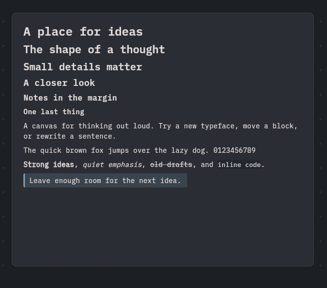
*Rendered text specimen.*

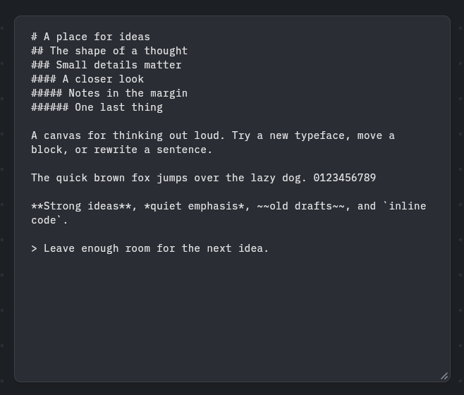
*Markdown source for the specimen.*

*Code sample.*

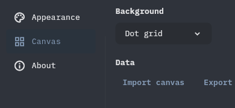
*Canvas settings.*

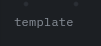
*Small template-label crop.*

### Roboto Mono

The specimen shows the same heading, body, digit, and formatting examples. Its
source and code captures put those characters in editing contexts, and the
settings crop shows compact labels and controls.

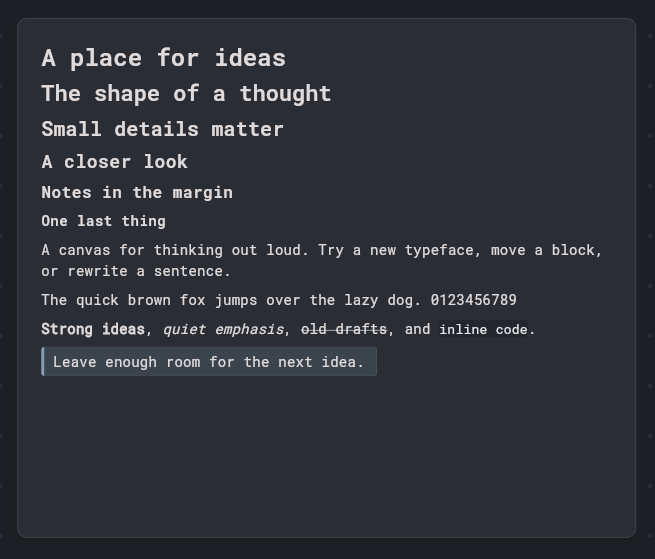
*Rendered text specimen.*

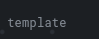
*Markdown source for the specimen.*

*Code sample.*

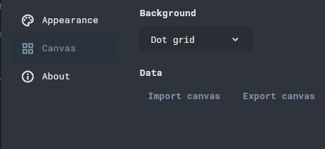
*Canvas settings.*

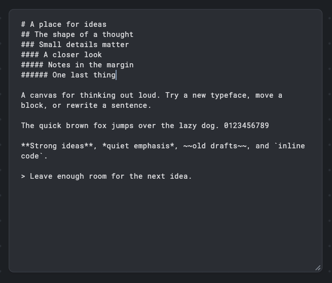
*Small template-label crop.*

### Geist Mono

The specimen and Markdown source show the shared text at rendered and source
stages. The group also includes code and settings captures. Its extra code image
is the exact duplicate noted above, rather than a second independent sample.

*Rendered text specimen.*

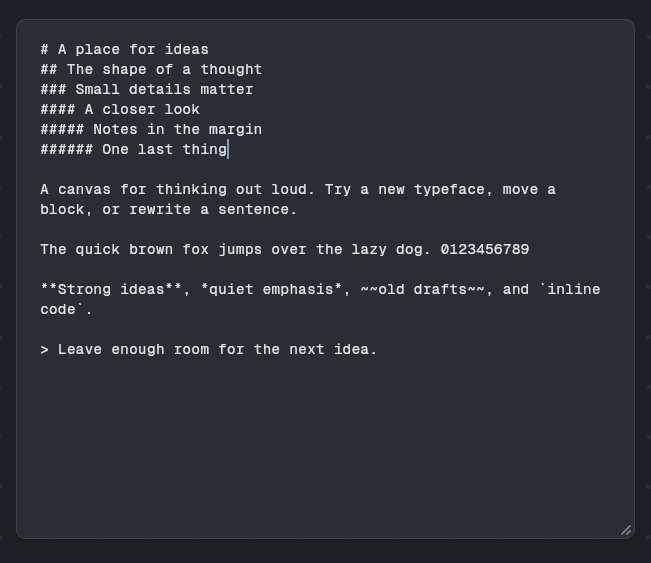
*Markdown source for the specimen.*

*Code sample.*

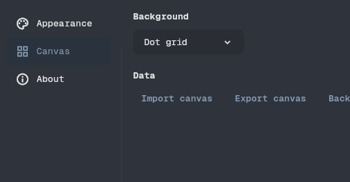
*Canvas settings.*

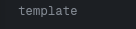
*Small template-label crop.*

*Duplicate retained from the original Geist Mono group.*

### JetBrains Mono

The specimen includes the same range of text sizes and formatting. Its code
capture shows the `ideas.dart` sample, while the settings and source captures
show smaller interface labels and editable Markdown.

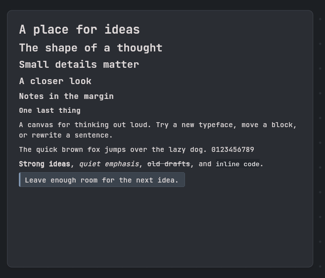
*Rendered text specimen.*

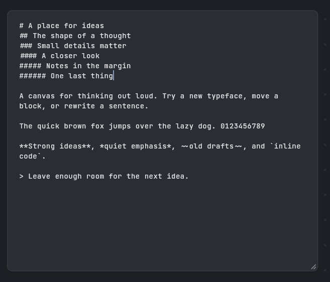
*Markdown source for the specimen.*

*Code sample.*

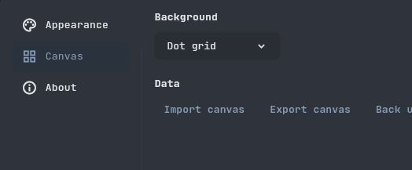
*Canvas settings.*

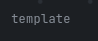
*Small template-label crop.*

## Limits

The screenshots do not document the operating system, browser, font size,
rendering scale, or whether the requested font loaded instead of a fallback.
Their crops and dimensions vary, and they do not test reading with assistive
technology or on other screens. No winner can be established from this evidence.
